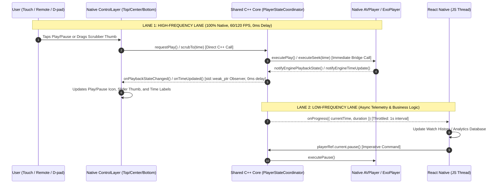

# Enterprise Cross-Platform React Native Video Player: Architecture Specification

> **Quick Navigation**: See [quick-ref.md](file:///Users/ashokammineni/video-player/new_2/Player/quick-ref.md) for the documentation sitemap, code inventory, and the change-to-document update guide.

## 1. Executive Summary & Vision

This project is an enterprise-grade, high-performance, cross-platform video player for React Native (Fabric / New Architecture). It solves the performance, memory, and UX bottlenecks of conventional video libraries by providing:

1. **Pre-Built, High-Performance Native Templates**: Rather than fragmenting playback controls across uncoordinated JSX views or exposing complex styling overhead to developers, the player offers production-ready, beautifully designed native templates (e.g. Cinema / VOD, Minimal / Reel, Live Stream, TV Leanback) with extensive customization props (`accentColor`, `skipInterval`, `autoHideTimeout`, `title`, `template`).
2. **Zero-Latency Direct Native Controls**: All button interactions, touch ripples, scrubbing thumbs, and timeline updates run **100% inside native view hierarchies** at 60/120 FPS with 0ms JavaScript bridge delay.
3. **Shared C++ State Coordinator Core**: A single, robust, memory-safe playback state machine and scrub engine implemented in pure C++ (`PlayerStateCoordinator`). It uses an auto-pruning `std::weak_ptr` observer bus to guarantee zero dangling pointers, thread safety, and identical state behaviors across iOS, Android, and TV.
4. **True Cross-Platform (Mobile & TV First)**: Native support for iOS, Android, Apple TV (tvOS), and Android TV / Fire TV, including remote control / D-pad focus management and leanback ergonomics.
5. **Full System Integration**: Native OS Media Sessions (lock screen, control center, headset buttons), Voice Control (Siri & Google Assistant), Accessibility (VoiceOver & TalkBack), Audio Focus / Interruption Handling, and Picture-in-Picture (PiP).

---

## 2. High-Level Architecture Diagram

```mermaid
graph TD
    subgraph React_Native_Layer ["1. React Native Application Layer (JavaScript / TypeScript)"]
        JSX["<VideoPlayer videoUrl={...} play={...} template='cinema' accentColor='#E50914' />"]
        RN_State["App State / Business Logic / Telemetry Listeners"]
    end

    subgraph Fabric_Bridge ["Fabric Native Interface"]
        Props["Props & Imperative Handle (play, pause, seekTo, setTemplate)"]
        LowFreqEvents["Low-Frequency Telemetry (onProgress, onScriptLoaded, onError)"]
    end

    subgraph Native_UI_Overlay ["2. Native Control Overlay (ControlLayer)"]
        TopBar["TopSection (Title, Back Button, Overflow Menu)"]
        CenterBar["CenterSection (Rewind 15s, Play/Pause Toggle, Forward 15s)"]
        BottomBar["BottomSection (Elapsed Time, 60fps Scrubber, Duration, Fullscreen)"]
        AutoHide["Smart 5s Auto-Hide Controller (Pause & Scrub Immunity)"]
    end

    subgraph Shared_Core ["3. Shared Cross-Platform C++ Core (PlayerStateCoordinator)"]
        StateMachine["Deterministic State Machine (Idle, Loading, Ready, Playing, Paused, Buffering, Ended, Error)"]
        ScrubEngine["3-Phase Scrub Engine (startScrubbing, scrubTo, endScrubbing)"]
        WeakBus["Thread-Safe Observer Bus (std::weak_ptr<IPlayerStateObserver>)"]
    end

    subgraph Platform_Engines ["4. Platform Native Engines & OS Integrations"]
        subgraph iOS_tvOS ["Apple (iOS & tvOS)"]
            AVAdapter["AVPlayerAdapter (IPlaybackEngineBridge)"]
            AVPlayer["AVPlayer & AVPlayerLayer"]
            MPMedia["MPRemoteCommandCenter & MPNowPlayingInfoCenter"]
            A11y_iOS["UIAccessibility & VoiceOver"]
            Focus_tvOS["tvOS UIFocusEngine (D-pad)"]
        end

        subgraph Android_TV ["Android & Android TV"]
            BasePlayer["BasePlayer (Media3 ExoPlayer & PlayerView)"]
            MediaSession["MediaSessionCompat & AudioFocus"]
            A11y_Android["AccessibilityDelegateCompat & TalkBack"]
            Focus_AndroidTV["Android TV D-pad Focus (Leanback)"]
        end
    end

    %% Wiring
    JSX --> Props
    Props --> Native_UI_Overlay
    Props --> Shared_Core

    %% Direct High-Frequency Native Loop
    Native_UI_Overlay <-->|std::weak_ptr Observer & Direct Method Calls| Shared_Core
    Shared_Core <-->|IPlaybackEngineBridge| AVAdapter
    AVAdapter <-->|KVO & Periodic Time Observer| AVPlayer
    Shared_Core <-->|JNI / Direct Bridge| BasePlayer

    %% System Integrations
    Shared_Core <--> MPMedia
    Shared_Core <--> MediaSession
    Native_UI_Overlay --- A11y_iOS
    Native_UI_Overlay --- A11y_Android
    Native_UI_Overlay --- Focus_tvOS
    Native_UI_Overlay --- Focus_AndroidTV

    %% Low-Frequency Telemetry
    Shared_Core -->>|Throttled Events| LowFreqEvents
    LowFreqEvents -->> RN_State
```

---

## 3. The Dual-Lane Data & Event Flow

The player operates on two independent communication lanes to completely decouple 60/120 FPS user touch interactions from JavaScript thread performance:



---

## 4. Layer-by-Layer Technical Specification

### Layer 1: React Native Template-Driven API
Developers consume a single unified, highly performant component with clean configuration props:

```tsx
import React, { useRef } from 'react';
import { StyleSheet, View } from 'react-native';
import { VideoPlayer } from './src';

export default function App() {
  const playerRef = useRef(null);

  return (
    <View style={styles.container}>
      <VideoPlayer
        ref={playerRef}
        videoUrl="https://commondatastorage.googleapis.com/gtv-videos-bucket/sample/BigBuckBunny.mp4"
        play={true}
        template="cinema"              // "cinema" | "minimal" | "live" | "leanback"
        accentColor="#E50914"          // Brand color for scrub bar and highlights
        skipInterval={15}              // Skip interval in seconds
        autoHideTimeout={5000}         // Auto-hide controls after 5 seconds of inactivity
        onScriptLoaded={({ nativeEvent }) => {
          console.log('Player loaded:', nativeEvent.result);
        }}
        style={styles.player}
      />
    </View>
  );
}

const styles = StyleSheet.create({
  container: { flex: 1, backgroundColor: '#000' },
  player: { width: '100%', height: '100%' },
});
```

### Layer 2: Headless Core Player & State Coordinator
The headless core playback engine ([core_player_arch.md](file:///Users/ashokammineni/video-player/new_2/Player/core_player_arch.md)) and shared C++ state coordinator ([state_manager_arch.md](file:///Users/ashokammineni/video-player/new_2/Player/state_manager_arch.md)) contain zero UI and act as the single source of truth across iOS and Android:
- **Zero-UI Separation**: Decoupled from views, buttons, and layouts; purely manages media, timing, tracks, and state.
- **Pure C++ Coordinator (`PlayerStateCoordinator`)**: Symmetrical bridge between inbound caller requests, engine hardware notifications, and outbound observers.
- **Deterministic State Machine**: Validates transitions across `IDLE`, `LOADING`, `READY`, `PLAYING`, `PAUSED`, `BUFFERING`, `ENDED`, and `ERROR`.
- **Scrubbing Engine**: Handles 3-phase scrub lifecycle (`startScrubbing`, `scrubTo`, `endScrubbing`), seek throttling, time clamping, and pre-scrub state restoration.
- **Auto-Pruning Observer Pattern (`IPlayerStateObserver`)**: Thread-safe dispatch of state and time snapshots via `std::weak_ptr` subscriptions with `getActiveObserversLocked()`. This guarantees zero dangling pointers and zero memory corruption even during rapid unmounts or view recycling.

### Layer 3: Native Overlay & Section Layouts
The native control overlay is composed of modular native sections hosted inside a master container:
- **Master Overlay Container (`ControlLayer`)**:
  - Full-bleed overlay above the video render surface.
  - Smart 5-second auto-hide lifecycle with pause immunity and scrub immunity.
  - Background tap-to-toggle visibility gesture.
  - Implements `IPlayerStateObserver` to react instantly to playback events.
- **Center Section (`CenterSection`)**:
  - Rewind button (default 15s), animated Play/Pause toggle, and Forward button (default 15s).
  - Built on [CommonButton](file:///Users/ashokammineni/video-player/new_2/Player/ios/VideoPlayer/Common/CommonButton.h) ensuring 44×44pt (iOS) / 48×48dp (Android) hit targets.
  - Communicates via decoupled delegate/listener interfaces.
- **Top Section (`TopSection`)**:
  - Video title display, back navigation button, and overflow/settings menu.
- **Bottom Section (`BottomSection`)**:
  - Elapsed time label, high-precision 60fps seek bar / slider, duration label, and fullscreen toggle.

### Layer 4: Platform Playback Engines
- **iOS & tvOS**: `AVPlayer` + `AVPlayerLayer` via `AVPlayerAdapter` (implements `IPlaybackEngineBridge`, Metal hardware rendering, FairPlay DRM, HLS adaptive bitrates).
- **Android & Android TV**: `androidx.media3.exoplayer.ExoPlayer` + `PlayerView` via `BasePlayer` (Widevine DRM, DASH/HLS, SurfaceView hardware rendering).

---

## 5. Enterprise Feature Integrations

### A. Mobile & TV (tvOS & Android TV)
- **Leanback Ergonomics**: Tap targets and buttons scale appropriately for 10-foot viewing distances.
- **D-pad Navigation**: Focus engine navigation using tvOS `UIFocusGuide` / `canBecomeFocused` and Android `isFocusable = true` with customized focus rings and animations.
- **Hardware Remote Keys**: Native interception of Play/Pause, Fast Forward, Rewind, and Select keys from Apple TV Siri Remote and Android TV remotes.

### B. Accessibility (A11y) & Screen Readers
- **VoiceOver (iOS) & TalkBack (Android)**:
  - All native buttons have semantic accessibility labels, traits (`button`), and hints (e.g. "Rewind 15 seconds").
  - Slider implements accessible traits (`adjustable`), allowing users to swipe up/down to scrub in 5% increments.
- **Live Announcements**: Automatic announcements on state changes (e.g., announcing "Video Paused" or "Buffering").

### C. Voice Control, Siri, Google Assistant & OS Media Sessions
- **iOS / tvOS**: Integrated with `MPNowPlayingInfoCenter` (metadata, artwork, playback rate, elapsed time) and `MPRemoteCommandCenter` (handling Play, Pause, Skip, and "Hey Siri, skip 30 seconds").
- **Android**: Integrated with `MediaSessionCompat` and `PlaybackStateCompat` to support Google Assistant, Bluetooth headphones, and Android notification controls.

### D. Interruption & Audio Focus Management
- **Audio Becoming Noisy**: Automatically pause playback when headphones are unplugged or Bluetooth disconnects.
- **Interruption Handlers**: Gracefully pause on incoming phone calls or alarms and resume when appropriate.

### E. Picture-in-Picture (PiP) & Background Audio
- Native layers are architected with `AVPictureInPictureController` (iOS) and Android 8.0+ `enterPictureInPictureMode()` to seamlessly detach the video surface into floating windows without crashing overlay components.

---

## 6. Implementation Status & Roadmap

> **Version 1.0 Release Specification**: See [VERSION_1.0_RELEASE.md](file:///Users/ashokammineni/video-player/new_2/Player/VERSION_1.0_RELEASE.md) for the formal v1.0.0 completion audit, acceptance criteria, and subsystem test results.
> **Live Implementation Tracking**: See [TASK_STATUS.md](file:///Users/ashokammineni/video-player/new_2/Player/TASK_STATUS.md) for the active task spotlight, granular component matrix, and agent update protocol.

### Currently Implemented (Active in Codebase):
- **Shared C++ Headless State Coordinator Core (`cpp/`)**:
  - [PlayerTypes.hpp](file:///Users/ashokammineni/video-player/new_2/Player/cpp/PlayerTypes.hpp): Enums (`PlaybackState`) and atomic `PlayerSnapshot` data struct.
  - [IPlayerStateObserver.hpp](file:///Users/ashokammineni/video-player/new_2/Player/cpp/IPlayerStateObserver.hpp): Observer contract for UI overlays, OS Media Sessions, and RN events.
  - [IPlaybackEngineBridge.hpp](file:///Users/ashokammineni/video-player/new_2/Player/cpp/IPlaybackEngineBridge.hpp): Outbound contract for platform playback engines (`executePlay`, `executePause`, `executeSeek`).
  - [PlayerStateCoordinator.hpp](file:///Users/ashokammineni/video-player/new_2/Player/cpp/PlayerStateCoordinator.hpp) & [PlayerStateCoordinator.cpp](file:///Users/ashokammineni/video-player/new_2/Player/cpp/PlayerStateCoordinator.cpp): Thread-safe state machine, mutex-guarded 3-phase scrub engine, auto-pruning `std::weak_ptr` observer bus.
  - Architecture Spec: [state_manager_arch.md](file:///Users/ashokammineni/video-player/new_2/Player/state_manager_arch.md).
- **iOS Native Engine Adapter & Root Wiring**:
  - [AVPlayerAdapter.h](file:///Users/ashokammineni/video-player/new_2/Player/ios/VideoPlayer/Core/AVPlayerAdapter.h) & [AVPlayerAdapter.mm](file:///Users/ashokammineni/video-player/new_2/Player/ios/VideoPlayer/Core/AVPlayerAdapter.mm): Implements `IPlaybackEngineBridge` via in-place `AVPlayerAdapterBridge`, binds `AVPlayer` KVO (`timeControlStatus`, `duration`) and periodic time observer to notify `PlayerStateCoordinator`. Includes playhead-aware buffer range lookup, 0.5s throttling, 30s forward buffer limit, low-latency live edge (`configuredTimeOffsetFromLive = 2.0`), network RTT/ping telemetry via `AVPlayerItemAccessLog`, and in-stream timed metadata parsing via `AVPlayerItemMetadataOutput`.
  - [RCTVideoPlayer.mm](file:///Users/ashokammineni/video-player/new_2/Player/ios/VideoPlayer/RCTVideoPlayer.mm): Instantiates `PlayerStateCoordinator` and `AVPlayerAdapter`, registers observers, wires `ControlLayer`, and handles Fabric view recycling (`prepareForRecycle`) with defensive reload checks on remount.
  - Architecture Spec: [core_player_arch.md](file:///Users/ashokammineni/video-player/new_2/Player/core_player_arch.md).
- **Base Button Primitives (`CommonButton`)**:
  - iOS / tvOS: [CommonButton.h](file:///Users/ashokammineni/video-player/new_2/Player/ios/VideoPlayer/Common/CommonButton.h) & [CommonButton.m](file:///Users/ashokammineni/video-player/new_2/Player/ios/VideoPlayer/Common/CommonButton.m) (Size presets, HIG 44×44pt minimum hit target, spring micro-interactions, tvOS D-pad focus scaling, VoiceOver traits).
  - Android / Android TV: [CommonButton.kt](file:///Users/ashokammineni/video-player/new_2/Player/android/app/src/main/java/com/player/ui/common/CommonButton.kt) (Size presets, Material 48×48dp minimum hit target, Material Ripple, Android TV / Fire TV D-pad focus highlight, TalkBack accessibility).
  - Architecture Spec: [button_arch.md](file:///Users/ashokammineni/video-player/new_2/Player/button_arch.md).
- **Playback Center Section (`CenterSection`)**:
  - iOS / tvOS: [CenterSection.h](file:///Users/ashokammineni/video-player/new_2/Player/ios/VideoPlayer/Layers/ControlLayer/CenterSection/CenterSection.h) & [CenterSection.mm](file:///Users/ashokammineni/video-player/new_2/Player/ios/VideoPlayer/Layers/ControlLayer/CenterSection/CenterSection.mm) (Rewind 15s, Play/Pause toggle, Forward 15s, decoupled via `CenterSectionDelegate`).
  - Android / Android TV: [CenterSection.kt](file:///Users/ashokammineni/video-player/new_2/Player/android/app/src/main/java/com/player/ui/sections/CenterSection.kt) (Rewind 15s, Play/Pause toggle, Forward 15s, decoupled via `CenterSectionListener`).
  - Architecture Spec: [sections_arch.md](file:///Users/ashokammineni/video-player/new_2/Player/sections_arch.md).
- **Playback Bottom Section (`BottomSection`)**:
  - iOS / tvOS: [BottomSection.h](file:///Users/ashokammineni/video-player/new_2/Player/ios/VideoPlayer/Layers/ControlLayer/BottomSection/BottomSection.h) & [BottomSection.mm](file:///Users/ashokammineni/video-player/new_2/Player/ios/VideoPlayer/Layers/ControlLayer/BottomSection/BottomSection.mm) (Monospaced elapsed/duration labels, 60fps timeline scrubber with 3-phase scrub engine, CommonButton fullscreen toggle, auto-hide scrub immunity).
  - Android / Android TV: [BottomSection.kt](file:///Users/ashokammineni/video-player/new_2/Player/android/app/src/main/java/com/player/ui/sections/BottomSection.kt) (Monospaced elapsed/duration labels, SeekBar timeline, CommonButton fullscreen toggle, auto-hide scrub immunity).
  - Architecture Spec: [sections_arch.md](file:///Users/ashokammineni/video-player/new_2/Player/sections_arch.md).
- **Master Overlay Container (`ControlLayer`)**:
  - iOS / tvOS: [ControlLayer.h](file:///Users/ashokammineni/video-player/new_2/Player/ios/VideoPlayer/Layers/ControlLayer/ControlLayer.h) & [ControlLayer.mm](file:///Users/ashokammineni/video-player/new_2/Player/ios/VideoPlayer/Layers/ControlLayer/ControlLayer.mm) (Full-bleed overlay, background tap toggle, smart 5-second auto-hide with pause and scrub immunity, section delegation, wired to `PlayerStateCoordinator` via `std::weak_ptr`).
  - Android / Android TV: [ControlLayer.kt](file:///Users/ashokammineni/video-player/new_2/Player/android/app/src/main/java/com/player/ui/ControlLayer.kt) (FrameLayout overlay, background tap toggle, smart 5-second auto-hide with pause and scrub immunity, section listening, mounted in `ReactVideoPlayer.kt` and wired to ExoPlayer).
  - Architecture Spec: [base_layout_arch.md](file:///Users/ashokammineni/video-player/new_2/Player/base_layout_arch.md).
- **Android C++ JNI Bridge & Root Wiring**:
  - [PlayerStateCoordinatorJni.cpp](file:///Users/ashokammineni/video-player/new_2/Player/android/app/src/main/jni/PlayerStateCoordinatorJni.cpp): Bridges C++ `PlayerStateCoordinator` to JVM with `AndroidPlaybackEngineBridge` and `AndroidStateObserverBridge`.
  - [PlayerStateCoordinator.kt](file:///Users/ashokammineni/video-player/new_2/Player/android/app/src/main/java/com/player/core/PlayerStateCoordinator.kt): Kotlin facade exposing the full 3-phase scrub and deterministic state machine API.
  - [ReactVideoPlayer.kt](file:///Users/ashokammineni/video-player/new_2/Player/android/app/src/main/java/com/player/ReactVideoPlayer.kt): Instantiates coordinator, connects ExoPlayer engine bridge, and pipes state and scrub events directly to `ControlLayer.kt`.
- **Dedicated Networking, Authorization & Hardware DRM Subsystem**:
  - iOS / tvOS: [NetworkAuthManager.h](file:///Users/ashokammineni/video-player/new_2/Player/ios/VideoPlayer/Network/NetworkAuthManager.h) & [NetworkAuthManager.mm](file:///Users/ashokammineni/video-player/new_2/Player/ios/VideoPlayer/Network/NetworkAuthManager.mm) (`AVContentKeySessionDelegate`, Apple FairPlay Streaming SPC <-> CKC exchange, `AVURLAssetHTTPHeaderFieldsKey` injection).
  - Android / Android TV: [NetworkAuthManager.kt](file:///Users/ashokammineni/video-player/new_2/Player/android/app/src/main/java/com/player/network/NetworkAuthManager.kt), [DrmConfig.kt](file:///Users/ashokammineni/video-player/new_2/Player/android/app/src/main/java/com/player/network/DrmConfig.kt), and [TokenRefreshAuthenticator.kt](file:///Users/ashokammineni/video-player/new_2/Player/android/app/src/main/java/com/player/network/TokenRefreshAuthenticator.kt) (`DefaultHttpDataSource.Factory`, Google Widevine Modular L1/L3 via `DefaultDrmSessionManager`, low-latency live streaming via `MediaItem.LiveConfiguration`, `DefaultLoadControl` 1s preroll / 3s rebuffer with time-over-size RAM prioritization, thread-safe token refresh and replay).
  - Architecture Spec: [network_auth_arch.md](file:///Users/ashokammineni/video-player/new_2/Player/network_auth_arch.md).
- **Pure Fabric Native Component & Demo App**:
  - [specs/VideoPlayerNativeComponent.ts](file:///Users/ashokammineni/video-player/new_2/Player/specs/VideoPlayerNativeComponent.ts): Codegen native component specification with `headers?: string` and `drm?: string`.
  - [src/index.tsx](file:///Users/ashokammineni/video-player/new_2/Player/src/index.tsx): Exports typed Fabric `<VideoPlayer />` component with `DrmOptions` and serialized props.
  - iOS Root: [RCTVideoPlayer.h](file:///Users/ashokammineni/video-player/new_2/Player/ios/VideoPlayer/RCTVideoPlayer.h) & [RCTVideoPlayer.mm](file:///Users/ashokammineni/video-player/new_2/Player/ios/VideoPlayer/RCTVideoPlayer.mm) (Pure Fabric `RCTViewComponentView` subclass with typed C++ `Props`).
  - Android Root: [ReactVideoPlayerManager.kt](file:///Users/ashokammineni/video-player/new_2/Player/android/app/src/main/java/com/player/ReactVideoPlayerManager.kt) & [ReactVideoPlayer.kt](file:///Users/ashokammineni/video-player/new_2/Player/android/app/src/main/java/com/player/ReactVideoPlayer.kt).
  - [App.tsx](file:///Users/ashokammineni/video-player/new_2/Player/App.tsx): Clean demo screen rendering `<VideoPlayer />`.

---

### Next Roadmap Milestones:
1. **Analytics & Pluggable Telemetry Subsystem**:
   - Vendor-agnostic plugin architecture (`VideoPlayerAnalyticsPlugin`, `BaseAnalyticsPlugin`).
   - `AnalyticsCoordinator` tracking TTFF, rebuffer ratio, seek latency, and quartile milestones.
   - Built-in `ConsoleAnalyticsPlugin` & `HttpBeaconPlugin`.
   - Architecture Spec: [analytics_arch.md](file:///Users/ashokammineni/video-player/new_2/Player/analytics_arch.md).
2. **Declarative Custom Layout Builder (Schema / Mini-Markup)**:
   - 2-Pillar system: Turnkey Native (fast-path zero overhead) vs. Declarative Custom Layout Builder.
   - Universal schema specification (`LayoutNode`) supporting both JSON and XML layouts.
   - Dual execution modes: **Runtime Inflater (SDUI)** for remote OTA layout updates and **Build-Time AOT Compiler (CLI)** for 0ms parse time and compile-time type safety.
   - Architecture Spec: [layout_builder_arch.md](file:///Users/ashokammineni/video-player/new_2/Player/layout_builder_arch.md).
3. **OS Media Session & TV Remote Focus**:
   - `MPRemoteCommandCenter` & `MPNowPlayingInfoCenter` (iOS/tvOS).
   - `MediaSessionCompat` (Android).
   - D-pad 2D navigation grid focus engine scaling.
4. **Picture-in-Picture (PiP) & Background Playback**:
   - `AVPictureInPictureController` (iOS) & `enterPictureInPictureMode()` (Android).
