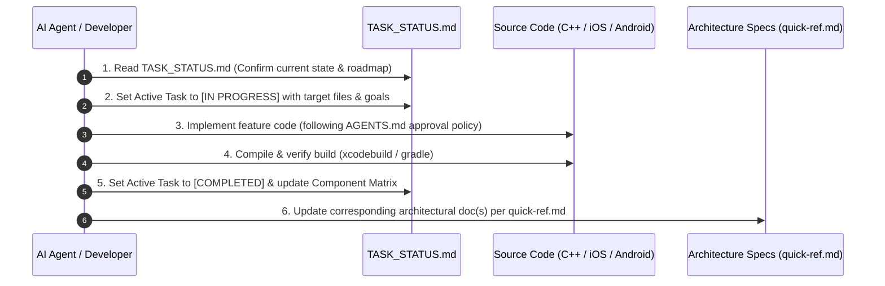

# Live Implementation Tracker & Task Status (`TASK_STATUS.md`)

> **CRITICAL MANDATE FOR ALL AI AGENTS & DEVELOPERS**:
> 1. **Check this file FIRST** before picking up, planning, or executing any task.
> 2. **When starting a task**: Update Section 1 (**Active Task Spotlight**) to mark the task as `[IN PROGRESS]` and list target files.
> 3. **When completing a task / action**:
>    - Mark the task as `[COMPLETED]` in Section 1 and Section 2.
>    - Immediately synchronize the corresponding architecture document(s) as specified in [quick-ref.md](file:///Users/ashokammineni/video-player/new_2/Player/quick-ref.md).
>    - Update the **Last Updated** timestamp at the bottom of this file.

---

## 1. Active Task Spotlight

| Field | Current Details |
| :--- | :--- |
| **Current Task** | Cross-Platform Video ResizeMode & Aspect Ratio Prop (`contain`, `cover`, `stretch`) |
| **Current Status** | `[COMPLETED]` |
| **Primary Platforms** | iOS / tvOS, Android / Android TV (`specs/`, `src/index.tsx`, `RCTVideoPlayer.mm`, `BasePlayer.kt`, `ReactVideoPlayer.kt`, `ReactVideoPlayerManager.kt`) |
| **Target Files** | • [specs/VideoPlayerNativeComponent.ts](file:///Users/ashokammineni/video-player/new_2/Player/specs/VideoPlayerNativeComponent.ts) • [src/index.tsx](file:///Users/ashokammineni/video-player/new_2/Player/src/index.tsx) • [RCTVideoPlayer.mm](file:///Users/ashokammineni/video-player/new_2/Player/ios/VideoPlayer/RCTVideoPlayer.mm) • [BasePlayer.kt](file:///Users/ashokammineni/video-player/new_2/Player/android/app/src/main/java/com/player/videoplayer/BasePlayer.kt) • [ReactVideoPlayer.kt](file:///Users/ashokammineni/video-player/new_2/Player/android/app/src/main/java/com/player/ReactVideoPlayer.kt) • [ReactVideoPlayerManager.kt](file:///Users/ashokammineni/video-player/new_2/Player/android/app/src/main/java/com/player/ReactVideoPlayerManager.kt) • [TASK_STATUS.md](file:///Users/ashokammineni/video-player/new_2/Player/TASK_STATUS.md) |
| **Related Architecture Docs** | • [core_player_arch.md](file:///Users/ashokammineni/video-player/new_2/Player/core_player_arch.md) • [ARCHITECTURE.md](file:///Users/ashokammineni/video-player/new_2/Player/ARCHITECTURE.md) |
| **Acceptance Criteria** | 1. Expose `resizeMode?: string` in `specs/VideoPlayerNativeComponent.ts` and `resizeMode?: 'contain' | 'cover' | 'stretch'` + `aspectRatio?: number | string` in `src/index.tsx`. 2. Map `resizeMode` in iOS `RCTVideoPlayer.mm` to `AVLayerVideoGravityResizeAspect`, `AVLayerVideoGravityResizeAspectFill`, and `AVLayerVideoGravityResize`. 3. Map `resizeMode` in Android `BasePlayer.kt` to `RESIZE_MODE_FIT`, `RESIZE_MODE_ZOOM`, and `RESIZE_MODE_FILL`. 4. Center `PlayerView` with black letterbox background on Android to match iOS. 5. Verified compilation on both platforms (`xcodebuild` exit 0, `./gradlew assembleDebug` exit 0). |

---

## 2. Component Implementation & Milestone Matrix

### Status Legend
- `[COMPLETED]`: Fully implemented, verified, and active in codebase.
- `[IN PROGRESS]`: Actively being written or refined.
- `[STUB / SKELETON]`: Preliminary file or placeholder exists; requires complete implementation.
- `[PLANNED]`: Architected and scheduled on the roadmap.

### A. Shared Headless Core & State Machine
| Component | Files / Scope | Status | Notes |
| :--- | :--- | :--- | :--- |
| **State Machine & Scrub Engine** | [PlayerStateCoordinator.cpp](file:///Users/ashokammineni/video-player/new_2/Player/cpp/PlayerStateCoordinator.cpp), [PlayerStateCoordinator.hpp](file:///Users/ashokammineni/video-player/new_2/Player/cpp/PlayerStateCoordinator.hpp) | `[COMPLETED]` | Pure C++17, mutex-guarded, 3-phase scrub engine, zero UI dependencies. |
| **Types & Snapshot Struct** | [PlayerTypes.hpp](file:///Users/ashokammineni/video-player/new_2/Player/cpp/PlayerTypes.hpp) | `[COMPLETED]` | Enums (`PlaybackState`) and immutable `PlayerSnapshot`. |
| **Observer Interface** | [IPlayerStateObserver.hpp](file:///Users/ashokammineni/video-player/new_2/Player/cpp/IPlayerStateObserver.hpp) | `[COMPLETED]` | Safe `std::weak_ptr` observer bus with auto-pruning. |
| **Engine Bridge Contract** | [IPlaybackEngineBridge.hpp](file:///Users/ashokammineni/video-player/new_2/Player/cpp/IPlaybackEngineBridge.hpp) | `[COMPLETED]` | Inbound engine command contract (`executePlay`, `executeSeek`, etc.). |
| **Android JNI Bridge** | [PlayerStateCoordinatorJni.cpp](file:///Users/ashokammineni/video-player/new_2/Player/android/app/src/main/jni/PlayerStateCoordinatorJni.cpp), [PlayerStateCoordinator.kt](file:///Users/ashokammineni/video-player/new_2/Player/android/app/src/main/java/com/player/core/PlayerStateCoordinator.kt) | `[COMPLETED]` | Full bidirectional JNI binding between Kotlin and pure C++ coordinator. |

### B. Base Primitives & Master Overlay Container
| Component | Platform | Files | Status | Notes |
| :--- | :--- | :--- | :--- | :--- |
| **CommonButton** | iOS / tvOS | [CommonButton.m](file:///Users/ashokammineni/video-player/new_2/Player/ios/VideoPlayer/Common/CommonButton.m) | `[COMPLETED]` | 44×44pt minimum hit target, spring micro-interactions, tvOS focus. |
| **CommonButton** | Android / TV | [CommonButton.kt](file:///Users/ashokammineni/video-player/new_2/Player/android/app/src/main/java/com/player/ui/common/CommonButton.kt) | `[COMPLETED]` | 48×48dp minimum hit target, Material ripple, Android TV focus highlight. |
| **ControlLayer (Overlay Container)** | iOS / tvOS | [ControlLayer.mm](file:///Users/ashokammineni/video-player/new_2/Player/ios/VideoPlayer/Layers/ControlLayer/ControlLayer.mm) | `[COMPLETED]` | Full-bleed overlay with direct top/center/bottom AutoLayout pinning (Android FrameLayout parity), 5s auto-hide with pause and scrub immunity, C++ observer hookup. |
| **ControlLayer (Overlay Container)** | Android / TV | [ControlLayer.kt](file:///Users/ashokammineni/video-player/new_2/Player/android/app/src/main/java/com/player/ui/ControlLayer.kt) | `[COMPLETED]` | FrameLayout overlay, 5s auto-hide with pause and scrub immunity, wired to C++ coordinator via JNI. |

### C. Control Sections
| Section | Platform | Files | Status | Notes |
| :--- | :--- | :--- | :--- | :--- |
| **CenterSection** | iOS / tvOS | [CenterSection.mm](file:///Users/ashokammineni/video-player/new_2/Player/ios/VideoPlayer/Layers/ControlLayer/CenterSection/CenterSection.mm) | `[COMPLETED]` | Rewind 15s, Play/Pause toggle, Forward 15s; wired via `CenterSectionDelegate`. |
| **CenterSection** | Android / TV | [CenterSection.kt](file:///Users/ashokammineni/video-player/new_2/Player/android/app/src/main/java/com/player/ui/sections/CenterSection.kt) | `[COMPLETED]` | Rewind 15s, Play/Pause toggle, Forward 15s; wired via `CenterSectionListener`. |
| **BottomSection** | iOS / tvOS | [BottomSection.mm](file:///Users/ashokammineni/video-player/new_2/Player/ios/VideoPlayer/Layers/ControlLayer/BottomSection/BottomSection.mm) | `[COMPLETED]` | Full timeline with monospaced time labels, 60fps scrub binding to coordinator, fullscreen toggle. |
| **BottomSection** | Android / TV | [BottomSection.kt](file:///Users/ashokammineni/video-player/new_2/Player/android/app/src/main/java/com/player/ui/sections/BottomSection.kt) | `[COMPLETED]` | Full timeline with monospaced time labels, 60fps 3-phase C++ scrub binding, fullscreen toggle, auto-hide immunity. |
| **TopSection** | iOS / tvOS | [TopSection.mm](file:///Users/ashokammineni/video-player/new_2/Player/ios/VideoPlayer/Layers/ControlLayer/TopSection/TopSection.mm) | `[COMPLETED]` | Back button, title label, captions & settings actions; detached from safe area margins via `insetsLayoutMarginsFromSafeArea = NO` for flush top alignment; wired via `TopSectionDelegate`. |
| **TopSection** | Android / TV | [TopSection.kt](file:///Users/ashokammineni/video-player/new_2/Player/android/app/src/main/java/com/player/ui/sections/TopSection.kt) | `[COMPLETED]` | Back button, title label, captions & settings actions; wired via `TopSectionListener`. |

### D. Platform Native Adapters & Roots
| Component | Platform | Files | Status | Notes |
| :--- | :--- | :--- | :--- | :--- |
| **AVPlayerAdapter** | iOS / tvOS | [AVPlayerAdapter.mm](file:///Users/ashokammineni/video-player/new_2/Player/ios/VideoPlayer/Core/AVPlayerAdapter.mm) | `[COMPLETED]` | Binds AVPlayer KVO & periodic time observer to coordinator; includes in-place `AVPlayerAdapterBridge`, idempotent cleanup, and `self.observedItem` tracking. |
| **RCTVideoPlayer** | iOS / tvOS | [RCTVideoPlayer.mm](file:///Users/ashokammineni/video-player/new_2/Player/ios/VideoPlayer/RCTVideoPlayer.mm) | `[COMPLETED]` | Root Fabric view instantiating coordinator, AVPlayerLayer, and ControlLayer; clean teardown disconnecting `playerLayer.player`. |
| **BasePlayer** | Android / TV | [BasePlayer.kt](file:///Users/ashokammineni/video-player/new_2/Player/android/app/src/main/java/com/player/videoplayer/BasePlayer.kt) | `[COMPLETED]` | Media3 ExoPlayer wrapper with `onPlaybackStateListener`. |
| **ReactVideoPlayer** | Android / TV | [ReactVideoPlayer.kt](file:///Users/ashokammineni/video-player/new_2/Player/android/app/src/main/java/com/player/ReactVideoPlayer.kt) | `[COMPLETED]` | Root FrameLayout mounting `PlayerView`, `ControlLayer`, and `PlayerStateCoordinator` via JNI. |

### E. Networking, Authorization & Hardware DRM Subsystem
| Component | Platform | Files | Status | Notes |
| :--- | :--- | :--- | :--- | :--- |
| **NetworkAuthManager** | iOS / tvOS | [NetworkAuthManager.h](file:///Users/ashokammineni/video-player/new_2/Player/ios/VideoPlayer/Network/NetworkAuthManager.h), [NetworkAuthManager.mm](file:///Users/ashokammineni/video-player/new_2/Player/ios/VideoPlayer/Network/NetworkAuthManager.mm) | `[COMPLETED]` | AVURLAssetHTTPHeaderFieldsKey injection, AVContentKeySession FairPlay SPC <-> CKC exchange. |
| **NetworkAuthManager** | Android / TV | [NetworkAuthManager.kt](file:///Users/ashokammineni/video-player/new_2/Player/android/app/src/main/java/com/player/network/NetworkAuthManager.kt), [DrmConfig.kt](file:///Users/ashokammineni/video-player/new_2/Player/android/app/src/main/java/com/player/network/DrmConfig.kt), [TokenRefreshAuthenticator.kt](file:///Users/ashokammineni/video-player/new_2/Player/android/app/src/main/java/com/player/network/TokenRefreshAuthenticator.kt) | `[COMPLETED]` | DefaultHttpDataSource.Factory, DefaultDrmSessionManager Widevine L1/L3, thread-safe token renewal. |
| **Fabric Network Props** | Cross-Platform | [specs/VideoPlayerNativeComponent.ts](file:///Users/ashokammineni/video-player/new_2/Player/specs/VideoPlayerNativeComponent.ts), [src/index.tsx](file:///Users/ashokammineni/video-player/new_2/Player/src/index.tsx) | `[COMPLETED]` | Typed `headers?: Record<string, string>`, `drm?: DrmOptions` serialized to Fabric. |

### F. High-Level Integrations & Features
| Feature | Files | Status | Notes |
| :--- | :--- | :--- | :--- |
| **React Native Export** | [src/index.tsx](file:///Users/ashokammineni/video-player/new_2/Player/src/index.tsx), [specs/VideoPlayerNativeComponent.ts](file:///Users/ashokammineni/video-player/new_2/Player/specs/VideoPlayerNativeComponent.ts) | `[COMPLETED]` | Native component export and prop specs. |
| **Sample Demo App** | [App.tsx](file:///Users/ashokammineni/video-player/new_2/Player/App.tsx) | `[COMPLETED]` | Sample harness playing Big Buck Bunny. |
| **Template Customization Engine** | iOS & Android | `[PLANNED]` | Native template switcher (`cinema`, `minimal`, `live`, `leanback`). |
| **OS Media Sessions** | iOS & Android | `[PLANNED]` | `MPRemoteCommandCenter` / `MPNowPlayingInfoCenter` & `MediaSessionCompat`. |
| **TV D-pad 2D Focus Grid** | tvOS & Android TV | `[PLANNED]` | Full 2D focus traversal between Top, Center, and Bottom sections. |
| **Picture-in-Picture (PiP)** | iOS & Android | `[PLANNED]` | Background playback and PiP controllers. |

---

## 3. Agent Protocol & Implementation Workflow

Whenever an AI agent or developer works in this repository, they MUST execute this 3-step synchronization protocol:

### Detailed Steps:
1. **Before Taking Action**:
   - Inspect [TASK_STATUS.md](file:///Users/ashokammineni/video-player/new_2/Player/TASK_STATUS.md) to understand current focus and active task dependencies.
   - Update Section 1 (**Active Task Spotlight**) with the new task name, target files, and `[IN PROGRESS]` status.
2. **During Implementation**:
   - Follow [AGENTS.md](file:///Users/ashokammineni/video-player/new_2/Player/AGENTS.md) Strict User Approval Policy (obtain user confirmation before mutating files).
   - Adhere to the 11 Core Principles (DRY, pure C++ shared state, TV focus, A11y, 60/120 FPS performance).
3. **Upon Task Completion**:
   - Update Section 1 of [TASK_STATUS.md](file:///Users/ashokammineni/video-player/new_2/Player/TASK_STATUS.md) to mark the task `[COMPLETED]`.
   - Update Section 2 (**Component Implementation & Milestone Matrix**) with the new status and notes.
   - Update the respective documentation specified in the **Document Synchronization Map** below.

---

## 4. Document Synchronization Map

When a task in a specific subsystem is modified, the agent must update the following architectural files:

| Subsystem Modified | Files Changed | Required Document Updates |
| :--- | :--- | :--- |
| **Task / Milestone Status** | Any feature started or finished | • **[TASK_STATUS.md](file:///Users/ashokammineni/video-player/new_2/Player/TASK_STATUS.md)** (Section 1 & 2) • **[ARCHITECTURE.md](file:///Users/ashokammineni/video-player/new_2/Player/ARCHITECTURE.md)** (Section 6) |
| **Buttons / Primitives** | `CommonButton.*` | • **[button_arch.md](file:///Users/ashokammineni/video-player/new_2/Player/button_arch.md)** |
| **Control Sections** | `CenterSection.*`, `BottomSection.*`, `TopSection.*` | • **[sections_arch.md](file:///Users/ashokammineni/video-player/new_2/Player/sections_arch.md)** |
| **Overlay / Auto-Hide** | `ControlLayer.*` | • **[base_layout_arch.md](file:///Users/ashokammineni/video-player/new_2/Player/base_layout_arch.md)** |
| **C++ Core / State Machine** | `PlayerStateCoordinator.*`, `cpp/` | • **[state_manager_arch.md](file:///Users/ashokammineni/video-player/new_2/Player/state_manager_arch.md)** • **[core_player_arch.md](file:///Users/ashokammineni/video-player/new_2/Player/core_player_arch.md)** |
| **System Architecture / API**| `RCTVideoPlayer.*`, `ReactVideoPlayer.*`, `src/index.tsx` | • **[ARCHITECTURE.md](file:///Users/ashokammineni/video-player/new_2/Player/ARCHITECTURE.md)** |
| **Networking, Auth & DRM** | `NetworkAuthManager.*`, `DrmConfig.*` | • **[network_auth_arch.md](file:///Users/ashokammineni/video-player/new_2/Player/network_auth_arch.md)** • **[USAGE_GUIDE.md](file:///Users/ashokammineni/video-player/new_2/Player/USAGE_GUIDE.md)** |
| **Rules / Workflow** | Policies, agent instructions | • **[AGENTS.md](file:///Users/ashokammineni/video-player/new_2/Player/AGENTS.md)** |

---

*Last Updated: 2026-10-25*
