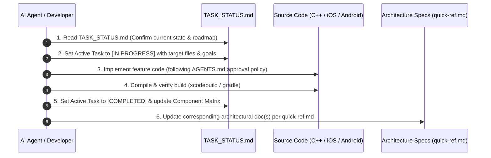

# Live Implementation Tracker & Task Status (`TASK_STATUS.md`)

> **CRITICAL MANDATE FOR ALL AI AGENTS & DEVELOPERS**:
> 1. **Check this file FIRST** before picking up, planning, or executing any task.
> 2. **When starting a task**: Update Section 1 (**Active Task Spotlight**) to mark the task as `[IN PROGRESS]` and list target files.
> 3. **When completing a task / action**:
>    - Mark the task as `[COMPLETED]` in Section 1 and Section 2.
>    - Immediately synchronize the corresponding architecture document(s) as specified in [quick-ref.md](file:///Users/ashokammineni/video-player/new_2/Player/quick-ref.md).
>    - Update the **Last Updated** timestamp at the bottom of this file.

---

## 1. Active Task Spotlight

| Field | Current Details |
| :--- | :--- |
| **Current Task** | Shared C++ Core Concurrency, Memory Safety, Transition Matrix & Observer Notification Bug Fixes |
| **Current Status** | `[COMPLETED]` |
| **Primary Platforms** | Cross-Platform Shared C++ Core (`cpp/`) |
| **Target Files** | • `cpp/PlayerStateCoordinator.cpp` • `cpp/PlayerStateCoordinator.hpp` • `cpp/IPlayerStateObserver.hpp` • `cpp/IPlaybackEngineBridge.hpp` • `cpp/PlayerTypes.hpp` |
| **Related Architecture Docs** | • [ARCHITECTURE.md](file:///Users/ashokammineni/video-player/new_2/Player/ARCHITECTURE.md) • [state_manager_arch.md](file:///Users/ashokammineni/video-player/new_2/Player/state_manager_arch.md) • [quick-ref.md](file:///Users/ashokammineni/video-player/new_2/Player/quick-ref.md) |
| **Acceptance Criteria** | 1. Fix data race in `requestVolume()`, `requestMute()`, `requestPlaybackRate()` by capturing snapshot values within mutex lock before unlock. 2. Migrate `bridge_` to `std::shared_ptr<IPlaybackEngineBridge>` with copy-inside-lock semantics to eliminate TOCTOU use-after-free risks. 3. Enforce destructor lifetime ordering (clear bridge before observers) and add exception guards around bridge calls. 4. Add whitelist transition validation matrix in `isValidTransition()` and check in `notifyEngineState()`. 5. Notify registered observers on mute, playback rate, and volume changes with backward-compatible overloads in `IPlayerStateObserver`. 6. Add missing `default: return "Unknown";` in `PlaybackStateToString()`. |

---

## 2. Component Implementation & Milestone Matrix

### Status Legend
- `[COMPLETED]`: Fully implemented, verified, and active in codebase.
- `[IN PROGRESS]`: Actively being written or refined.
- `[STUB / SKELETON]`: Preliminary file or placeholder exists; requires complete implementation.
- `[PLANNED]`: Architected and scheduled on the roadmap.

### A. Shared Headless Core & State Machine
| Component | Files / Scope | Status | Notes |
| :--- | :--- | :--- | :--- |
| **State Machine & Scrub Engine** | [PlayerStateCoordinator.cpp](file:///Users/ashokammineni/video-player/new_2/Player/cpp/PlayerStateCoordinator.cpp), [PlayerStateCoordinator.hpp](file:///Users/ashokammineni/video-player/new_2/Player/cpp/PlayerStateCoordinator.hpp) | `[COMPLETED]` | Pure C++17, mutex-guarded, 3-phase scrub engine, zero UI dependencies. |
| **Types & Snapshot Struct** | [PlayerTypes.hpp](file:///Users/ashokammineni/video-player/new_2/Player/cpp/PlayerTypes.hpp) | `[COMPLETED]` | Enums (`PlaybackState`) and immutable `PlayerSnapshot`. |
| **Observer Interface** | [IPlayerStateObserver.hpp](file:///Users/ashokammineni/video-player/new_2/Player/cpp/IPlayerStateObserver.hpp) | `[COMPLETED]` | Safe `std::weak_ptr` observer bus with auto-pruning. |
| **Engine Bridge Contract** | [IPlaybackEngineBridge.hpp](file:///Users/ashokammineni/video-player/new_2/Player/cpp/IPlaybackEngineBridge.hpp) | `[COMPLETED]` | Inbound engine command contract (`executePlay`, `executeSeek`, etc.). |
| **Android JNI Bridge** | [PlayerStateCoordinatorJni.cpp](file:///Users/ashokammineni/video-player/new_2/Player/android/app/src/main/jni/PlayerStateCoordinatorJni.cpp), [PlayerStateCoordinator.kt](file:///Users/ashokammineni/video-player/new_2/Player/android/app/src/main/java/com/player/core/PlayerStateCoordinator.kt) | `[COMPLETED]` | Full bidirectional JNI binding between Kotlin and pure C++ coordinator. |

### B. Base Primitives & Master Overlay Container
| Component | Platform | Files | Status | Notes |
| :--- | :--- | :--- | :--- | :--- |
| **CommonButton** | iOS / tvOS | [CommonButton.m](file:///Users/ashokammineni/video-player/new_2/Player/ios/VideoPlayer/Common/CommonButton.m) | `[COMPLETED]` | 44×44pt minimum hit target, spring micro-interactions, tvOS focus. |
| **CommonButton** | Android / TV | [CommonButton.kt](file:///Users/ashokammineni/video-player/new_2/Player/android/app/src/main/java/com/player/ui/common/CommonButton.kt) | `[COMPLETED]` | 48×48dp minimum hit target, Material ripple, Android TV focus highlight. |
| **ControlLayer (Overlay Container)** | iOS / tvOS | [ControlLayer.mm](file:///Users/ashokammineni/video-player/new_2/Player/ios/VideoPlayer/Layers/ControlLayer/ControlLayer.mm) | `[COMPLETED]` | Full-bleed overlay with direct safe area AutoLayout pinning (`safeAreaLayoutGuide`) for top and bottom sections, 5s auto-hide with pause and scrub immunity, dynamically sized gradient scrims (`topInset + 54`), touch-swallowing protection, and C++ observer hookup. |
| **ControlLayer (Overlay Container)** | Android / TV | [ControlLayer.kt](file:///Users/ashokammineni/video-player/new_2/Player/android/app/src/main/java/com/player/ui/ControlLayer.kt) | `[COMPLETED]` | FrameLayout overlay, 5s auto-hide with pause and scrub immunity, top/bottom gradient contrast scrims, ghost-tap prevention via View.GONE end actions, periodic buffer/time dispatch to C++ coordinator, dynamic safe area vertical centering, and lifecycle `onAttachedToWindow` time resume on fullscreen Dialog re-attachment. |

### C. Control Sections
| Section | Platform | Files | Status | Notes |
| :--- | :--- | :--- | :--- | :--- |
| **CenterSection** | iOS / tvOS | [CenterSection.mm](file:///Users/ashokammineni/video-player/new_2/Player/ios/VideoPlayer/Layers/ControlLayer/CenterSection/CenterSection.mm) | `[COMPLETED]` | Rewind 15s, Play/Pause toggle, Forward 15s; wired via `CenterSectionDelegate`. |
| **CenterSection** | Android / TV | [CenterSection.kt](file:///Users/ashokammineni/video-player/new_2/Player/android/app/src/main/java/com/player/ui/sections/CenterSection.kt) | `[COMPLETED]` | Rewind 15s, Play/Pause toggle, Forward 15s; wired via `CenterSectionListener`. |
| **BottomSection** | iOS / tvOS | [BottomSection.mm](file:///Users/ashokammineni/video-player/new_2/Player/ios/VideoPlayer/Layers/ControlLayer/BottomSection/BottomSection.mm) | `[COMPLETED]` | Full timeline with monospaced time labels, 60fps scrub binding to coordinator, dual-track scrubber with secondary `UIProgressView` buffer visualization, pinned to `safeAreaLayoutGuide.bottomAnchor` to avoid home indicator bar, fullscreen toggle. |
| **BottomSection** | Android / TV | [BottomSection.kt](file:///Users/ashokammineni/video-player/new_2/Player/android/app/src/main/java/com/player/ui/sections/BottomSection.kt) | `[COMPLETED]` | Full timeline with monospaced time labels, 60fps 3-phase C++ scrub binding, `seekBar.secondaryProgress` buffer progress visualization, fullscreen toggle. |
| **TopSection** | iOS / tvOS | [TopSection.mm](file:///Users/ashokammineni/video-player/new_2/Player/ios/VideoPlayer/Layers/ControlLayer/TopSection/TopSection.mm) | `[COMPLETED]` | Back button, title label, captions & settings actions; pinned to `safeAreaLayoutGuide.topAnchor` with `insetsLayoutMarginsFromSafeArea = NO` to automatically clear Dynamic Island / notch without double-insetting; wired via `TopSectionDelegate`. |
| **TopSection** | Android / TV | [TopSection.kt](file:///Users/ashokammineni/video-player/new_2/Player/android/app/src/main/java/com/player/ui/sections/TopSection.kt) | `[COMPLETED]` | Back button, title label, captions & settings actions; wired via `TopSectionListener`. |

### D. Platform Native Adapters & Roots
| Component | Platform | Files | Status | Notes |
| :--- | :--- | :--- | :--- | :--- |
| **AVPlayerAdapter** | iOS / tvOS | [AVPlayerAdapter.mm](file:///Users/ashokammineni/video-player/new_2/Player/ios/VideoPlayer/Core/AVPlayerAdapter.mm) | `[COMPLETED]` | Binds AVPlayer KVO & periodic time observer to coordinator; includes in-place `AVPlayerAdapterBridge`, playhead-aware buffer range lookup, 0.5s throttling, 30s forward buffer limit, low-latency live edge (`configuredTimeOffsetFromLive = 2.0s`), `AVPlayerItemAccessLog` network telemetry, and `AVPlayerItemMetadataOutput` timed metadata. |
| **RCTVideoPlayer** | iOS / tvOS | [RCTVideoPlayer.mm](file:///Users/ashokammineni/video-player/new_2/Player/ios/VideoPlayer/RCTVideoPlayer.mm) | `[COMPLETED]` | Root Fabric view instantiating coordinator, AVPlayerLayer, and ControlLayer; clean teardown disconnecting `playerLayer.player`. |
| **BasePlayer** | Android / TV | [BasePlayer.kt](file:///Users/ashokammineni/video-player/new_2/Player/android/app/src/main/java/com/player/videoplayer/BasePlayer.kt) | `[COMPLETED]` | Media3 ExoPlayer wrapper with optimized `DefaultLoadControl` (1.0s preroll / 30s max / 3.0s rebuffer with time-over-size RAM prioritization), `AnalyticsListener` (ping/throughput), `onMetadata` listener, `onVideoSizeChangedListener` forwarding to resolve React Native Fabric layout suppression, and `useController = false` / `controllerAutoShow = false` in `init` to eliminate default controls leak on mount. |
| **ReactVideoPlayer** | Android / TV | [ReactVideoPlayer.kt](file:///Users/ashokammineni/video-player/new_2/Player/android/app/src/main/java/com/player/ReactVideoPlayer.kt) | `[COMPLETED]` | Root FrameLayout mounting `PlayerView`, `ControlLayer`, and `PlayerStateCoordinator` via JNI; safe area insets & fullscreen Dialog; implements `LifecycleEventListener` for automatic playback pause on app background/minimize and resource cleanup on host destroy (full iOS parity). |

### E. Networking, Authorization & Hardware DRM Subsystem
| Component | Platform | Files | Status | Notes |
| :--- | :--- | :--- | :--- | :--- |
| **NetworkAuthManager** | iOS / tvOS | [NetworkAuthManager.h](file:///Users/ashokammineni/video-player/new_2/Player/ios/VideoPlayer/Network/NetworkAuthManager.h), [NetworkAuthManager.mm](file:///Users/ashokammineni/video-player/new_2/Player/ios/VideoPlayer/Network/NetworkAuthManager.mm) | `[COMPLETED]` | AVURLAssetHTTPHeaderFieldsKey injection, AVContentKeySession FairPlay SPC <-> CKC exchange. |
| **NetworkAuthManager** | Android / TV | [NetworkAuthManager.kt](file:///Users/ashokammineni/video-player/new_2/Player/android/app/src/main/java/com/player/network/NetworkAuthManager.kt), [DrmConfig.kt](file:///Users/ashokammineni/video-player/new_2/Player/android/app/src/main/java/com/player/network/DrmConfig.kt), [TokenRefreshAuthenticator.kt](file:///Users/ashokammineni/video-player/new_2/Player/android/app/src/main/java/com/player/network/TokenRefreshAuthenticator.kt) | `[COMPLETED]` | DefaultHttpDataSource.Factory, DefaultDrmSessionManager Widevine L1/L3, thread-safe token renewal, low-latency LiveConfiguration. |
| **Network & Latency Telemetry** | Cross-Platform | [BasePlayer.kt](file:///Users/ashokammineni/video-player/new_2/Player/android/app/src/main/java/com/player/videoplayer/BasePlayer.kt), [AVPlayerAdapter.mm](file:///Users/ashokammineni/video-player/new_2/Player/ios/VideoPlayer/Core/AVPlayerAdapter.mm), [PlayerStateCoordinator.cpp](file:///Users/ashokammineni/video-player/new_2/Player/cpp/PlayerStateCoordinator.cpp) | `[COMPLETED]` | Zero-bloat chunk RTT/ping and bandwidth telemetry piped to C++ coordinator snapshot and observer bus; live low-latency offset; built-in ID3 and SCTE-35 metadata parsers. |
| **Fabric Network Props** | Cross-Platform | [specs/VideoPlayerNativeComponent.ts](file:///Users/ashokammineni/video-player/new_2/Player/specs/VideoPlayerNativeComponent.ts), [src/index.tsx](file:///Users/ashokammineni/video-player/new_2/Player/src/index.tsx) | `[COMPLETED]` | Typed `headers?: Record<string, string>`, `drm?: DrmOptions` serialized to Fabric. |

### F. High-Level Integrations & Features
| Feature | Files | Status | Notes |
| :--- | :--- | :--- | :--- |
| **React Native Export** | [src/index.tsx](file:///Users/ashokammineni/video-player/new_2/Player/src/index.tsx), [specs/VideoPlayerNativeComponent.ts](file:///Users/ashokammineni/video-player/new_2/Player/specs/VideoPlayerNativeComponent.ts) | `[COMPLETED]` | Native component export and prop specs. |
| **Controlled Native Fullscreen** | [specs/VideoPlayerNativeComponent.ts](file:///Users/ashokammineni/video-player/new_2/Player/specs/VideoPlayerNativeComponent.ts), [src/index.tsx](file:///Users/ashokammineni/video-player/new_2/Player/src/index.tsx), [RCTVideoPlayer.mm](file:///Users/ashokammineni/video-player/new_2/Player/ios/VideoPlayer/RCTVideoPlayer.mm), [ReactVideoPlayer.kt](file:///Users/ashokammineni/video-player/new_2/Player/android/app/src/main/java/com/player/ReactVideoPlayer.kt) | `[COMPLETED]` | Native fullscreen button toggling landscape orientation and immersive system bars, bidirectional sync via `fullscreen` prop and `onFullscreenChange` event. |
| **Sample Demo App** | [App.tsx](file:///Users/ashokammineni/video-player/new_2/Player/App.tsx) | `[COMPLETED]` | Sample harness playing Big Buck Bunny with controlled fullscreen demonstration. |
| **AOT Build-Time Theme & Asset Compiler** | [scripts/build-theme.js](file:///Users/ashokammineni/video-player/new_2/Player/scripts/build-theme.js), `PlayerThemeGenerated.*` | `[COMPLETED]` | Pre-build AOT compiler parsing `player-theme.json`, validating assets/colors/numbers with fail-fast errors, auto-copying image assets into Android `res/drawable` & iOS resources, and inlining native constants into machine code. |
| **Testing Architecture & Enterprise Benchmarks** | [TESTING_ARCHITECTURE.md](file:///Users/ashokammineni/video-player/new_2/Player/TESTING_ARCHITECTURE.md), `scripts/test-*` | `[COMPLETED]` | Comprehensive multi-tier testing pyramid (C++ Core, Native Engines, UI, Fabric, E2E), load & channel flipping, 100-cycle memory soak, 12h soak, chaos/network injection, production benchmarks table, and automation scripts. |
| **Declarative JSON Theming & Bundled Config** | [src/default-player-config.json](file:///Users/ashokammineni/video-player/new_2/Player/src/default-player-config.json), [src/index.tsx](file:///Users/ashokammineni/video-player/new_2/Player/src/index.tsx) | `[COMPLETED]` | Declarative design tokens schema (`PlayerConfig` with `theme`, `icons`, `behavior`), bundled at build time with Metro; `readFromJson` and `config` props with 0ms runtime I/O overhead. |
| **Customizable Controls & Replaceable Icons** | [specs/VideoPlayerNativeComponent.ts](file:///Users/ashokammineni/video-player/new_2/Player/specs/VideoPlayerNativeComponent.ts), [CommonButton.*](file:///Users/ashokammineni/video-player/new_2/Player/ios/VideoPlayer/Common/CommonButton.m), [sections/](file:///Users/ashokammineni/video-player/new_2/Player/ios/VideoPlayer/Layers/ControlLayer/) | `[COMPLETED]` | Full replacement of all center/bottom/top icons (local assets, SF Symbols, drawables, remote URLs); custom scrubber notch (`UISlider.setThumbImage:forState:` / `SeekBar.thumb`), timeline track & buffer tinting (`accentColor`, `trackColor`, `bufferColor`), configurable skip intervals and auto-hide timing. |

### G. Metadata, Subtitles & Thumbnail Subsystem
| Component | Platform | Files | Status | Notes |
| :--- | :--- | :--- | :--- | :--- |
| **MediaMetadataResolver** | Cross-Platform | `com.player.metadata.MediaMetadataResolver`, `ios/VideoPlayer/Metadata/MediaMetadataResolver` | `[COMPLETED]` | 3-tier hierarchy: explicit prop override, embedded stream tags (MP4 `©nam`, ID3 `TIT2`, ICY headers), and clean URL slug sanitizer. |
| **SubtitleManager** | Cross-Platform | `com.player.subtitles.SubtitleManager`, `ios/VideoPlayer/Subtitles/SubtitleManager` | `[COMPLETED]` | Queries legible text tracks (`C.TRACK_TYPE_TEXT` & `AVMediaCharacteristicLegible`), handles active selection, and wires to `TopSection` captions button. |
| **ThumbnailProvider** | Cross-Platform | `com.player.thumbnail.ThumbnailProvider`, `ios/VideoPlayer/Thumbnail/ThumbnailProvider` | `[COMPLETED]` | Async 1.0s video frame capture (`MediaMetadataRetriever` / `AVAssetImageGenerator`) with embedded `covr` art decoding and 20MB in-memory LRU caching. |
| **Android HLS Parity** | Android | `android/app/build.gradle` | `[COMPLETED]` | Added `androidx.media3:media3-exoplayer-hls` for full cross-platform HLS streaming parity. |

### H. Code Quality, Linters & Dead Code Subsystem
| Tool / Capability | Layer / Platform | Files | Status | Notes |
| :--- | :--- | :--- | :--- | :--- |
| **Knip Dead Code Scanner** | TypeScript / JS | `knip.json`, `package.json` | `[COMPLETED]` | Full-project dead file, uncalled function, unused export & dependency scanner (`npm run lint:deadcode`). |
| **ESLint Scope & Prop Check** | TypeScript / JS | `.eslintrc.js`, `.eslintignore` | `[COMPLETED]` | `react/no-unused-prop-types`, `@typescript-eslint/no-unused-vars`, ignore non-app assets. |
| **TypeScript Strict Unused** | TypeScript / JS | `tsconfig.json` | `[COMPLETED]` | `noUnusedLocals: true`, `noUnusedParameters: true`. |
| **Detekt Static Analysis** | Android (Kotlin) | `android/build.gradle`, `android/app/build.gradle`, `android/detekt.yml` | `[COMPLETED]` | Detects unused private members, unused parameters, unused properties, and unreachable code (`./gradlew detekt`). |
| **R8 Shrinking & Keep Rules** | Android | `android/app/build.gradle`, `android/app/proguard-rules.pro` | `[COMPLETED]` | `minifyEnabled true` with explicit preserve rules for JNI, Media3, and Fabric annotations. |
| **SwiftLint & Xcode Warnings**| iOS (Swift / Obj-C) | `.swiftlint.yml`, `ios/Player.xcodeproj/project.pbxproj` | `[COMPLETED]` | Integrated SwiftLint Run Script build phase, enabled `GCC_WARN_UNUSED_PARAMETER = YES`, `GCC_WARN_UNUSED_VARIABLE = YES`, `DEAD_CODE_STRIPPING = YES`. Rebuilt with `xcodebuild` and verified 0 unused parameter warnings. |
| **Clang-Tidy & CMake Warnings**| Shared C++ / JNI | `.clang-tidy`, `android/app/src/main/jni/CMakeLists.txt` | `[COMPLETED]` | `-Wall -Wextra -Wunused-parameter -Wunused-function -ffunction-sections -fdata-sections`. |

### I. Roadmap & Advanced Features
| Feature | Files | Status | Notes |
| :--- | :--- | :--- | :--- |
| **Analytics & Plugin Subsystem** | [src/analytics/](file:///Users/ashokammineni/video-player/new_2/Player/src/analytics), [analytics_arch.md](file:///Users/ashokammineni/video-player/new_2/Player/analytics_arch.md) | `[PLANNED]` | Vendor-agnostic plugin architecture (`VideoPlayerAnalyticsPlugin`, `BaseAnalyticsPlugin`), `AnalyticsCoordinator`, standardized CTA-2066 QoE/QoS schemas, heartbeat dispatcher, and reference `ConsoleAnalyticsPlugin` & `HttpBeaconPlugin`. |
| **Declarative Custom Layout Builder** | [src/dynamic/](file:///Users/ashokammineni/video-player/new_2/Player/src/dynamic), [layout_builder_arch.md](file:///Users/ashokammineni/video-player/new_2/Player/layout_builder_arch.md) | `[PLANNED]` | 2-Pillar system: Turnkey native player vs Declarative schema builder (`LayoutNode` JSON/XML), supporting Runtime Inflater (SDUI) and Build-Time AOT Compiler (CLI). |
| **OS Media Sessions** | iOS & Android | `[PLANNED]` | `MPRemoteCommandCenter` / `MPNowPlayingInfoCenter` & `MediaSessionCompat`. |
| **TV D-pad 2D Focus Grid** | tvOS & Android TV | `[PLANNED]` | Full 2D focus traversal between Top, Center, and Bottom sections. |
| **Picture-in-Picture (PiP)** | iOS & Android | `[PLANNED]` | Background playback and PiP controllers. |

---

## 3. Agent Protocol & Implementation Workflow

Whenever an AI agent or developer works in this repository, they MUST execute this 3-step synchronization protocol:

### Detailed Steps:
1. **Before Taking Action**:
   - Inspect [TASK_STATUS.md](file:///Users/ashokammineni/video-player/new_2/Player/TASK_STATUS.md) to understand current focus and active task dependencies.
   - Update Section 1 (**Active Task Spotlight**) with the new task name, target files, and `[IN PROGRESS]` status.
2. **During Implementation**:
   - Follow [AGENTS.md](file:///Users/ashokammineni/video-player/new_2/Player/AGENTS.md) Strict User Approval Policy (obtain user confirmation before mutating files).
   - Adhere to the 11 Core Principles (DRY, pure C++ shared state, TV focus, A11y, 60/120 FPS performance).
3. **Upon Task Completion**:
   - Update Section 1 of [TASK_STATUS.md](file:///Users/ashokammineni/video-player/new_2/Player/TASK_STATUS.md) to mark the task `[COMPLETED]`.
   - Update Section 2 (**Component Implementation & Milestone Matrix**) with the new status and notes.
   - Update the respective documentation specified in the **Document Synchronization Map** below.

---

## 4. Document Synchronization Map

When a task in a specific subsystem is modified, the agent must update the following architectural files:

| Subsystem Modified | Files Changed | Required Document Updates |
| :--- | :--- | :--- |
| **Release / Version Audit** | Release milestones, scope audits | • **[VERSION_1.0_RELEASE.md](file:///Users/ashokammineni/video-player/new_2/Player/VERSION_1.0_RELEASE.md)** • **[TASK_STATUS.md](file:///Users/ashokammineni/video-player/new_2/Player/TASK_STATUS.md)** |
| **Task / Milestone Status** | Any feature started or finished | • **[TASK_STATUS.md](file:///Users/ashokammineni/video-player/new_2/Player/TASK_STATUS.md)** (Section 1 & 2) • **[ARCHITECTURE.md](file:///Users/ashokammineni/video-player/new_2/Player/ARCHITECTURE.md)** (Section 6) |
| **Buttons / Primitives** | `CommonButton.*` | • **[button_arch.md](file:///Users/ashokammineni/video-player/new_2/Player/button_arch.md)** |
| **Control Sections** | `CenterSection.*`, `BottomSection.*`, `TopSection.*` | • **[sections_arch.md](file:///Users/ashokammineni/video-player/new_2/Player/sections_arch.md)** |
| **Overlay / Auto-Hide** | `ControlLayer.*` | • **[base_layout_arch.md](file:///Users/ashokammineni/video-player/new_2/Player/base_layout_arch.md)** |
| **C++ Core / State Machine** | `PlayerStateCoordinator.*`, `cpp/` | • **[state_manager_arch.md](file:///Users/ashokammineni/video-player/new_2/Player/state_manager_arch.md)** • **[core_player_arch.md](file:///Users/ashokammineni/video-player/new_2/Player/core_player_arch.md)** |
| **System Architecture / API**| `RCTVideoPlayer.*`, `ReactVideoPlayer.*`, `src/index.tsx` | • **[ARCHITECTURE.md](file:///Users/ashokammineni/video-player/new_2/Player/ARCHITECTURE.md)** |
| **Networking, Auth & DRM** | `NetworkAuthManager.*`, `DrmConfig.*` | • **[network_auth_arch.md](file:///Users/ashokammineni/video-player/new_2/Player/network_auth_arch.md)** • **[USAGE_GUIDE.md](file:///Users/ashokammineni/video-player/new_2/Player/USAGE_GUIDE.md)** |
| **Metadata, Subtitles & Thumbnail** | `MediaMetadataResolver.*`, `SubtitleManager.*`, `ThumbnailProvider.*` | • **[metadata_subtitles_thumbnail_arch.md](file:///Users/ashokammineni/video-player/new_2/Player/metadata_subtitles_thumbnail_arch.md)** • **[quick-ref.md](file:///Users/ashokammineni/video-player/new_2/Player/quick-ref.md)** |
| **Analytics & Telemetry** | `src/analytics/*`, `AnalyticsCoordinator.*` | • **[analytics_arch.md](file:///Users/ashokammineni/video-player/new_2/Player/analytics_arch.md)** • **[USAGE_GUIDE.md](file:///Users/ashokammineni/video-player/new_2/Player/USAGE_GUIDE.md)** |
| **Testing & Benchmarks** | `TESTING_ARCHITECTURE.md`, `scripts/test-*`, `__tests__/*` | • **[TESTING_ARCHITECTURE.md](file:///Users/ashokammineni/video-player/new_2/Player/TESTING_ARCHITECTURE.md)** • **[TASK_STATUS.md](file:///Users/ashokammineni/video-player/new_2/Player/TASK_STATUS.md)** |
| **Rules / Workflow** | Policies, agent instructions | • **[AGENTS.md](file:///Users/ashokammineni/video-player/new_2/Player/AGENTS.md)** |

---

*Last Updated: 2026-11-11 (Shared C++ Core Concurrency, Memory Safety, Transition Matrix & Observer Notification Bug Fixes Completed & Synchronized)*
