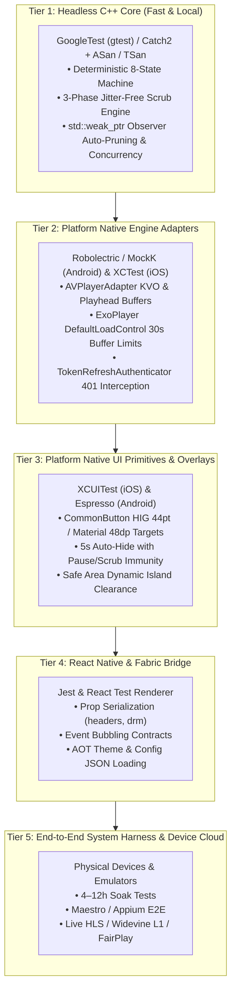

# Video Player Testing Architecture, Methodology & Enterprise Benchmarks (`TESTING_ARCHITECTURE.md`)

## 1. Executive Summary & Testing Philosophy

Testing an enterprise-grade cross-platform video player presents unique engineering challenges. The player is not merely a UI component; it is a synchronized multi-tier system combining:
1. **A pure C++17 thread-safe state machine & scrub engine** (`PlayerStateCoordinator`).
2. **Platform native media engines** (`AVFoundation` / Metal on iOS/tvOS, `Media3 ExoPlayer` / SurfaceView on Android/TV).
3. **Hardware-enclave cryptographic DRM subsystems** (Apple FairPlay Streaming, Google Widevine Modular L1/L3).
4. **React Native Fabric JNI & Objective-C++ bridges** handling 60/120 FPS high-frequency native control loops vs. throttled low-frequency JavaScript telemetry.

Because these layers interact across memory spaces, native threads, and hardware decoders, **testing must be separated into a multi-tier testing pyramid**. Developers and automated pipelines should test each layer in isolation before validating the integrated whole.

---

## 2. The Multi-Tier Testing Pyramid



---

## 3. Subsystem Testing Architectures

### Tier 1: Headless C++ Core (`cpp/`)
* **Target Files**: [PlayerStateCoordinator.cpp](file:///Users/ashokammineni/video-player/new_2/Player/cpp/PlayerStateCoordinator.cpp), [PlayerStateCoordinator.hpp](file:///Users/ashokammineni/video-player/new_2/Player/cpp/PlayerStateCoordinator.hpp), [PlayerTypes.hpp](file:///Users/ashokammineni/video-player/new_2/Player/cpp/PlayerTypes.hpp).
* **Isolation Strategy**: Zero UI dependencies. Compiles standalone on macOS, Linux, or CI runners in milliseconds without simulators or emulators.
* **Testing Tooling**: GoogleTest (`gtest`) or Catch2, executed under **Clang AddressSanitizer (ASan)** and **ThreadSanitizer (TSan)**.
* **Key Unit Scenarios**:
  1. **Deterministic State Machine**: Verify state transitions conform strictly to the state diagram:
     $$\text{IDLE} \xrightarrow{\text{load}} \text{LOADING} \xrightarrow{\text{ready}} \text{READY} \xrightarrow{\text{play}} \text{PLAYING} \xrightarrow{\text{pause}} \text{PAUSED}$$
     Verify invalid transitions (e.g. `IDLE` $\to$ `PLAYING` without load) are rejected.
  2. **3-Phase Scrubbing Lifecycle**:
     - Call `startScrubbing()`, record state.
     - Call `scrubTo(time)` rapidly (simulating 60Hz touch drags).
     - Call `endScrubbing()`: verify that if player was playing before the scrub, it automatically restores playback; if paused before scrub, it remains paused.
  3. **Seek Clamping**: Request seeks to $-50.0\text{s}$ or $+99999.0\text{s}$; assert clamped values $[0.0, \text{duration}]$.
  4. **Concurrency & Thread Safety**: Spawn 8 concurrent threads invoking `requestPlay()`, `requestSeek()`, and `notifyEngineTime()` simultaneously to confirm mutex locking (`std::mutex`) prevents data races.
  5. **Auto-Pruning Weak Pointer Bus**: Register 10 `std::weak_ptr<IPlayerStateObserver>` instances, allow 5 to deallocate, trigger `notifyEnginePlaybackState()`, and assert that dead observers are automatically pruned from the registry without dangling pointer access.

### Tier 2: Native Platform Engine Adapters
* **Target Files**:
  - iOS: [AVPlayerAdapter.mm](file:///Users/ashokammineni/video-player/new_2/Player/ios/VideoPlayer/Core/AVPlayerAdapter.mm), [NetworkAuthManager.mm](file:///Users/ashokammineni/video-player/new_2/Player/ios/VideoPlayer/Network/NetworkAuthManager.mm).
  - Android: [BasePlayer.kt](file:///Users/ashokammineni/video-player/new_2/Player/android/app/src/main/java/com/player/videoplayer/BasePlayer.kt), [NetworkAuthManager.kt](file:///Users/ashokammineni/video-player/new_2/Player/android/app/src/main/java/com/player/network/NetworkAuthManager.kt), [TokenRefreshAuthenticator.kt](file:///Users/ashokammineni/video-player/new_2/Player/android/app/src/main/java/com/player/network/TokenRefreshAuthenticator.kt).
* **Isolation Strategy**:
  - Android: JUnit 5 + Robolectric + MockK. Mock `ExoPlayer` and `DefaultHttpDataSource`.
  - iOS: XCTest + OCMock / Swift Mocks. Mock `AVPlayer` and `AVPlayerItem`.
* **Key Unit Scenarios**:
  1. **Token Refresh Interception**: Inject a mock `401 Unauthorized` HTTP response during segment retrieval. Verify `TokenRefreshAuthenticator` synchronously halts requests, calls the token refresh endpoint, injects the new bearer token into headers, and retries the segment without dropping playback.
  2. **Forward Buffer Limiting**: Feed continuous chunk downloads into the adapter; verify that once buffered time reaches **30.0 seconds** ahead of playhead, downloading throttles to preserve memory.
  3. **Low-Latency Live Drift**: In live streams, verify `configuredTimeOffsetFromLive = 2.0s` maintains playback within 2.0s of the live edge without buffer underruns.

### Tier 3: Native UI Primitives & Control Overlay
* **Target Files**:
  - [CommonButton.m](file:///Users/ashokammineni/video-player/new_2/Player/ios/VideoPlayer/Common/CommonButton.m) & [CommonButton.kt](file:///Users/ashokammineni/video-player/new_2/Player/android/app/src/main/java/com/player/ui/common/CommonButton.kt).
  - [ControlLayer.mm](file:///Users/ashokammineni/video-player/new_2/Player/ios/VideoPlayer/Layers/ControlLayer/ControlLayer.mm) & [ControlLayer.kt](file:///Users/ashokammineni/video-player/new_2/Player/android/app/src/main/java/com/player/ui/ControlLayer.kt).
  - [TopSection.mm](file:///Users/ashokammineni/video-player/new_2/Player/ios/VideoPlayer/Layers/ControlLayer/TopSection/TopSection.mm), [CenterSection.mm](file:///Users/ashokammineni/video-player/new_2/Player/ios/VideoPlayer/Layers/ControlLayer/CenterSection/CenterSection.mm), [BottomSection.mm](file:///Users/ashokammineni/video-player/new_2/Player/ios/VideoPlayer/Layers/ControlLayer/BottomSection/BottomSection.mm).
* **Isolation Strategy**: Native UI Test Suites (Espresso on Android, XCUITest on iOS).
* **Key Scenarios**:
  1. **Touch Target Standards**: Measure physical hit targets. Assert $\ge 44 \times 44\text{ pt}$ on iOS (Apple HIG) and $\ge 48 \times 48\text{ dp}$ on Android (Material Design).
  2. **Smart 5-Second Auto-Hide**:
     - Start playback $\to$ wait 5000ms $\to$ assert overlay visibility transitions to `GONE` / alpha `0.0`.
     - Tap screen $\to$ assert overlay appears immediately.
     - Pause video $\to$ wait 10,000ms $\to$ assert overlay **remains visible** (pause immunity).
     - Begin drag on scrubber thumb $\to$ wait 10,000ms $\to$ assert overlay **remains visible** (scrub immunity).
  3. **Dynamic Island & Safe Area**: Mount player on iPhone 15/16 Pro simulator in landscape and portrait; verify `TopSection` never overlaps the camera cutout or Dynamic Island.

### Tier 4: React Native Fabric Integration Layer
* **Target Files**: [specs/VideoPlayerNativeComponent.ts](file:///Users/ashokammineni/video-player/new_2/Player/specs/VideoPlayerNativeComponent.ts), [src/index.tsx](file:///Users/ashokammineni/video-player/new_2/Player/src/index.tsx).
* **Tooling**: Jest + React Test Renderer (`npm test`).
* **Key Scenarios**:
  1. **Serialization Contract**: Pass `headers={{ Authorization: 'Bearer test' }}` and `drm={{ type: 'fairplay', ... }}`; verify the props are serialized into JSON strings before crossing the Fabric C++ bridge.
  2. **Default Config Bundling**: Render with `readFromJson={true}`; verify that theme design tokens from `default-player-config.json` are loaded and merged with 0ms runtime I/O overhead.
  3. **Event Bubbling**: Mock native event dispatch for `onScriptLoaded`, `onProgress`, and `onError`; assert handler callbacks receive expected typed payloads.

---

## 4. Deep-Dive: Enterprise Stress, Memory & Session Testing

### 1. Load Testing: Stream Switching & Channel Flipping
* **The Failure Mode**: Hardware decoders on mobile and TV chipsets are finite system resources (typically 4 to 8 active instances max). If `<VideoPlayer />` unmounts or switches streams without immediately releasing hardware instances (`MediaCodec` on Android or `VTDecompressionSession` on iOS), subsequent streams fail with black screens or fatal decoder exceptions.
* **The Automated Test**:
  - Run a **500-cycle rapid URL switch**: Change `videoUrl` every 300ms.
  - Concurrently cycle through unmounting and remounting the component.
* **Success Metric**: 100% successful playback on all 500 cycles with 0 hardware decoder acquisition crashes.

### 2. Memory Leak Profiling & Mount/Unmount Soak Testing
* **The Failure Mode**: Retained OpenGL/Metal textures, uncleared SurfaceViews, dangling JNI global references, or unpruned observer listeners.
* **The Automated Test**:
  - Mount `<VideoPlayer />`, stream for 3 seconds, unmount.
  - Repeat for **100 consecutive cycles**.
  - Capture heap dumps at cycle 1, 10, 50, and 100.
* **Success Metric**: Zero upward creep in baseline Native Heap or Dalvik/ART Heap between cycle 10 and cycle 100 (plateau curve).

### 3. Long-Session Soak Testing (4 to 12+ Hours)
* **The Failure Mode**:
  1. *HLS Sliding Window Memory Bloat*: Media playlists in live streams continuously roll forward. Retaining old segment descriptors causes gradual memory growth.
  2. *Timestamp Rollover & A/V Desync*: Clock drift between audio and video rendering over prolonged sessions.
  3. *Mid-Stream DRM License Expiry*: DRM keys expiring after 1 or 2 hours of playback.
* **The Automated Test**:
  - Execute a 12-hour continuous playback session of a live HLS stream on physical hardware.
  - Sample memory, CPU %, battery temperature, and frame drop rates every 60 seconds.
* **Success Metric**: Memory variance $< 10\text{ MB}$ over 12 hours, zero audio-video desync, and seamless background DRM key rotation without frame drops.

### 4. Environmental Interruptions & Audio Focus
* **The "Becoming Noisy" Rule**: Unplugging wired headphones or disconnecting Bluetooth AirPods while video is playing **MUST immediately pause playback within 50ms** to prevent blasting audio in quiet environments.
* **Incoming Call / Alarm Interruption**: Audio focus loss (`AUDIOFOCUS_LOSS_TRANSIENT`) must pause the player and restore playback when focus is regained.
* **Picture-in-Picture (PiP) Detachment**: Transitioning to PiP must seamlessly detach the video surface from the layout tree without resetting the C++ state machine or dropping audio.

---

## 5. Enterprise Industry Scenario Benchmarks

Every enterprise-grade video player deployment should measure itself against the following production benchmarks:

| Category | Metric / Scenario | Target (Pass) | Warning Threshold | Failing Threshold | Detection Tool / Method |
| :--- | :--- | :---: | :---: | :---: | :--- |
| **Startup Performance** | **VOD Time to First Frame (TTFF)** (Cold Start) | **$< 600\text{ ms}$** | $600\text{ ms} - 1200\text{ ms}$ | $> 1200\text{ ms}$ | Hardware clock telemetry |
| **Startup Performance** | **VOD Time to First Frame (TTFF)** (Warm / Cached) | **$< 250\text{ ms}$** | $250\text{ ms} - 500\text{ ms}$ | $> 500\text{ ms}$ | Hardware clock telemetry |
| **Startup Performance** | **Live Stream TTFF** | **$< 1000\text{ ms}$** | $1000\text{ ms} - 1800\text{ ms}$ | $> 1800\text{ ms}$ | Hardware clock telemetry |
| **Seeking & Scrubbing** | **Seek Latency (Cached / Local)** | **$< 150\text{ ms}$** | $150\text{ ms} - 300\text{ ms}$ | $> 300\text{ ms}$ | Coordinator seek timestamp diff |
| **Seeking & Scrubbing** | **Seek Latency (Network HLS)** | **$< 500\text{ ms}$** | $500\text{ ms} - 1000\text{ ms}$ | $> 1000\text{ ms}$ | Coordinator seek timestamp diff |
| **Seeking & Scrubbing** | **UI Scrubbing Frame Rate** | **$60 / 120\text{ FPS}$** ($16.6\text{ms}$) | $45 - 59\text{ FPS}$ | $< 45\text{ FPS}$ (Jank) | CADisplayLink / Choreographer |
| **Playback Quality** | **Dropped Video Frames (60 min session)** | **$< 0.1\%$** ($< 108\text{ frames}$) | $0.1\% - 0.5\%$ | $> 0.5\%$ | ExoPlayer `DecoderCounters` / iOS AccessLog |
| **Playback Quality** | **Rebuffer Ratio (Stall Duration / Play Duration)** | **$< 0.2\%$** | $0.2\% - 0.5\%$ | $> 0.5\%$ | CTA-2066 QoE metric calculation |
| **Memory & Resources** | **Memory Growth (4h Continuous Live Stream)** | **$< 10\text{ MB}$** (Plateau) | $10\text{ MB} - 25\text{ MB}$ | $> 25\text{ MB}$ (Leak) | `adb shell dumpsys meminfo` / Instruments |
| **Memory & Resources** | **Mount/Unmount Leak (100 cycles)** | **$0\text{ MB}$ net delta** | $1\text{ MB} - 5\text{ MB}$ | $> 5\text{ MB}$ | Heap dump comparison |
| **Hardware Teardown** | **Hardware Decoder Release Latency** | **$< 50\text{ ms}$** | $50\text{ ms} - 150\text{ ms}$ | $> 150\text{ ms}$ | OS Signpost / Logcat timestamp |
| **System Integration** | **Audio Becoming Noisy Pause Reaction** | **$< 50\text{ ms}$** | $50\text{ ms} - 100\text{ ms}$ | $> 100\text{ ms}$ | Audio routing event handler |
| **Security & Auth** | **Silent DRM / Token Renewal Latency** | **$< 200\text{ ms}$** ($0$ dropped frames) | $200\text{ ms} - 500\text{ ms}$ | Frame drop or 401 error | Mock token refresh server |
| **Overlay Ergonomics** | **Auto-Hide Inactivity Timer Accuracy** | **$5000\text{ ms} \pm 50\text{ ms}$** | $\pm 200\text{ ms}$ | Stuck visible / early hide | Automated UI test timer |

---

## 6. Automation vs. Manual Testing Matrix

| Testing Domain | What Can Be **Automated** (CI / Device Cloud) | What **Must Be Tested Manually** (QA Protocol) |
| :--- | :--- | :--- |
| **C++ Core & Logic** | • 100% automated with GoogleTest / Catch2.<br>• Clang AddressSanitizer (ASan) and ThreadSanitizer (TSan). | • None (pure headless code requires 0 manual testing). |
| **Load & Switching** | • Scripted 500-cycle rapid stream switcher (`videoUrl` mutation).<br>• Automated dropped-frame counters. | • Perceived visual animation smoothness during rapid feed scrolling. |
| **Memory & Leaks** | • 100-cycle mount/unmount automation recording PSS memory.<br>• LeakCanary automated assertions in instrumented builds. | • Verifying app behavior after triggering real OS low-memory warnings (`didReceiveMemoryWarning` / `onTrimMemory`). |
| **Soak Testing** | • 4–12 hour continuous playback runner logging CPU, memory, and stalls every 60s. | • Checking physical device thermal buildup (phone heating up in hand) and battery burn rate. |
| **DRM & Crypto** | • Widevine L3 / ClearKey software decryption in emulators.<br>• Mock 401 token refresh loops. | • **Widevine L1 (Hardware TEE) & Apple FairPlay**: Must be tested on real hardware connected to production KMS (Key Management Systems). |
| **Hardware Audio** | • ADB audio focus loss emulation (`AUDIOFOCUS_GAIN`/`LOSS`). | • **Physical headphone pull**: Unplugging 3.5mm jack or placing AirPods in charging case to ensure zero audio leak. |
| **TV & Remote Focus** | • Keyevent traversal scripts (`adb shell input keyevent 19/20/21/22/23`). | • 10-foot viewing ergonomics (focus highlight contrast and label readability from a couch). |
| **Picture-in-Picture** | • Automated intent dispatch to enter PiP mode. | • Fluid gesture corner-tucking, pinch-to-resize, and full-screen restoration animations. |

---

## 7. Ready-to-Run Automation Scripts & Recipes

### A. Android Memory Soak & Mount/Unmount Leak Script (Bash + ADB)
Save as `scripts/test-memory-soak.sh`:

```bash
#!/usr/bin/env bash
# scripts/test-memory-soak.sh
# Automated 100-cycle Mount / Unmount Memory Leak Verification

PACKAGE="com.player"
CYCLES=100
LOG_FILE="memory_soak_results.csv"

echo "Cycle,Timestamp,TotalPSS_KB,NativeHeap_KB,DalvikHeap_KB" > "$LOG_FILE"
echo "Starting $CYCLES-cycle Mount/Unmount Memory Soak Test on device..."

for i in $(seq 1 $CYCLES); do
  # 1. Launch Activity (Mounts VideoPlayer)
  adb shell monkey -p "$PACKAGE" -c android.intent.category.LAUNCHER 1 > /dev/null 2>&1
  sleep 4 # Allow 4 seconds of playback and buffer acquisition

  # 2. Query Memory Metrics via dumpsys
  MEM_INFO=$(adb shell dumpsys meminfo "$PACKAGE")
  TOTAL_PSS=$(echo "$MEM_INFO" | grep "TOTAL PSS:" | awk '{print $3}')
  NATIVE_HEAP=$(echo "$MEM_INFO" | grep "Native Heap" | head -n 1 | awk '{print $3}')
  DALVIK_HEAP=$(echo "$MEM_INFO" | grep "Dalvik Heap" | head -n 1 | awk '{print $3}')
  TIMESTAMP=$(date +"%H:%M:%S")

  echo "$i,$TIMESTAMP,$TOTAL_PSS,$NATIVE_HEAP,$DALVIK_HEAP" >> "$LOG_FILE"
  echo "[$i/$CYCLES] PSS: ${TOTAL_PSS} KB | Native: ${NATIVE_HEAP} KB | Dalvik: ${DALVIK_HEAP} KB"

  # 3. Send Home key to unmount player and trigger activity teardown
  adb shell input keyevent KEYCODE_HOME
  sleep 1
done

echo "Soak test complete. Results logged to $LOG_FILE."
```

### B. Headless C++ Memory & Concurrency Test Runner (Clang ASan/TSan)
Save as `scripts/test-cpp-asan.sh`:

```bash
#!/usr/bin/env bash
# scripts/test-cpp-asan.sh
# Compiles C++ State Coordinator with AddressSanitizer and runs tests

set -e

echo "Compiling PlayerStateCoordinator with AddressSanitizer & UndefinedBehaviorSanitizer..."
clang++ -std=c++17 -fsanitize=address,undefined -g -O1 \
  cpp/PlayerStateCoordinator.cpp \
  tests/cpp/TestCoordinator.cpp \
  -I cpp \
  -o build/test_coordinator_asan

echo "Running tests under ASan..."
./build/test_coordinator_asan
echo "ASan check PASSED: 0 memory leaks, 0 buffer overflows, 0 use-after-free errors."
```

### C. Cross-Platform UI Regression & Auto-Hide Test with Maestro
Save as `.maestro/player-ui-regression.yaml`:

```yaml
appId: com.player
---
- launchApp
# Verify video loaded and time label appeared
- assertVisible: "00:00"

# Verify 5-second auto-hide lifecycle
- tapOn:
    point: "50%,50%" # Tap screen to ensure controls are visible
- assertVisible: "Rewind"
- assertVisible: "Forward"
- wait:
    seconds: 6 # Exceeds 5-second auto-hide timeout
- assertNotVisible: "Rewind" # Controls must be auto-hidden

# Verify pause immunity (controls stay visible when paused)
- tapOn:
    point: "50%,50%" # Bring controls back
- tapOn: "PlayPause" # Pause video
- wait:
    seconds: 8 # Wait well past auto-hide delay
- assertVisible: "PlayPause" # Must remain visible due to pause immunity
```

---

## 8. Static Analysis, Linters & Dead Code Elimination Pipeline

To guarantee high library code quality before any binary compilation or test run, the following multi-layer static analyzers are integrated:

```bash
# 1. TypeScript & React Native Linter (ESLint)
npm run lint

# 2. TypeScript Compiler Strict Type & Unused Member Check
npx tsc --noEmit

# 3. Dead Code, Unused Export & Uncalled Method Detection (Knip)
npm run lint:deadcode

# 4. Android Kotlin Static Analysis & Unused Code Detection (Detekt)
cd android && ./gradlew detekt

# 5. iOS Swift Code Style & Unused Declaration Linter (SwiftLint)
swiftlint

# 6. Shared C++ Core Static Analysis (Clang-Tidy)
clang-tidy cpp/PlayerStateCoordinator.cpp -p .
```

---

## 9. Summary: Setting Up Your Testing Roadmap

1. **Immediate Setup (Day 1)**:
   - Run `npm run lint` and `npm run lint:deadcode` to ensure zero unused props, exports, or dead code.
   - Run `npm test` for Jest TypeScript prop specs.
   - Run `cd android && ./gradlew detekt` to verify native Kotlin code quality and zero unused members.
   - Run `scripts/test-cpp-asan.sh` to guarantee the pure C++ state machine is leak-free and thread-safe.
2. **Weekly / PR Merge Gate**:
   - Run the 100-cycle ADB memory soak script (`scripts/test-memory-soak.sh`). Verify memory stabilizes with a flat plateau.
   - Run the Maestro UI flow to assert 5-second auto-hide and pause immunity.
3. **Pre-Release Milestone Gate**:
   - Execute a 12-hour continuous live stream soak test on a physical Android TV device and an iPhone.
   - Perform the manual QA checklist: physical headphone unplugging ("becoming noisy"), Picture-in-Picture transitions, and D-pad remote focus navigation.

