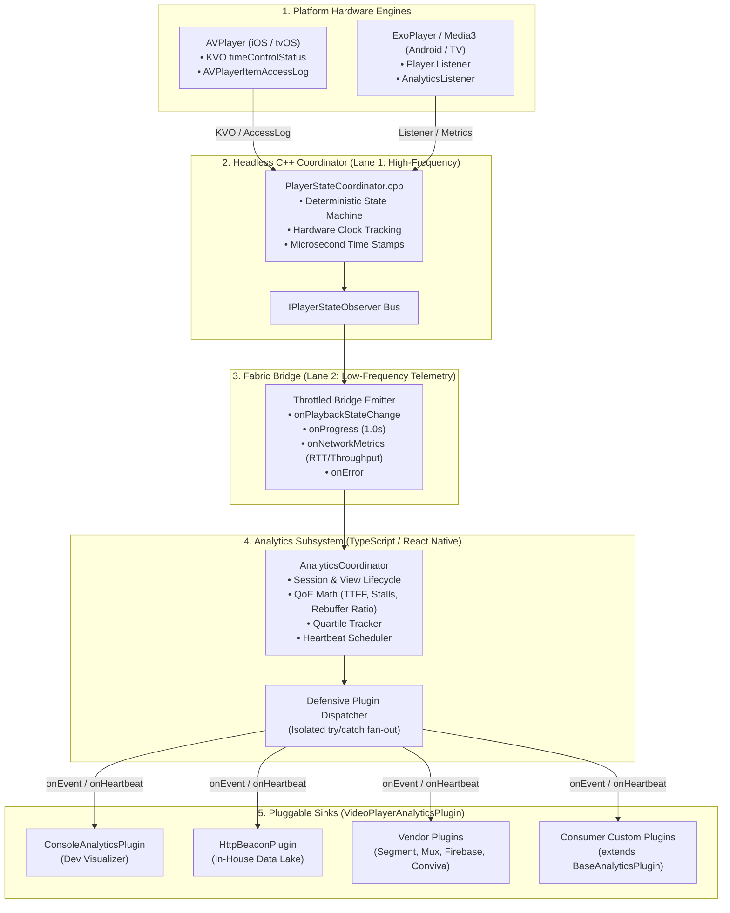

# Analytics & Plugin Architecture Specification (`analytics_arch.md`)

## 1. Executive Summary & Core Philosophy

The **Analytics & Plugin Subsystem** provides a zero-overhead, vendor-agnostic, and enterprise-grade telemetry pipeline for the cross-platform Video Player. It solves the fragmentation and vendor lock-in common to video analytics by decoupling **Metric Calculation (Engine)** from **Event Dispatching (Pluggable Sinks)**.

```
+---------------------------------------------------------------------------------------+
|                                React Native JSX / Fabric                              |
|   <VideoPlayer                                                                        |
|      videoUrl="https://stream.example.com/live/master.m3u8"                          |
|      title="Grand Finals Live"                                                       |
|      analytics={{                                                                     |
|        contentId: "stream_live_123",                                                 |
|        heartbeatIntervalMs: 10000,                                                   |
|        plugins: [                                                                    |
|          new ConsoleAnalyticsPlugin({ verbose: __DEV__ }),                           |
|          new SegmentAnalyticsPlugin({ writeKey: "SEG_123" }),                         |
|          new HttpBeaconPlugin({ endpoint: "https://telemetry.corp.com/beacon" }),     |
|        ],                                                                            |
|      }}                                                                              |
|   />                                                                                  |
+-------------------------------------------+-------------------------------------------+
                                            |
                     Normalized Playback Events & QoE Telemetry
                                            |
                                            v
+---------------------------------------------------------------------------------------+
|                         AnalyticsCoordinator (Session Manager)                         |
|  - Manages sessionId, viewId, and quartile progression (25%, 50%, 75%, 100%)          |
|  - Computes Time-To-First-Frame (TTFF), rebuffer duration & ratio, seek latency      |
|  - Drives periodic heartbeat timers (cumulative sessions metrics)                     |
|  - Defensive isolation: wraps every plugin in try/catch to protect core playback     |
+-------------------+-----------------------+-----------------------+-------------------+
                    |                       |                       |                   |
                    v                       v                       v                   v
           [ Console Plugin ]      [ Segment Plugin ]      [ Beacon Plugin ]   [ Custom Plugin ]
```

### Core Design Principles
1. **Zero Vendor Lock-In & Open-Closed Design**: The core playback engine contains zero dependencies on specific analytics SDKs (Mux, Conviva, Segment, Firebase). Any vendor is attached as a pluggable sink.
2. **Deterministic Metric Parity**: Key Quality of Experience (QoE) metrics—such as Time-to-First-Frame (TTFF), rebuffering duration, and seek latency—are calculated deterministically from native hardware clocks, guaranteeing consistent metrics across iOS, tvOS, Android, and Android TV.
3. **Strict Dual-Lane Isolation (Lane 2)**: All analytics processing and plugin dispatches execute asynchronously on the low-frequency telemetry lane. Analytics execution **never blocks or degrades the 60/120 FPS native control and scrub loop**.
4. **Crash-Resilient Plugin Isolation**: Every plugin dispatch is isolated in defensive exception boundaries. If a third-party plugin throws an exception or network failure, player rendering and core state transitions remain 100% uninterrupted.
5. **Standardized Video Metric Domains**: Normalizes raw platform noise into standardized schemas adhering to **CTA-2066** and **Streaming Video Technology Alliance** video analytics specifications.

---

## 2. Subsystem Architecture & Dual-Lane Data Flow



---

## 3. Plugin Interface Contract & Lifecycle

Every analytics tracker adheres to the unified `VideoPlayerAnalyticsPlugin` contract.

```typescript
// src/analytics/types.ts

export type PlatformType = 'ios' | 'android' | 'tvos' | 'android_tv';

export type PlaybackEventType =
  | 'session_start'
  | 'first_frame_rendered'
  | 'play'
  | 'pause'
  | 'buffering_start'
  | 'buffering_end'
  | 'seek_start'
  | 'seek_end'
  | 'quartile_25'
  | 'quartile_50'
  | 'quartile_75'
  | 'quartile_100'
  | 'rendition_change'
  | 'error'
  | 'session_end';

export interface PlayerContext {
  /** Unique UUID generated per playback session (reset on new stream load) */
  sessionId: string;
  /** Unique UUID generated per playback attempt */
  viewId: string;
  /** Content identifier passed by consumer */
  contentId: string;
  /** Title of the stream */
  title: string;
  /** Media stream URL */
  videoUrl: string;
  /** Whether the stream is a live broadcast or VOD */
  isLive: boolean;
  /** Duration in seconds (-1.0 for live streams) */
  duration: number;
  /** Operating system platform */
  platform: PlatformType;
  /** Optional custom dimension dictionary passed by consumer */
  customMetadata?: Record<string, any>;
}

export interface QoEMetrics {
  /** Latency in milliseconds from initial load() request to first decoded frame */
  timeToFirstFrameMs?: number;
  /** Total number of stall events encountered (excluding deliberate user pauses) */
  rebufferCount: number;
  /** Cumulative milliseconds spent in stalled buffering states */
  rebufferDurationMs: number;
  /** Ratio: rebufferDuration / (watchTime + rebufferDuration) */
  rebufferRatio: number;
  /** Cumulative active watch time (seconds media clock rendered frames) */
  activeWatchTimeSeconds: number;
  /** Active video rendition bitrate in bits per second */
  currentBitrateBps?: number;
  /** Network ping / chunk RTT in milliseconds */
  pingMs?: number;
  /** Observed network throughput in bits per second */
  bandwidthBps?: number;
  /** Latency in milliseconds from scrub release to video resume */
  seekLatencyMs?: number;
}

export interface AnalyticsEvent {
  type: PlaybackEventType;
  timestamp: number;
  currentTime: number;
  context: PlayerContext;
  metrics: QoEMetrics;
  payload?: Record<string, any>;
}

/**
 * Standard contract for any Analytics Plugin
 */
export interface VideoPlayerAnalyticsPlugin {
  /** Human-readable plugin name */
  readonly name: string;

  /** Called when the player mounts and initializes session context */
  setup?(context: PlayerContext): void;

  /** Called on every normalized playback event */
  onEvent(event: AnalyticsEvent): void;

  /** Called periodically (heartbeat interval) with cumulative metrics */
  onHeartbeat?(event: AnalyticsEvent): void;

  /** Called when playback finishes, unmounts, or stream resets */
  teardown?(): void;
}
```

---

## 4. Base Plugin Implementation (`BaseAnalyticsPlugin`)

To make writing custom plugins seamless, consumers can extend `BaseAnalyticsPlugin`, implementing only the callbacks they care about:

```typescript
// src/analytics/BaseAnalyticsPlugin.ts
import { VideoPlayerAnalyticsPlugin, PlayerContext, AnalyticsEvent } from './types';

export abstract class BaseAnalyticsPlugin implements VideoPlayerAnalyticsPlugin {
  abstract readonly name: string;

  setup(context: PlayerContext): void {}
  abstract onEvent(event: AnalyticsEvent): void;
  onHeartbeat(event: AnalyticsEvent): void {}
  teardown(): void {}
}
```

---

## 5. Standardized Video Metric Domains

The analytics pipeline normalizes raw playback events into four distinct domains (CTA-2066 standard):

| Domain | Key Metrics Computed | Trigger Timing |
| :--- | :--- | :--- |
| **QoE (Quality of Experience)** | • **Startup Latency / TTFF** (time from `load()` to first decoded frame)<br>• **Rebuffer Ratio** ($\frac{\text{stalled buffer duration}}{\text{total watch time}}$)<br>• **Stall Count & Durations** (excluding user pauses)<br>• **Seek Latency** (touch release to video clock resume)<br>• **Rendition Shifts** (ABR profile and bitrate changes) | Automatically calculated on playback state transitions |
| **QoS (Network & CDN)** | • **Chunk RTT / CDN Ping**<br>• **Observed Bandwidth Throughput** (bps)<br>• **HTTP Segment Errors** (401, 403, 404, 503)<br>• **CDN Hostname / Edge Attribution** | Captured via native `AnalyticsListener` (Android) and `AVPlayerItemAccessLog` (iOS) |
| **Engagement & Watch-Time** | • **Actual Watch Time** (clock active time)<br>• **Milestone / Quartile Events** (0% Start, 25%, 50%, 75%, 100% Completion)<br>• **Periodic Heartbeat** (cumulative metrics every $N$ seconds) | Timeline progression and steady interval timers |
| **User Interactions** | • Play / Pause toggles<br>• Scrub gestures (start, delta, end)<br>• Step seeks (+15s / -15s)<br>• Fullscreen toggles, track changes (audio/subtitles) | Immediately upon user action |

---

## 6. The `AnalyticsCoordinator` (Internal Engine)

The `AnalyticsCoordinator` is the central brain of the analytics subsystem. It is hosted inside `<VideoPlayer />` and manages:

1. **Session Lifecycle**: Automatically generates cryptographically strong UUIDs for `sessionId` and `viewId`. Resets session states when `videoUrl` changes.
2. **State & Clock Tracking**:
   - Records `loadTimestamp = Date.now()` on mount/load.
   - Computes `timeToFirstFrameMs = Date.now() - loadTimestamp` on `onScriptLoaded`.
   - Distinguishes between intentional **pauses** and unintentional **network stalls** (`buffering_start`).
   - Accumulates `rebufferDurationMs` when the engine is in `Buffering` state while user requested `Play`.
3. **Quartile Milestone Tracker**:
   - Monotonically tracks playback progress through 25%, 50%, 75%, and 100% of duration (for non-live media).
   - Guarantees each quartile is fired exactly once per video play cycle.
4. **Heartbeat Scheduler**:
   - Runs a steady timer (default: 10,000ms, configurable) while video is active.
   - Emits `onHeartbeat` across all plugins with cumulative session watch-time and network snapshots.
5. **Defensive Exception Isolation**:
   ```typescript
   private dispatchEvent(event: AnalyticsEvent): void {
     for (const plugin of this.plugins) {
       try {
         plugin.onEvent(event);
       } catch (error) {
         console.warn(`[VideoPlayer:Analytics] Exception in plugin "${plugin.name}":`, error);
       }
     }
   }
   ```

---

## 7. Built-in Reference Plugins

### 7.1 `ConsoleAnalyticsPlugin` (Development & Diagnostics)
Outputs color-coded, human-readable console tables during development:

```typescript
// src/analytics/plugins/ConsoleAnalyticsPlugin.ts
import { BaseAnalyticsPlugin } from '../BaseAnalyticsPlugin';
import { AnalyticsEvent } from '../types';

export interface ConsoleAnalyticsOptions {
  verbose?: boolean;
  filterEvents?: string[];
  logHeartbeats?: boolean;
}

export class ConsoleAnalyticsPlugin extends BaseAnalyticsPlugin {
  readonly name = 'ConsoleAnalyticsPlugin';
  private options: ConsoleAnalyticsOptions;

  constructor(options: ConsoleAnalyticsOptions = {}) {
    super();
    this.options = { verbose: false, logHeartbeats: false, ...options };
  }

  onEvent(event: AnalyticsEvent): void {
    if (this.options.filterEvents && !this.options.filterEvents.includes(event.type)) {
      return;
    }

    const badge = `[VideoAnalytics:${event.type}]`;
    console.log(
      `%c${badge} %c${event.context.title} | Pos: ${event.currentTime.toFixed(1)}s`,
      'color: #00bcd4; font-weight: bold;',
      'color: #ffffff;',
      { metrics: event.metrics, payload: event.payload }
    );
  }

  onHeartbeat(event: AnalyticsEvent): void {
    if (!this.options.logHeartbeats) return;
    console.table({
      sessionId: event.context.sessionId,
      watchTime: `${event.metrics.activeWatchTimeSeconds.toFixed(1)}s`,
      rebufferCount: event.metrics.rebufferCount,
      rebufferDuration: `${event.metrics.rebufferDurationMs}ms`,
      rebufferRatio: `${(event.metrics.rebufferRatio * 100).toFixed(2)}%`,
      bitrate: event.metrics.currentBitrateBps ? `${(event.metrics.currentBitrateBps / 1_000_000).toFixed(2)} Mbps` : 'N/A',
      ping: event.metrics.pingMs ? `${event.metrics.pingMs.toFixed(0)} ms` : 'N/A',
    });
  }
}
```

### 7.2 `HttpBeaconPlugin` (In-House Data Lake / REST Webhook)
Buffers events into batches and flushes them to any REST endpoint with automatic backoff:

```typescript
// src/analytics/plugins/HttpBeaconPlugin.ts
import { BaseAnalyticsPlugin } from '../BaseAnalyticsPlugin';
import { AnalyticsEvent } from '../types';

export interface HttpBeaconOptions {
  endpoint: string;
  batchSize?: number;
  flushIntervalMs?: number;
  headers?: Record<string, string>;
}

export class HttpBeaconPlugin extends BaseAnalyticsPlugin {
  readonly name = 'HttpBeaconPlugin';
  private queue: AnalyticsEvent[] = [];
  private timer: any = null;
  private options: Required<HttpBeaconOptions>;

  constructor(options: HttpBeaconOptions) {
    super();
    this.options = {
      batchSize: 20,
      flushIntervalMs: 10000,
      headers: {},
      ...options,
    };
  }

  setup(): void {
    this.timer = setInterval(() => this.flush(), this.options.flushIntervalMs);
  }

  onEvent(event: AnalyticsEvent): void {
    this.queue.push(event);
    if (this.queue.length >= this.options.batchSize) {
      this.flush();
    }
  }

  onHeartbeat(event: AnalyticsEvent): void {
    this.queue.push(event);
  }

  async flush(): Promise<void> {
    if (this.queue.length === 0) return;
    const batch = [...this.queue];
    this.queue = [];

    try {
      await fetch(this.options.endpoint, {
        method: 'POST',
        headers: {
          'Content-Type': 'application/json',
          ...this.options.headers,
        },
        body: JSON.stringify({ events: batch }),
      });
    } catch (err) {
      console.warn('[HttpBeaconPlugin] Failed to flush events:', err);
    }
  }

  teardown(): void {
    if (this.timer) clearInterval(this.timer);
    this.flush();
  }
}
```

---

## 8. Consumer Vendor Integration Recipes

### Recipe 1: Segment / Mixpanel Video Analytics Plugin
```typescript
import { BaseAnalyticsPlugin, AnalyticsEvent } from 'react-native-video-player';
import { createClient } from '@segment/analytics-react-native';

export class SegmentAnalyticsPlugin extends BaseAnalyticsPlugin {
  readonly name = 'SegmentAnalyticsPlugin';
  private client: ReturnType<typeof createClient>;

  constructor(client: ReturnType<typeof createClient>) {
    super();
    this.client = client;
  }

  onEvent(event: AnalyticsEvent) {
    this.client.track(`Video ${event.type}`, {
      sessionId: event.context.sessionId,
      contentId: event.context.contentId,
      position: event.currentTime,
      duration: event.context.duration,
      rebufferDurationMs: event.metrics.rebufferDurationMs,
      timeToFirstFrameMs: event.metrics.timeToFirstFrameMs,
      platform: event.context.platform,
    });
  }

  onHeartbeat(event: AnalyticsEvent) {
    this.client.track('Video Heartbeat', {
      rebufferRatio: event.metrics.rebufferRatio,
      currentBitrateBps: event.metrics.currentBitrateBps,
      activeWatchTime: event.metrics.activeWatchTimeSeconds,
    });
  }
}
```

### Recipe 2: Google Analytics / Firebase Analytics Plugin
```typescript
import { BaseAnalyticsPlugin, AnalyticsEvent } from 'react-native-video-player';
import analytics from '@react-native-firebase/analytics';

export class FirebaseVideoAnalyticsPlugin extends BaseAnalyticsPlugin {
  readonly name = 'FirebaseVideoAnalyticsPlugin';

  onEvent(event: AnalyticsEvent) {
    if (event.type === 'first_frame_rendered') {
      analytics().logEvent('video_start', {
        content_id: event.context.contentId,
        ttff_ms: event.metrics.timeToFirstFrameMs,
      });
    } else if (event.type === 'quartile_100') {
      analytics().logEvent('video_complete', {
        content_id: event.context.contentId,
      });
    }
  }
}
```

---

## 9. React Native Configuration & Usage Example

Consumers configure analytics declaratively in JSX:

```tsx
import React from 'react';
import { StyleSheet, View } from 'react-native';
import { VideoPlayer } from './src';
import { ConsoleAnalyticsPlugin, HttpBeaconPlugin } from './src/analytics';

export function PlayerWithAnalytics() {
  return (
    <View style={styles.container}>
      <VideoPlayer
        style={styles.player}
        videoUrl="https://commondatastorage.googleapis.com/gtv-videos-bucket/sample/BigBuckBunny.mp4"
        title="Big Buck Bunny (4K)"
        analytics={{
          contentId: "bbb_4k_vod",
          heartbeatIntervalMs: 10000,
          customMetadata: {
            userId: "user_enterprise_88",
            tier: "premium",
            experimentGroup: "player_v2_rollout",
          },
          plugins: [
            new ConsoleAnalyticsPlugin({ verbose: __DEV__, logHeartbeats: true }),
            new HttpBeaconPlugin({
              endpoint: "https://telemetry.example.com/v1/video/events",
              flushIntervalMs: 10000,
              headers: { Authorization: "Bearer telemetry_token" },
            }),
          ],
        }}
      />
    </View>
  );
}

const styles = StyleSheet.create({
  container: { flex: 1, backgroundColor: '#000' },
  player: { width: '100%', height: 260 },
});
```

---

## 10. Performance, Privacy & Security Guidelines

1. **Zero-UI Thread Burden**: All plugin callbacks and queue batching execute asynchronously without blocking 60/120 FPS scrubbing and native button interactions.
2. **Defensive Isolation**: Every `plugin.onEvent()` and `plugin.onHeartbeat()` is wrapped in a dedicated `try/catch` block. Faulty plugin implementations can never cause video playback crashes.
3. **No Sensitive PII by Default**: The standard context captures only non-identifying technical metadata (session UUIDs, platform, durations, bitrates). Consumers inject user identifiers explicitly via `customMetadata`.
4. **Idempotent Teardown**: Upon component unmount or rapid view recycling, `AnalyticsCoordinator.teardown()` immediately flushes all pending queues and halts active timers, preventing memory leaks and orphaned intervals.

---

## 11. Implementation & Verification Roadmap

- [ ] **TypeScript Interfaces & Core Types**: Create `src/analytics/types.ts` defining `VideoPlayerAnalyticsPlugin`, `PlayerContext`, `QoEMetrics`, and `AnalyticsEvent`.
- [ ] **Base Plugin Class**: Create `src/analytics/BaseAnalyticsPlugin.ts`.
- [ ] **Coordinator Engine**: Create `src/analytics/AnalyticsCoordinator.ts` managing session math, quartiles, and defensive dispatching.
- [ ] **Reference Plugins**: Create `ConsoleAnalyticsPlugin.ts` and `HttpBeaconPlugin.ts`.
- [ ] **Fabric Root Integration**: Hook `AnalyticsCoordinator` into `src/index.tsx` (`<VideoPlayer />`).
- [ ] **Export Barrel**: Expose all analytics primitives from `src/index.tsx` / `src/analytics/index.ts`.
- [ ] **Documentation Synchronization**: Synchronize `TASK_STATUS.md`, `quick-ref.md`, `ARCHITECTURE.md`, and `USAGE_GUIDE.md`.
