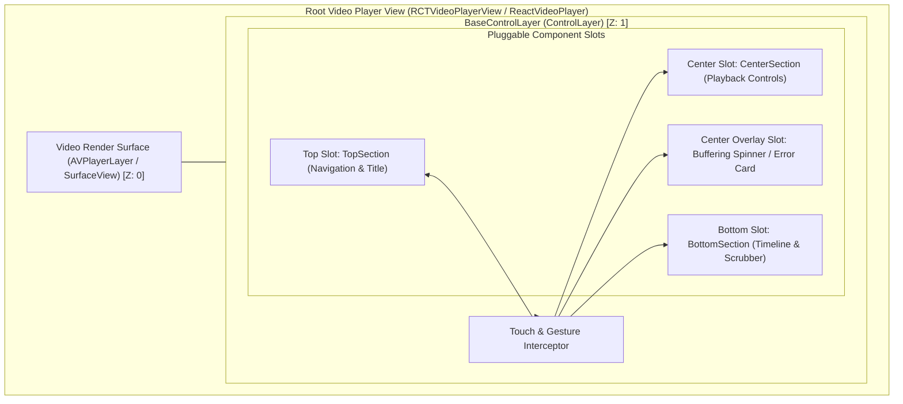
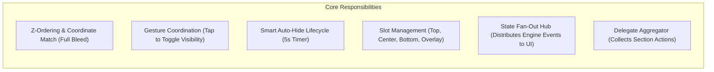
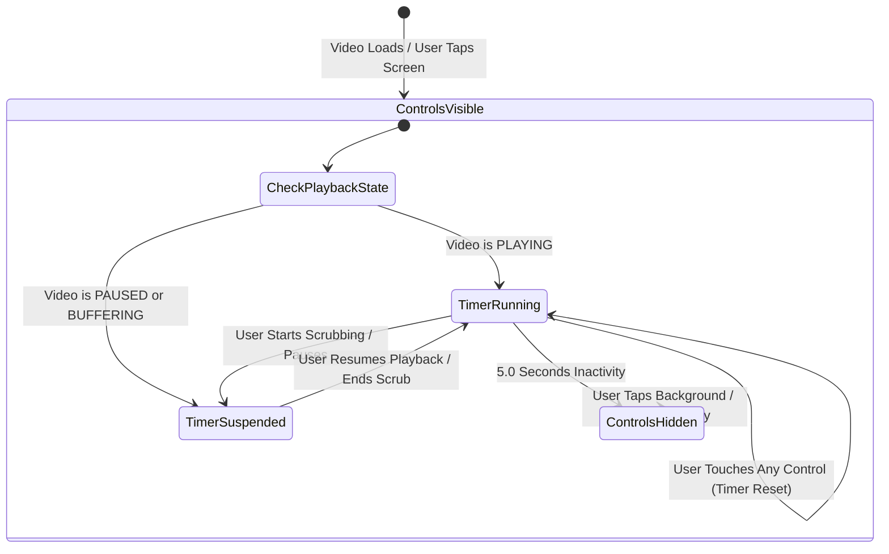
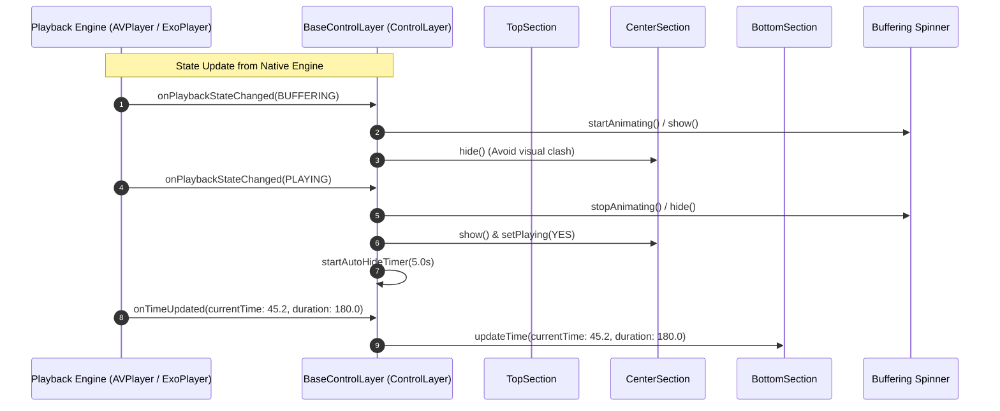

# Base Control Layer Architecture Specification (`base_layout_arch.md`)

## 1. Overview & Purpose

The **`BaseControlLayer`** (implemented as `ControlLayer`) is the master overlay container in the video player hierarchy. It is mounted directly on top of the native video surface (`AVPlayerLayer` on iOS, `PlayerView` on Android) and acts as the central coordinator for all user-facing controls.

It serves as the **single integration surface** that:
- Manages full-bleed bounds, safe areas, and z-index ordering.
- Coordinates touch gestures (background tap to toggle visibility).
- Enforces the smart auto-hide lifecycle (5-second inactivity timeout with pause/scrub immunity).
- Hosts the pluggable section slots (`TopSection`, `CenterSection`, `BottomSection`, and Buffering/Error overlays).
- Acts as the central State Fan-Out Hub between the player engine and child UI components.

---

## 2. Layer & Z-Index Hierarchy

---

## 3. Core Responsibilities

---

## 4. Smart Auto-Hide Lifecycle

Controls must feel natural and predictable. The auto-hide engine follows strict rules:

### Lifecycle Rules:
1. **Playing State**: When video is actively playing, inactivity triggers a smooth 0.25s fade-out to `alpha = 0.0` after **5.0 seconds**.
2. **Pause Immunity**: When video is paused, controls **remain visible indefinitely**. Auto-hide is disabled so users can inspect titles, scrub, or read captions.
3. **Scrub Immunity**: While the user is actively dragging the `UISlider` / `SeekBar`, the auto-hide timer is canceled so controls never fade out mid-scrub.
4. **Touch Reset**: Any interaction with child buttons resets the 5-second countdown.

---

## 5. State Fan-Out & Event Aggregation

`BaseControlLayer` is the bridge between the native playback engine and the UI sections:

---

## 6. Cross-Platform Class Mapping

| Feature | iOS / tvOS (`ControlLayer.mm`) | Android / Android TV (`ControlLayer.kt`) |
| :--- | :--- | :--- |
| **Base Class** | `UIView` | `FrameLayout` |
| **Sizing** | `translatesAutoresizingMaskIntoConstraints = NO`, pinned to container bounds | `match_parent` width and height |
| **Timer Mechanism** | `NSTimer scheduledTimerWithTimeInterval:5.0` | `Handler(Looper.getMainLooper()).postDelayed(5000L)` |
| **Fade Animation** | `[UIView animateWithDuration:0.25 animations:...]` on `controlsContainerView` with `.hidden = YES` on complete | `animate().alpha(0.0f).setDuration(250).withEndAction { visibility = GONE }` (Ghost Tap Fix) |
| **Gesture Handler** | `UITapGestureRecognizer` with `UIGestureRecognizerDelegate` touch exclusion for UIControls | `GestureDetector` / `setOnClickListener` |
| **Contrast Scrims** | Top (`MAX(90.0, topInset + 54)`) & Bottom (`MAX(100.0, bottomInset + 54)`) `CAGradientLayer` dark scrims dynamically sized to safe area insets | Top (`165 alpha`) & Bottom (`185 alpha`) `GradientDrawable` scrims |
| **Safe Area Adaptation** | Controlled via `autoAdjustSafeArea` prop (default: `YES`). When enabled, `RCTVideoPlayer` insets `playerLayer` into `safeAreaInsets` with black letterbox and binds `controlsLayer` to `safeAreaLayoutGuide`; when disabled, renders flush full-bleed edge-to-edge. | Controlled via `autoAdjustSafeArea` prop (default: `true`). Dynamically applies window insets & display cutouts via `setOnApplyWindowInsetsListener` with on-screen position checks to prevent double-padding. Pushes `safeAreaTopInset` and `safeAreaBottomInset` to `ControlLayer`. |
| **Child Slots** | `topControlView` (dynamic safe area guide constraints), `centerControlView` (centered within safe bounds), `bottomControlView` (dynamic safe area guide constraints), `bufferingSpinner` (centered within safe bounds) | `topSection` (positioned at `safeAreaTopInset`), `centerSection` (dynamically centered within safe viewing area: `safeAreaTopInset + availHeight / 2`), `bottomSection` (positioned at `height - safeAreaBottomInset - bottomH`), `bufferingSpinner` (centered with `centerSection`) |
| **Delegates** | Conforms to `TopSectionDelegate`, `CenterSectionDelegate`, `BottomSectionDelegate` | Implements `TopSectionListener`, `CenterSectionListener`, `BottomSectionListener` |

---

## 7. Native Fullscreen Orchestration Architecture

To provide a true zero-JS-overhead, OS-native fullscreen experience, both platforms implement direct window takeovers that completely bypass React Native style and layout manipulation:

### Android: Media3 Fullscreen Dialog (`android.R.style.Theme_Black_NoTitleBar_Fullscreen`)
- **OS Window Level**: Uses an independent `android.app.Dialog` with `Theme_Black_NoTitleBar_Fullscreen`. When entering fullscreen, `PlayerView` and `ControlLayer` are reparented into the Dialog's root `FrameLayout`.
- **Z-Index & Dead Space Immunity**: The Dialog sits above the host Activity window, completely covering any sibling React Native views (such as outer "Stop Video" buttons, headers, or `SafeAreaView` padding) edge-to-edge with 0 dead spaces.
- **Display Cutout & Fullscreen Safe Area Precision**: When entering fullscreen, `applySafeAreaLayout()` is guarded so portrait status bar insets (~94px) are bypassed, and `ControlLayer.setSafeAreaInsets(0, 0)` is explicitly set. The dialog's container applies `WindowInsetsCompat.Type.displayCutout()` padding strictly to horizontal edges (`left` and `right`) with `0` top/bottom padding. On Android P+ (API 28+), `win.attributes.layoutInDisplayCutoutMode` is set to `LAYOUT_IN_DISPLAY_CUTOUT_MODE_SHORT_EDGES`, ensuring `TopSection` sits flush at the very top edge with clean 12dp internal padding and zero dead space.
- **Hardware Back Button & Exit Restore**: The Dialog overrides `onBackPressed()` to automatically dismiss the Dialog, re-attach views back to `ReactVideoPlayer`, restore portrait orientation, schedule `applySafeAreaLayout(width, height)` to recompute portrait status bar clearance, and emit `onFullscreenChange(false)` to JavaScript.
- **Fabric Re-render Immunity**: Fabric's default prop passes during orientation changes are guarded via `setFullscreenProp()` so orientation re-layouts never stomp or bounce fullscreen back.
- **Lifecycle Re-attachment & Scrubber Continuity**: `ControlLayer` implements `onAttachedToWindow()` to immediately sync the playhead timestamp, update `BottomSection` scrubber progress, and resume `startTimeUpdates()` and the auto-hide timer whenever the view is reparented into the Dialog or restored to inline mode.

### iOS: Top-Level Window Container (`FullscreenPlayerContainerView`) & Dynamic `OrientationManager`
- **Top-Level Screen Overlay**: Uses a dedicated `FullscreenPlayerContainerView` attached directly to the root view (`topVC.view`) at `zPosition = 9999` with `autoresizingMask = UIViewAutoresizingFlexibleWidth | UIViewAutoresizingFlexibleHeight`. When entering fullscreen, `playerLayer` and `controlsLayer` are reparented into this overlay.
- **Dynamic Orientation Bridge (`OrientationManager`)**: A lightweight Objective-C `OrientationManager` bridges between UIKit and `AppDelegate.swift`'s `supportedInterfaceOrientationsFor`. The app defaults strictly to `UIInterfaceOrientationMaskPortrait`. When entering fullscreen, it unlocks `UIInterfaceOrientationMaskLandscape`. When exiting, it immediately locks back to `UIInterfaceOrientationMaskPortrait` and triggers `setNeedsUpdateOfSupportedInterfaceOrientations` on the active view controller hierarchy.
- **Zero Modal Presentation Conflicts**: By avoiding `UIViewController` modal presentation (`presentViewController`/`dismissViewControllerAnimated:`), UIKit coordinates **only one single OS window scene rotation** (`UIWindowSceneGeometryPreferencesIOS`). This eliminates multi-rotation spins, clashing orientation animations, and stutter.
- **Z-Index & Dead Space Immunity**: The container view covers 100% of the screen (`topVC.view.bounds`), completely covering status bars (`setStatusBarHidden:YES`), outer React Native sibling views (e.g. "Stop Video" buttons), and `SafeAreaView` padding with 0 dead spaces.
- **Safe Area & Dynamic Island Inset Handling**: Controlled via `autoAdjustSafeArea`. When `YES`, `FullscreenPlayerContainerView` insets `playerLayer` within `safeAreaInsets` and binds controls to `safeAreaLayoutGuide`. When `NO`, stretches full-bleed edge-to-edge under cutouts.
- **Fabric Height Clamping Immunity**: `RCTVideoPlayer` guards `layoutSubviews` with `if (!self.isFullscreenActive)`, ensuring Fabric's stylesheet height passes (e.g. 300) never shrink or clamp the video layer during fullscreen.
- **TopSection Back Integration**: Tapping the top-left back button (`topSectionDidTapBack`) or bottom-right fullscreen toggle initiates single-phase portrait rotation, re-attaches `playerLayer` and `controlsLayer` back to inline `RCTVideoPlayer`, and removes the overlay.

---

## 8. Implementation & Verification Status

- [x] **Smart `autoAdjustSafeArea` (iOS & Android)**: Fully implemented and configurable via Fabric prop `autoAdjustSafeArea` (default `true`).
  - **iOS**: Dynamically insets `playerLayer` into `safeAreaInsets` and binds `ControlLayer` section constraints to `safeAreaLayoutGuide` (or full bounds when `false`).
  - **Android**: `ReactVideoPlayer` accurately resolves the host `Activity` via `(context as? ThemedReactContext)?.currentActivity` and queries `windowManager.currentWindowMetrics` (on API 30+) for exact `statusBars()` and `displayCutout()` dimensions. In `onLayout` and `setAutoAdjustSafeArea`, it computes `topInset = (statusBarHeight - viewScreenY) + buffer` (with a 12dp safe clearance buffer) and applies insets to both `playerRef.playerView` and `ControlLayer.setSafeAreaInsets()`. In `ControlLayer`, `topSection` and `bottomSection` are immediately positioned at `safeAreaTopInset` and `height - safeAreaBottomInset - bottomH`, guaranteeing that the Back button, Title, Captions, and Settings never collide with the system clock, camera notch, or battery icons, while preserving full-bleed playback when toggled off.
  - **Verification**: Verified with `xcodebuild` (Exit code 0), `./gradlew installDebug` (Exit code 0), and live visual screenshots (`android_screen_verified_12dp_loaded.png` vs `android_screen_toggled_test.png`).
- [x] **iOS Master ControlLayer (`ControlLayer.mm`) & Top-Level Fullscreen Container**: Fully implemented with direct AutoLayout constraints pinning `TopSection` and `BottomSection` to `safeAreaLayoutGuide` inside `controlsContainerView`, with `CenterSection` centered. Features dynamic top and bottom `CAGradientLayer` contrast scrims sized to `safeAreaInsets`, `UIGestureRecognizerDelegate`, dual-track buffer progress updates, dynamic `OrientationManager` coordination with `AppDelegate.swift`, and top-level `FullscreenPlayerContainerView` overlay with single OS scene geometry preferences, safe area layout margin insets, and 0 top/bottom dead space. Verified with `xcodebuild` (Exit code 0).
- [x] **Android Master ControlLayer (`ControlLayer.kt`) & Media3 Fullscreen Dialog**: Fully implemented, mounted as overlay in `ReactVideoPlayer.kt`. Employs top-level Android `Dialog` for edge-to-edge fullscreen covering outer views, hardware back button dismissal via `onBackPressed()`, Fabric prop bounce immunity via `setFullscreenProp()`, fullscreen `setSafeAreaInsets(0, 0)` reset with horizontal-only `displayCutout()` padding, and automatic portrait safe area clearance restoration upon dismissal. Verified with `./gradlew installDebug` (Exit code 0) and live visual screenshots (`android_fullscreen_fixed.png` and `android_restored_portrait.png`).
- [x] **Android Video Aspect Ratio & Mount / Fullscreen Content Parity**: Fixed discrepancy where video content stretched vertically on initial mount (694px) and shrank upon exiting fullscreen (607px).
  - **Root Cause**: Under React Native Fabric, native child `requestLayout()` calls triggered when video dimensions resolve are suppressed by Yoga. Media3's `AspectRatioFrameLayout` had `aspectRatio = 0` on initial mount (before frames decoded) and defaulted to stretching across the full container height. Entering and exiting fullscreen re-added the view to a pure Android hierarchy, triggering a remeasure with the true 16:9 ratio and causing the video height to drop.
  - **Resolution**: Added `onVideoSizeChangedListener` to `BasePlayer.kt` to forward video dimensions upon decode. Hooked listener in `ReactVideoPlayer.kt` to schedule `applySafeAreaLayout(width, height)`. In `applySafeAreaLayout()`, calculated `availHeight = (height - topInset - bottomInset).coerceAtLeast(0)` and explicitly called `playerRef.playerView.measure(MeasureSpec.makeMeasureSpec(width, MeasureSpec.EXACTLY), MeasureSpec.makeMeasureSpec(availHeight, MeasureSpec.EXACTLY))` before layout.
  - **Verification**: Verified using `uiautomator dump` on initial mount (`bounds="[0,90][1080,697]"`, height 607px, 16:9) and post-fullscreen exit (`bounds="[0,90][1080,697]"`, height 607px). Discrepancy eliminated; zero height shrinkage.

