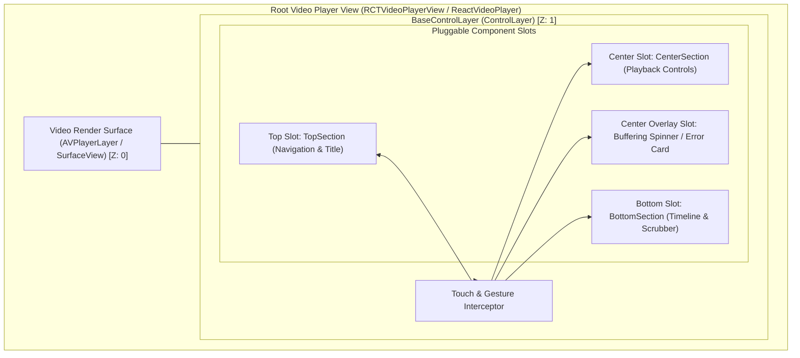
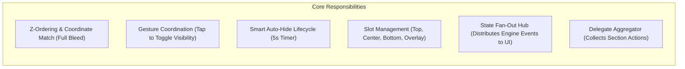
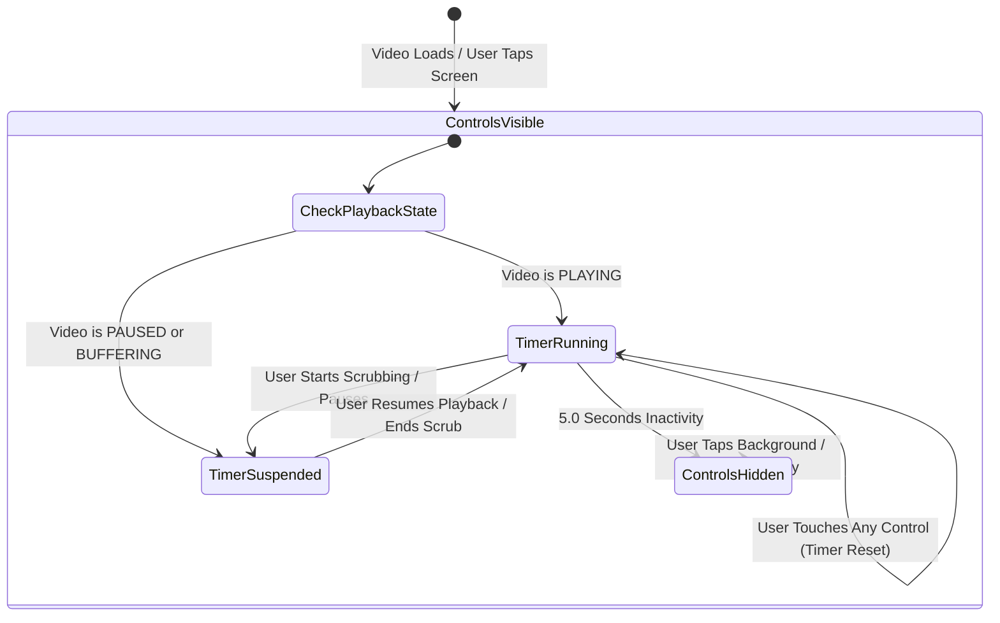
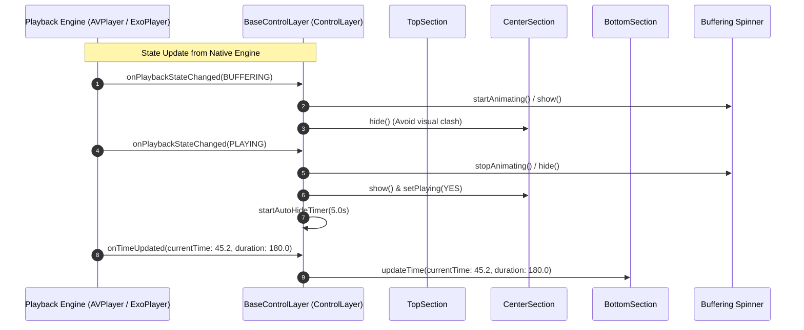

# Base Control Layer Architecture Specification (`base_layout_arch.md`)

## 1. Overview & Purpose

The **`BaseControlLayer`** (implemented as `ControlLayer`) is the master overlay container in the video player hierarchy. It is mounted directly on top of the native video surface (`AVPlayerLayer` on iOS, `PlayerView` on Android) and acts as the central coordinator for all user-facing controls.

It serves as the **single integration surface** that:
- Manages full-bleed bounds, safe areas, and z-index ordering.
- Coordinates touch gestures (background tap to toggle visibility).
- Enforces the smart auto-hide lifecycle (5-second inactivity timeout with pause/scrub immunity).
- Hosts the pluggable section slots (`TopSection`, `CenterSection`, `BottomSection`, and Buffering/Error overlays).
- Acts as the central State Fan-Out Hub between the player engine and child UI components.

---

## 2. Layer & Z-Index Hierarchy

---

## 3. Core Responsibilities

---

## 4. Smart Auto-Hide Lifecycle

Controls must feel natural and predictable. The auto-hide engine follows strict rules:

### Lifecycle Rules:
1. **Playing State**: When video is actively playing, inactivity triggers a smooth 0.25s fade-out to `alpha = 0.0` after **5.0 seconds**.
2. **Pause Immunity**: When video is paused, controls **remain visible indefinitely**. Auto-hide is disabled so users can inspect titles, scrub, or read captions.
3. **Scrub Immunity**: While the user is actively dragging the `UISlider` / `SeekBar`, the auto-hide timer is canceled so controls never fade out mid-scrub.
4. **Touch Reset**: Any interaction with child buttons resets the 5-second countdown.

---

## 5. State Fan-Out & Event Aggregation

`BaseControlLayer` is the bridge between the native playback engine and the UI sections:

---

## 6. Cross-Platform Class Mapping

| Feature | iOS / tvOS (`ControlLayer.mm`) | Android / Android TV (`ControlLayer.kt`) |
| :--- | :--- | :--- |
| **Base Class** | `UIView` | `FrameLayout` |
| **Sizing** | `translatesAutoresizingMaskIntoConstraints = NO`, pinned to container bounds | `match_parent` width and height |
| **Timer Mechanism** | `NSTimer scheduledTimerWithTimeInterval:5.0` | `Handler(Looper.getMainLooper()).postDelayed(5000L)` |
| **Fade Animation** | `[UIView animateWithDuration:0.25 animations:...]` | `animate().alpha(0.0f).setDuration(250).start()` |
| **Gesture Handler** | `UITapGestureRecognizer` attached to background | `GestureDetector` / `setOnClickListener` |
| **Child Slots** | `topSection`, `centerSection`, `bottomSection`, `spinner` | `topSection`, `centerSection`, `bottomSection`, `progressBar` |
| **Delegates** | Conforms to `TopSectionDelegate`, `CenterSectionDelegate`, `BottomSectionDelegate` | Implements `TopSectionListener`, `CenterSectionListener`, `BottomSectionListener` |

---

## 7. Implementation & Verification Status

- [x] **iOS Master ControlLayer (`ControlLayer.mm`)**: Fully implemented and compiled into `Player.app` with `xcodebuild` (Exit code 0). Manages `CenterSection`, 5s auto-hide with pause immunity, and dispatches directly to `PlayerStateCoordinator`.
- [x] **Android Master ControlLayer (`ControlLayer.kt`)**: Fully implemented, mounted as overlay in `ReactVideoPlayer.kt`, and synchronized with `BasePlayer.kt` playback state callbacks.

