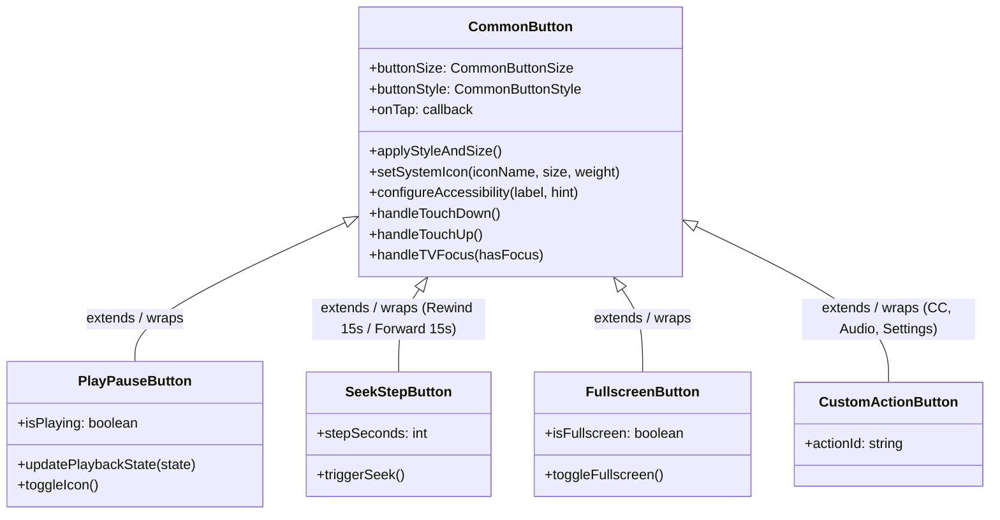
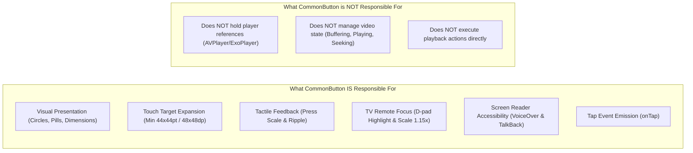
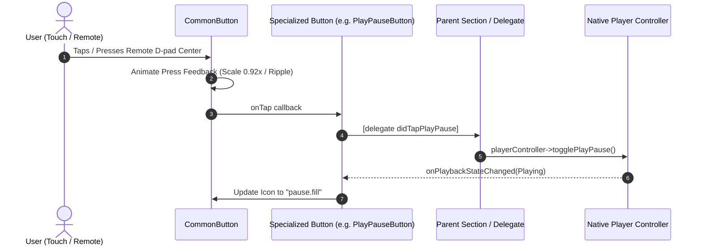

# CommonButton Architecture Specification (`button_arch.md`)

## 1. Overview & Purpose

`CommonButton` is the foundational UI button primitive for the entire enterprise video player. It provides an extensible, battle-tested base class for all interactive buttons across **iOS, Apple TV (tvOS), Android, and Android TV / Fire TV**.

It abstracts away the complexities of:
- High-contrast visual styling and circular masks.
- Platform touch target guidelines (minimum 44×44pt on Apple, 48×48dp on Android).
- TV remote D-pad focus mechanics and highlight animations.
- Screen-reader accessibility (VoiceOver & TalkBack).
- Micro-interactions (tactile press scaling and Material ripple effects).

---

## 2. Architectural Hierarchy



---

## 3. Separation of Concerns: Responsibilities



---

## 4. Cross-Platform Feature Alignment

| Capability | iOS / tvOS (`CommonButton.m`) | Android / Android TV (`CommonButton.kt`) |
| :--- | :--- | :--- |
| **Base Class** | `UIButton` | `AppCompatImageButton` |
| **Size Presets** | `Small` (36pt), `Medium` (48pt), `Large` (72pt) | `SMALL` (36dp), `MEDIUM` (48dp), `LARGE` (72dp) |
| **Background Mask** | Circular `layer.cornerRadius = size / 2.0` | `GradientDrawable(shape = OVAL)` |
| **Default Color** | `rgba(26, 26, 26, 0.55)` translucent black | `#8A1A1A1A` (55% translucent black) |
| **Touch Target** | Min 44×44pt via `pointInside:withEvent:` | Min 48×48dp via `minimumWidth`/`minimumHeight` |
| **Touch Feedback** | Spring scale animation down to `0.92x` | Scale down to `0.92x` + Material `RippleDrawable` |
| **TV Focus State** | `canBecomeFocused = YES`, scales `1.15x` | `isFocusable = true`, scales `1.18x` |
| **TV Focus Ring** | White 2.0pt border on focus | White 2.0dp stroke on focus |
| **Remote Keys** | Standard tvOS Remote Click | `KEYCODE_DPAD_CENTER` & `KEYCODE_ENTER` |
| **Accessibility** | `UIAccessibilityTraitButton`, `accessibilityLabel` | `contentDescription`, `ViewCompat.setStateDescription` |

---

## 5. Interaction & Event Flow



---

## 6. How Specialized Buttons Extend `CommonButton`

Specialized playback buttons either **subclass** `CommonButton` or **contain** `CommonButton` as an inner component.

### Example: `PlayPauseButton`
```objc
@interface PlayPauseButton : UIView
@property (nonatomic, strong) CommonButton *innerButton;
@property (nonatomic, assign) BOOL isPlaying;
- (void)setPlaybackState:(BOOL)isPlaying;
@end
```
1. It initializes `innerButton = [[CommonButton alloc] initWithSize:CommonButtonSizeLarge style:CommonButtonStyleTranslucentCircle];`.
2. When tapped, it notifies the delegate: `[self.delegate didTapPlayPause];`.
3. When the player state changes:
   - If `isPlaying == YES`: Sets icon to `"pause.fill"`, accessibility label to `"Pause video"`.
   - If `isPlaying == NO`: Sets icon to `"play.fill"`, accessibility label to `"Play video"`.

### Example: `RewindButton` & `ForwardButton`
- Uses `CommonButtonSizeMedium` (48pt).
- Configures icon to `"gobackward.15"` or `"goforward.15"`.
- Sets accessibility label to `"Rewind 15 seconds"` / `"Fast-forward 15 seconds"`.
- Tapping fires `[self.delegate didTapSeekBy:-15.0];`.

---

## 7. Implementation Checklist for Phase 2

- [x] Write [CommonButton.h](file:///Users/ashokammineni/video-player/new_2/Player/ios/VideoPlayer/Common/CommonButton.h) & [CommonButton.m](file:///Users/ashokammineni/video-player/new_2/Player/ios/VideoPlayer/Common/CommonButton.m) (iOS / tvOS).
- [x] Write `CommonButton.kt` in `android/app/src/main/java/com/player/ui/common/` (Android / Android TV).
- [x] Refactor [CenterSection.mm](file:///Users/ashokammineni/video-player/new_2/Player/ios/VideoPlayer/Layers/ControlLayer/CenterSection/CenterSection.mm) to replace duplicate button creation code with `CommonButton`.
- [x] Connect `CommonButton` to tvOS focus and TalkBack/VoiceOver testing.

---

## 8. Custom Icon Replacement & Scrubber Notch Architecture (v1.0.0)

Both iOS (`CommonButton.m`) and Android (`CommonButton.kt`) support custom icon replacement with fallback system icons:

### Icon Resolution Hierarchy:
1. **Local File / Asset Catalog URI**: `file://...` or standard bundle resource resolved at build time via `Image.resolveAssetSource()`.
2. **SF Symbol / Drawable Resource**: String names matching platform system icons (e.g. `play.fill`, `ic_media_play`).
3. **Remote HTTP/HTTPS URL**: Fetched asynchronously on background threads without blocking main UI.
4. **Slider Scrubber Notch (Thumb)**: Replaces standard circle notch via `UISlider.setThumbImage:forState:` on iOS and `SeekBar.thumb = drawable` on Android. Tinting is handled via `accentColor` (`tintColor` / `thumbTintList`).
