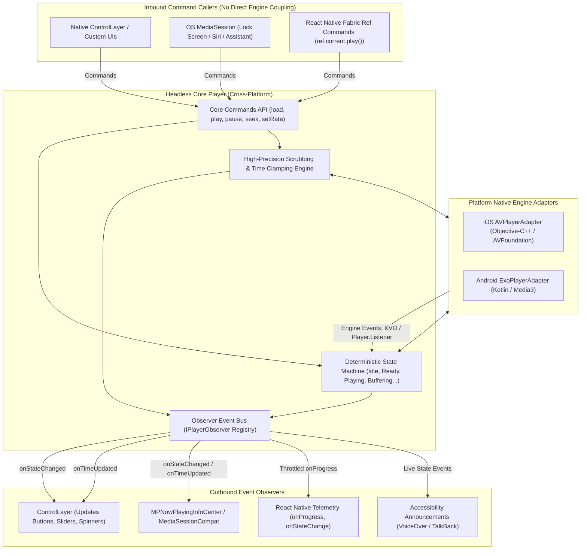
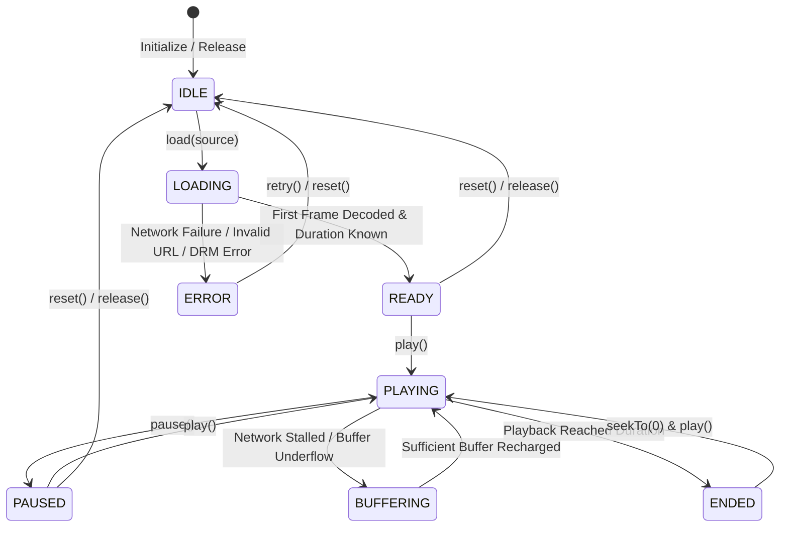

# Headless Core Player Architecture Specification (`core_player_arch.md`)

## 1. Overview & The Separation Principle

The **Headless Core Player** is the central playback engine of the architecture. It is strictly **decoupled from all UI elements**.

### Core Tenet: Zero UI in the Core Engine
- The Core Player has **no views, no buttons, no sliders, no colors, and no layout logic**.
- Its sole purpose is to manage **media loading, playback state transitions, timing calculation, buffering, audio/subtitles tracks, and platform engine adaptation**.
- Any UI (such as [base_layout_arch.md](file:///Users/ashokammineni/video-player/new_2/Player/base_layout_arch.md), lock-screen media widgets, or Apple TV focus layers) acts as an external **observer** that subscribes to state and sends commands.

---

## 2. High-Level Core Architecture Diagram



---

## 3. Formal Playback State Machine

The core enforces a strict, deterministic state machine. No UI can force an invalid transition.



### State Definitions:
- **`IDLE`**: Player instance exists, but no media source is loaded. Decoders are idle.
- **`LOADING`**: Media item requested; manifest / headers / initial buffer loading.
- **`READY`**: Video metadata (duration, width, height, audio/subtitle tracks) is parsed; ready for immediate playback.
- **`PLAYING`**: Audio/video clock is running and frames are rendering.
- **`PAUSED`**: Audio/video clock is paused at the current timestamp.
- **`BUFFERING`**: Media is temporarily paused while waiting for network data.
- **`ENDED`**: Current timestamp reached the video duration.
- **`ERROR`**: Playback failed (network disconnect, decoding failure, DRM license expiration).

---

## 4. Inbound Command API (Platform-Agnostic Interface)

Every platform adapter and shared core component implements this uniform command interface:

```cpp
class ICorePlayer {
public:
    virtual ~ICorePlayer() = default;

    // Lifecycle & Loading
    virtual void load(const std::string& url, const std::string& mimeType = "") = 0;
    virtual void reset() = 0;
    virtual void release() = 0;

    // Playback Controls
    virtual void play() = 0;
    virtual void pause() = 0;
    virtual void togglePlayPause() = 0;
    virtual void stop() = 0;

    // Seeking & Scrubbing
    virtual void seekTo(double seconds, bool accurate = true) = 0;
    virtual void seekBy(double deltaSeconds) = 0; // e.g. +15s, -15s
    virtual void startScrubbing() = 0;
    virtual void scrubTo(double seconds) = 0;
    virtual void endScrubbing(double finalSeconds) = 0;

    // Audio & Rate
    virtual void setPlaybackRate(float rate) = 0; // 0.5x, 1.0x, 1.5x, 2.0x
    virtual void setVolume(float volume) = 0;     // 0.0f to 1.0f
    virtual void setMuted(bool muted) = 0;

    // Track Selection
    virtual void selectAudioTrack(int trackIndex) = 0;
    virtual void selectTextTrack(int trackIndex) = 0;
};
```

---

## 5. Outbound Observer Interface (`IPlayerObserver`)

UI controls, OS media notification services, and analytics modules subscribe to the core via this observer contract:

```cpp
class IPlayerObserver {
public:
    virtual ~IPlayerObserver() = default;

    // Playback State
    virtual void onPlaybackStateChanged(PlaybackState newState) = 0;
    
    // Time & Progress (Dispatched on Audio/Video Clock)
    virtual void onTimeUpdated(double currentTime, double duration) = 0;
    virtual void onBufferProgress(double bufferedSeconds, double percentage) = 0;
    
    // Media Dimensions & Metadata
    virtual void onVideoDimensionsChanged(int width, int height) = 0;
    virtual void onDurationChanged(double duration) = 0;
    
    // Track Changes
    virtual void onTracksAvailable(const std::vector<AudioTrack>& audioTracks, 
                                   const std::vector<TextTrack>& textTracks) = 0;
    
    // Error Reporting
    virtual void onPlaybackError(int errorCode, const std::string& message) = 0;
};
```

---

## 6. Platform Engine Binding (Bridging the Real Engines)

### iOS / tvOS (`AVPlayerAdapter`)
- Wraps an `AVPlayer` and `AVPlayerItem`.
- **State Listening**: Uses Key-Value Observing (KVO) on `player.timeControlStatus` (`paused`, `waitingToPlayAtSpecifiedRate`, `playing`).
- **Timing**: Adds an `addPeriodicTimeObserverForInterval:queue:usingBlock:` on the main dispatch queue (e.g. interval of `CMTimeMake(1, 4)` = 4 updates per second).
- **Duration**: Observes `currentItem.duration` via KVO on `AVPlayerItemStatusReadyToPlay`.
- **End Notification**: Subscribes to `AVPlayerItemDidPlayToEndTimeNotification`.

### Android / Android TV (`ExoPlayerAdapter`)
- Wraps an `androidx.media3.exoplayer.ExoPlayer`.
- **State Listening**: Uses `Player.Listener`:
  - `onPlaybackStateChanged(state)`: Maps `STATE_IDLE`, `STATE_BUFFERING`, `STATE_READY`, `STATE_ENDED`.
  - `onIsPlayingChanged(isPlaying)`: Dispatches `PLAYING` or `PAUSED`.
  - `onVideoSizeChanged(videoSize)`: Dispatches dimensions.
- **Timing**: Runs a lightweight periodic `Runnable` on the Android Main Looper during `PLAYING` states.

---

## 7. Thread Safety & Lifecycle Management

1. **Main Thread UI Safety**: All observer events delivered to UI controls are guaranteed to dispatch on the platform's **Main / UI Thread** (UIKit / Android Main Looper) so UI views never crash from background thread updates.
2. **Deterministic Teardown (`release()`)**:
   - iOS: Removes all periodic time observers and KVO observers before releasing `AVPlayer` memory.
   - Android: Calls `exoPlayer.stop()` and `exoPlayer.release()` to instantly reclaim hardware decoder resources.
3. **Background Audio & PiP Continuity**:
   - Because the core is headless, detaching or minimizing the video surface does **not stop audio playback**. 
   - When entering Picture-in-Picture, only the video surface transfers to the PiP window; the core state machine continues running uninterrupted.

---

## 8. Implementation & Verification Status

- [x] **Shared C++ Coordinator Core (`cpp/`)**: Fully implemented in [PlayerStateCoordinator.cpp](file:///Users/ashokammineni/video-player/new_2/Player/cpp/PlayerStateCoordinator.cpp), thread-safe with `std::mutex`, zero UI dependencies.
- [x] **iOS AVPlayer Adapter (`AVPlayerAdapter.mm`)**: Fully implemented, registered in `project.pbxproj`, and verified with `xcodebuild` (Exit code 0).
- [x] **Android Media3 ExoPlayer Adapter (`BasePlayer.kt`)**: Fully implemented base ExoPlayer wrapper with `onPlaybackStateListener` callbacks dispatched to `ControlLayer.kt` and `ReactVideoPlayer.kt`.

