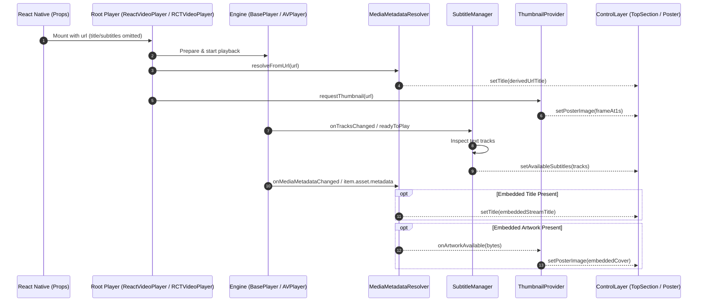

# Metadata, Subtitles & Thumbnail Architecture (`metadata_subtitles_thumbnail_arch.md`)

## 1. Overview & Architectural Principles

This subsystem establishes dedicated, modular services for resolving media metadata (Title, Artist, Duration), managing subtitle/caption tracks, and generating video poster thumbnails directly from media stream sources and URLs.

### Core Principles
1. **Separation of Concerns (SoC)**: Player engines (`BasePlayer`, `AVPlayerAdapter`) focus strictly on playback lifecycle, clock coordination, and rendering. Parsing, track management, and image extraction are delegated to isolated modules.
2. **Zero-Prop Autonomy**: If React Native passes explicit `title`, `subtitles`, or `poster` props, they serve as developer overrides. If omitted or empty, the player autonomously discovers and resolves them from the stream or URL.
3. **Non-Blocking & Memory-Safe**: Frame generation and image decoding occur strictly off the main UI thread with in-memory LRU caching to eliminate UI jank.

---

## 2. Subsystem Structure

### Android (`android/app/src/main/java/com/player/`)
```
com.player/
├── metadata/
│   ├── MediaMetadataInfo.kt       # Immutable data model (title, artist, artworkBytes)
│   └── MediaMetadataResolver.kt   # Extractor for MP4 tags, ID3, ICY & clean URL slugs
├── subtitles/
│   ├── SubtitleTrack.kt           # Immutable model (id, language, label, isSelected)
│   └── SubtitleManager.kt         # Track querying, language preference & switching
└── thumbnail/
    └── ThumbnailProvider.kt       # Async frame capture (1.0s) with memory LRU cache
```

### iOS (`ios/VideoPlayer/`)
```
ios/VideoPlayer/
├── Metadata/
│   ├── MediaMetadataResolver.h
│   └── MediaMetadataResolver.mm   # AVAsset commonMetadata / QuickTime tags & URL slug cleaner
├── Subtitles/
│   ├── SubtitleManager.h
│   └── SubtitleManager.mm         # AVMediaCharacteristicLegible track selector
└── Thumbnail/
    ├── ThumbnailProvider.h
    └── ThumbnailProvider.mm       # AVAssetImageGenerator (1.0s) with NSCache
```

---

## 3. Module Specifications

### A. MediaMetadataResolver
- **Inputs**: Media source URL (`String` / `NSURL`), optional embedded metadata (`androidx.media3.common.MediaMetadata` / `AVMetadataItem`).
- **Hierarchy of Title Resolution**:
  1. Manual prop override (if non-empty).
  2. Stream / container embedded title (MP4 `©nam`, ID3 `TIT2`, ICY stream title).
  3. Clean URL slug derivation (decoding percent-encoding, removing query params, extensions, and resolution tokens like `1080p`, converting snake_case/kebab-case/CamelCase to Title Case).
- **Outputs**: `MediaMetadataInfo` delivered to `ControlLayer.setTitle()`.

### B. SubtitleManager
- **Inputs**: Platform player engine track groups.
- **Responsibilities**:
  - Scans for legible text tracks (`C.TRACK_TYPE_TEXT` on Android, `AVMediaCharacteristicLegible` on iOS).
  - Maintains the list of available subtitles and active selection state.
  - Toggles/selects subtitle tracks on the underlying player engine.
  - Dynamically updates visibility and state of the `TopSection` captions button (hiding or disabling it when no text tracks exist in the media).

### C. ThumbnailProvider
- **Inputs**: Media source URL and optional embedded artwork byte buffer.
- **Responsibilities**:
  - If embedded artwork (`covr` atom or ID3 `APIC`) is present, decodes it into a bitmap.
  - If no embedded artwork is present, dispatches asynchronous native frame capture at timestamp 1.0s (`MediaMetadataRetriever` on Android, `AVAssetImageGenerator` on iOS).
  - Caches thumbnails in memory (`LruCache` / `NSCache`) keyed by media URL.
  - Delivers the loaded bitmap to the player overlay poster view.

---

## 4. Data Flow & Integration Diagram


