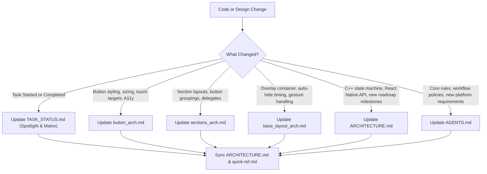

# Quick Reference & Documentation Map (`quick-ref.md`)

## 1. Documentation Sitemap

This repository maintains living architectural documentation. Every document has a distinct scope and purpose:

| Document | Purpose & Scope | Key Topics Covered |
| :--- | :--- | :--- |
| [VERSION_1.0_RELEASE.md](file:///Users/ashokammineni/video-player/new_2/Player/VERSION_1.0_RELEASE.md) | **Version 1.0 Release Audit** | • Formal v1.0.0 scope, acceptance criteria, completed components & roadmap |
| [TASK_STATUS.md](file:///Users/ashokammineni/video-player/new_2/Player/TASK_STATUS.md) | **Live Implementation Tracker** | • Active task spotlight & currently running work • Full component milestone status matrix • Mandatory agent update workflow & protocol |
| [AGENTS.md](file:///Users/ashokammineni/video-player/new_2/Player/AGENTS.md) | **Governance & Rules** | • Strict User Approval Policy (Permission required before mutating code) • 11 Core Architectural & Engineering Principles • Living documentation and task tracking mandate |
| [ARCHITECTURE.md](file:///Users/ashokammineni/video-player/new_2/Player/ARCHITECTURE.md) | **Master System Architecture** | • High-level system architecture & Mermaid diagrams • Dual-lane data & event flow (High-frequency native vs Low-frequency JS) • Pre-built native templates & configuration props • Layer-by-layer technical breakdown • Enterprise features (TV, A11y, Voice, Audio Focus, PiP) • System-wide implementation status |
| [USAGE_GUIDE.md](file:///Users/ashokammineni/video-player/new_2/Player/USAGE_GUIDE.md) | **React Native Usage & API Reference** | • Props reference table (`videoUrl`, `title`, `play`, `seekTo`, etc.) • Event callbacks (`onScriptLoaded`, `onError`, `onPlay`, etc.) • Practical code recipes (16:9 aspect ratio, controlled buttons, playlists) • TypeScript interfaces (`VideoPlayerProps`) |
| [network_auth_arch.md](file:///Users/ashokammineni/video-player/new_2/Player/network_auth_arch.md) | **Networking, Auth & Hardware DRM** | • Custom HTTP headers injection (`AVURLAssetHTTPHeaderFieldsKey` & `DefaultHttpDataSource`) • Apple FairPlay Streaming (`AVContentKeySession`, SPC <-> CKC) • Google Widevine Modular (`DefaultDrmSessionManager` L1/L3) • Native interceptors & thread-safe token refresh • Unified error propagation into C++ coordinator |
| [analytics_arch.md](file:///Users/ashokammineni/video-player/new_2/Player/analytics_arch.md) | **Analytics & Plugin Architecture** | • Vendor-agnostic plugin architecture (`VideoPlayerAnalyticsPlugin`, `BaseAnalyticsPlugin`) • Standardized QoE, QoS, watch-time & heartbeat schemas • Session management & defensive error isolation in `AnalyticsCoordinator` • Built-in `ConsoleAnalyticsPlugin` & `HttpBeaconPlugin` |
| [core_player_arch.md](file:///Users/ashokammineni/video-player/new_2/Player/core_player_arch.md) | **Headless Core Player** | • Zero-UI separation principle • Formal 8-state deterministic playback state machine • Inbound Commands API (`ICorePlayer`) & Outbound Observer Bus (`IPlayerObserver`) • Platform engine adapters (`AVPlayerAdapter` & `ExoPlayerAdapter`) |
| [state_manager_arch.md](file:///Users/ashokammineni/video-player/new_2/Player/state_manager_arch.md) | **Headless State Coordinator** | • Pure C++17 thread-safe state machine & scrub math (`PlayerStateCoordinator`) • Memory safety: `std::weak_ptr` observer pattern with auto-pruning • Outbound Engine Bridge (`IPlaybackEngineBridge`) & Observer Bus (`IPlayerStateObserver`) • Cross-platform `cpp/` directory structure |
| [base_layout_arch.md](file:///Users/ashokammineni/video-player/new_2/Player/base_layout_arch.md) | **Master Overlay Container** | • `BaseControlLayer` / `ControlLayer` specification • Full-bleed z-index layering over native video surface • Smart auto-hide lifecycle (5s countdown, pause immunity, scrub immunity) • State fan-out from engine to child sections |
| [sections_arch.md](file:///Users/ashokammineni/video-player/new_2/Player/sections_arch.md) | **Section Layouts & Delegates** | • 3-Section breakdown: `TopSection`, `CenterSection`, `BottomSection` • Decoupled communication protocols (`CenterSectionDelegate`, `TopSectionDelegate`, `BottomSectionDelegate`) • Apple TV & Android TV 2D remote focus navigation grid |
| [layout_builder_arch.md](file:///Users/ashokammineni/video-player/new_2/Player/layout_builder_arch.md) | **Custom Layout Builder** | • 2-Pillar architecture (Turnkey vs Declarative Custom Builder) • Layout schema specification (`LayoutNode`, element types, style map) • Dual execution modes: Runtime Inflater (SDUI) vs Build-Time AOT (CLI) • Zero-cost fast-path routing for turnkey player • Primitive catalog & C++ state coordinator binding |
| [button_arch.md](file:///Users/ashokammineni/video-player/new_2/Player/button_arch.md) | **Base Button Primitive** | • `CommonButton` foundation (iOS & Android) • Sizing presets (Small, Medium, Large) • Apple HIG 44×44pt & Material 48×48dp minimum touch targets • Spring micro-interactions & Material ripple • tvOS & Android TV focus engine scaling (1.15x) • VoiceOver & TalkBack accessibility |
| [TESTING_ARCHITECTURE.md](file:///Users/ashokammineni/video-player/new_2/Player/TESTING_ARCHITECTURE.md) | **Testing Architecture & Enterprise Benchmarks** | • Multi-tier testing pyramid (C++ Core, Native Engines, UI, Fabric, E2E) • Enterprise stress, memory leak, 12h soak, and chaos testing • Production benchmarks (TTFF, 60fps scrub, rebuffer ratio, memory delta) • Automated CI vs. manual matrix and copy-pasteable test scripts |
| [metadata_subtitles_thumbnail_arch.md](file:///Users/ashokammineni/video-player/new_2/Player/metadata_subtitles_thumbnail_arch.md) | **Metadata, Subtitles & Thumbnail Subsystems** | • Isolated `MediaMetadataResolver` for MP4/ID3/ICY/URL slug titles • Dedicated `SubtitleManager` for text track query and language selection • Asynchronous `ThumbnailProvider` with frame extraction at 1.0s and memory caching |
| [quick-ref.md](file:///Users/ashokammineni/video-player/new_2/Player/quick-ref.md) | **Index & Update Guide** | • This document: fast lookup index, code mapping, and update triggers |

---

## 2. "When to Update What" (Update Guide for Developers & Agents)

Whenever a change is made in the codebase, use this matrix to identify which documentation files must be updated:

### Detailed Update Triggers:

0. **When Starting or Finishing ANY Task**:
   - **Update**: [TASK_STATUS.md](file:///Users/ashokammineni/video-player/new_2/Player/TASK_STATUS.md) (Set to `[IN PROGRESS]` at start, and `[COMPLETED]` with milestone updates upon completion).

1. **If you modify Button logic / styling**:
   - **Files**: `CommonButton.h`, `CommonButton.m`, `CommonButton.kt`
   - **Update**: [button_arch.md](file:///Users/ashokammineni/video-player/new_2/Player/button_arch.md) (Section 2, 4, or 6).

2. **If you add/modify a Section (`TopSection`, `CenterSection`, `BottomSection`)**:
   - **Files**: `CenterSection.*`, `TopSection.*`, `BottomSection.*`
   - **Update**: [sections_arch.md](file:///Users/ashokammineni/video-player/new_2/Player/sections_arch.md) (Update Section 3 roles, Section 4 delegates, and Section 8 status checklist).

3. **If you modify the Master Overlay (`ControlLayer`) or Auto-Hide rules**:
   - **Files**: `ControlLayer.h`, `ControlLayer.mm`, `ControlLayer.kt`
   - **Update**: [base_layout_arch.md](file:///Users/ashokammineni/video-player/new_2/Player/base_layout_arch.md) (Update Section 4 lifecycle states or Section 6 mapping).

4. **If you modify Headless Playback Core logic (State machine, Commands, Observers)**:
   - **Files**: `PlayerStateCoordinator.*`, `AVPlayerAdapter.*`, `BasePlayer.*`
   - **Update**: [core_player_arch.md](file:///Users/ashokammineni/video-player/new_2/Player/core_player_arch.md) & [state_manager_arch.md](file:///Users/ashokammineni/video-player/new_2/Player/state_manager_arch.md).

5. **If you make System-Level Architectural or Roadmap changes**:
   - **Files**: C++ core, Fabric specs, platform engine bridges, or new milestones.
   - **Update**: [ARCHITECTURE.md](file:///Users/ashokammineni/video-player/new_2/Player/ARCHITECTURE.md) (Update Section 2 diagrams, Section 4 specs, or Section 6 implementation inventory) & [TASK_STATUS.md](file:///Users/ashokammineni/video-player/new_2/Player/TASK_STATUS.md).

6. **If you modify Analytics, Metrics, or Plugins**:
   - **Files**: `src/analytics/*`, `AnalyticsCoordinator.ts`, or telemetry plugins
   - **Update**: [analytics_arch.md](file:///Users/ashokammineni/video-player/new_2/Player/analytics_arch.md).

7. **If you modify Operational or Engineering Rules**:
   - **Update**: [AGENTS.md](file:///Users/ashokammineni/video-player/new_2/Player/AGENTS.md) (Update policies or principles).

8. **If you modify Custom Layout Builder, Schemas, or Parsers**:
   - **Files**: `src/dynamic/*`, `scripts/compile-layout.ts`, or layout schemas
   - **Update**: [layout_builder_arch.md](file:///Users/ashokammineni/video-player/new_2/Player/layout_builder_arch.md).

9. **If you modify Testing Infrastructure, Soak Scripts, or Performance Benchmarks**:
   - **Files**: `scripts/test-*`, `__tests__/*`, `tests/`, benchmark thresholds
   - **Update**: [TESTING_ARCHITECTURE.md](file:///Users/ashokammineni/video-player/new_2/Player/TESTING_ARCHITECTURE.md).

---

## 3. Active Code Inventory (Version 1.0 Release)

### Shared C++ Headless Core (v1.0 Active)
- **Type Definitions**: [PlayerTypes.hpp](file:///Users/ashokammineni/video-player/new_2/Player/cpp/PlayerTypes.hpp)
- **Observer Interface**: [IPlayerStateObserver.hpp](file:///Users/ashokammineni/video-player/new_2/Player/cpp/IPlayerStateObserver.hpp)
- **Engine Bridge Contract**: [IPlaybackEngineBridge.hpp](file:///Users/ashokammineni/video-player/new_2/Player/cpp/IPlaybackEngineBridge.hpp)
- **State Coordinator**: [PlayerStateCoordinator.hpp](file:///Users/ashokammineni/video-player/new_2/Player/cpp/PlayerStateCoordinator.hpp) & [PlayerStateCoordinator.cpp](file:///Users/ashokammineni/video-player/new_2/Player/cpp/PlayerStateCoordinator.cpp)

### iOS / tvOS Components (v1.0 Active)
- **Playback Engine Adapter**: [AVPlayerAdapter.h](file:///Users/ashokammineni/video-player/new_2/Player/ios/VideoPlayer/Core/AVPlayerAdapter.h) & [AVPlayerAdapter.mm](file:///Users/ashokammineni/video-player/new_2/Player/ios/VideoPlayer/Core/AVPlayerAdapter.mm)
- **Network & DRM Manager**: [NetworkAuthManager.h](file:///Users/ashokammineni/video-player/new_2/Player/ios/VideoPlayer/Network/NetworkAuthManager.h) & [NetworkAuthManager.mm](file:///Users/ashokammineni/video-player/new_2/Player/ios/VideoPlayer/Network/NetworkAuthManager.mm)
- **Base Button**: [CommonButton.h](file:///Users/ashokammineni/video-player/new_2/Player/ios/VideoPlayer/Common/CommonButton.h) & [CommonButton.m](file:///Users/ashokammineni/video-player/new_2/Player/ios/VideoPlayer/Common/CommonButton.m)
- **Playback Top Section**: [TopSection.h](file:///Users/ashokammineni/video-player/new_2/Player/ios/VideoPlayer/Layers/ControlLayer/TopSection/TopSection.h) & [TopSection.mm](file:///Users/ashokammineni/video-player/new_2/Player/ios/VideoPlayer/Layers/ControlLayer/TopSection/TopSection.mm)
- **Playback Center Section**: [CenterSection.h](file:///Users/ashokammineni/video-player/new_2/Player/ios/VideoPlayer/Layers/ControlLayer/CenterSection/CenterSection.h) & [CenterSection.mm](file:///Users/ashokammineni/video-player/new_2/Player/ios/VideoPlayer/Layers/ControlLayer/CenterSection/CenterSection.mm)
- **Playback Bottom Section**: [BottomSection.h](file:///Users/ashokammineni/video-player/new_2/Player/ios/VideoPlayer/Layers/ControlLayer/BottomSection/BottomSection.h) & [BottomSection.mm](file:///Users/ashokammineni/video-player/new_2/Player/ios/VideoPlayer/Layers/ControlLayer/BottomSection/BottomSection.mm)
- **Master Overlay Container**: [ControlLayer.h](file:///Users/ashokammineni/video-player/new_2/Player/ios/VideoPlayer/Layers/ControlLayer/ControlLayer.h) & [ControlLayer.mm](file:///Users/ashokammineni/video-player/new_2/Player/ios/VideoPlayer/Layers/ControlLayer/ControlLayer.mm)
- **Orientation & Fullscreen**: [OrientationManager.h](file:///Users/ashokammineni/video-player/new_2/Player/ios/VideoPlayer/OrientationManager.h)
- **Root Native View**: [RCTVideoPlayer.mm](file:///Users/ashokammineni/video-player/new_2/Player/ios/VideoPlayer/RCTVideoPlayer.mm)

### Android / Android TV Components (v1.0 Active)
- **C++ JNI Bridge**: [PlayerStateCoordinatorJni.cpp](file:///Users/ashokammineni/video-player/new_2/Player/android/app/src/main/jni/PlayerStateCoordinatorJni.cpp) & [CMakeLists.txt](file:///Users/ashokammineni/video-player/new_2/Player/android/app/src/main/jni/CMakeLists.txt)
- **Coordinator Facade**: [PlayerStateCoordinator.kt](file:///Users/ashokammineni/video-player/new_2/Player/android/app/src/main/java/com/player/core/PlayerStateCoordinator.kt) & [PlaybackState.kt](file:///Users/ashokammineni/video-player/new_2/Player/android/app/src/main/java/com/player/core/PlaybackState.kt)
- **Network & DRM Manager**: [NetworkAuthManager.kt](file:///Users/ashokammineni/video-player/new_2/Player/android/app/src/main/java/com/player/network/NetworkAuthManager.kt) & [DrmConfig.kt](file:///Users/ashokammineni/video-player/new_2/Player/android/app/src/main/java/com/player/network/DrmConfig.kt) & [TokenRefreshAuthenticator.kt](file:///Users/ashokammineni/video-player/new_2/Player/android/app/src/main/java/com/player/network/TokenRefreshAuthenticator.kt)
- **Base Button**: [CommonButton.kt](file:///Users/ashokammineni/video-player/new_2/Player/android/app/src/main/java/com/player/ui/common/CommonButton.kt)
- **Playback Center Section**: [CenterSection.kt](file:///Users/ashokammineni/video-player/new_2/Player/android/app/src/main/java/com/player/ui/sections/CenterSection.kt)
- **Playback Top Section**: [TopSection.kt](file:///Users/ashokammineni/video-player/new_2/Player/android/app/src/main/java/com/player/ui/sections/TopSection.kt)
- **Playback Bottom Section**: [BottomSection.kt](file:///Users/ashokammineni/video-player/new_2/Player/android/app/src/main/java/com/player/ui/sections/BottomSection.kt)
- **Master Overlay Container**: [ControlLayer.kt](file:///Users/ashokammineni/video-player/new_2/Player/android/app/src/main/java/com/player/ui/ControlLayer.kt)
- **ExoPlayer Wrapper**: [BasePlayer.kt](file:///Users/ashokammineni/video-player/new_2/Player/android/app/src/main/java/com/player/videoplayer/BasePlayer.kt)
- **Root View & Manager**: [ReactVideoPlayer.kt](file:///Users/ashokammineni/video-player/new_2/Player/android/app/src/main/java/com/player/ReactVideoPlayer.kt) & [ReactVideoPlayerManager.kt](file:///Users/ashokammineni/video-player/new_2/Player/android/app/src/main/java/com/player/ReactVideoPlayerManager.kt)

### React Native Fabric Components & Exports (v1.0 Active)
- **Component Root**: [src/index.tsx](file:///Users/ashokammineni/video-player/new_2/Player/src/index.tsx) (`<VideoPlayer />`)
- **Fabric Component Spec**: [VideoPlayerNativeComponent.ts](file:///Users/ashokammineni/video-player/new_2/Player/specs/VideoPlayerNativeComponent.ts)
- **Sample Application**: [App.tsx](file:///Users/ashokammineni/video-player/new_2/Player/App.tsx)

---

## 4. Post-v1.0 Roadmap Architecture Specifications (Planned for v2.0+)

The following subsystem specifications are designed and scheduled for upcoming releases:

- **Analytics & Telemetry Subsystem**: [analytics_arch.md](file:///Users/ashokammineni/video-player/new_2/Player/analytics_arch.md) (QoE metrics, `AnalyticsCoordinator`, plugins)
- **Custom Layout Builder Subsystem**: [layout_builder_arch.md](file:///Users/ashokammineni/video-player/new_2/Player/layout_builder_arch.md) (2-Pillar architecture, SDUI parser, AOT compiler)
