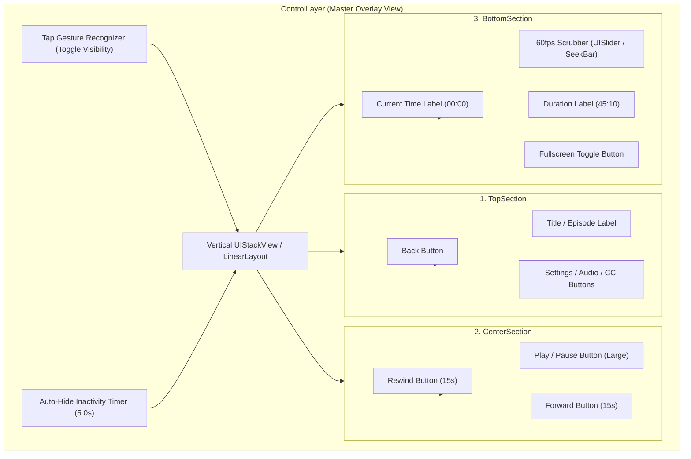
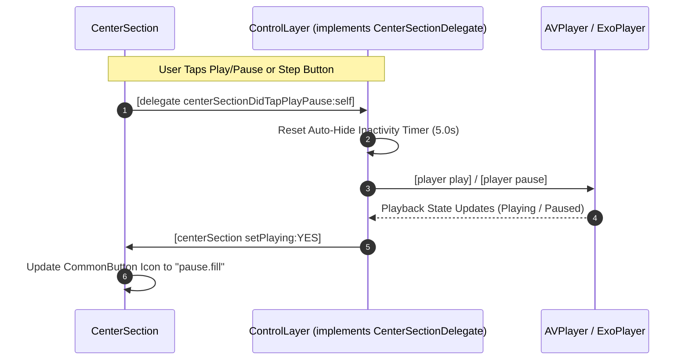

# Section Layout Architecture Specification (`sections_arch.md`)

## 1. Overview & Purpose

The **Section Layout Architecture** defines the structure, hierarchy, and communication contracts of the custom video player controls overlay. 

Instead of building a single, monolithic control overlay file, the controls are decomposed into **three modular, pluggable sections** managed by a master container (`ControlLayer`):

1. **`TopSection`**: Header area for navigation, metadata, and secondary actions.
2. **`CenterSection`**: Primary playback interaction zone (Rewind, Play/Pause, Fast Forward).
3. **`BottomSection`**: Timeline zone for time tracking, progress scrubbing, and fullscreen toggles.

---

## 2. Structural Hierarchy Diagram



---

## 3. Section Roles & Responsibilities

| Section | Layout Type | Primary Contents | User Interaction & Events |
| :--- | :--- | :--- | :--- |
| **`TopSection`** | Horizontal Stack | • Back / Dismiss button<br>• Video title / episode subtitle<br>• Settings / CC / Audio track buttons | Tap back to exit, tap settings to open modal |
| **`CenterSection`** | Horizontal Centered Stack | • Rewind (15s) `CommonButton`<br>• Play/Pause `CommonButton` (Large)<br>• Forward (15s) `CommonButton` | Immediate playback toggling and fixed-step seeking |
| **`BottomSection`** | Horizontal Stack | • Current elapsed time<br>• High-precision native Scrubber bar<br>• Remaining / total duration<br>• Fullscreen toggle button (defaults to hidden, controlled via `showFullscreenButton`) | Real-time continuous scrub seeking, fullscreen toggle, and `onFullscreenChange` native events |

---

## 4. Decoupled Communication Architecture (Delegate / Listener)

To prevent circular dependencies, tight coupling, and compiler errors, **sections never import their parent container or the playback engine directly**. They communicate purely through protocols/interfaces:



### Delegation Protocols:

#### iOS (`CenterSectionDelegate`)
```objc
@protocol CenterSectionDelegate <NSObject>
- (void)centerSectionDidTapPlayPause:(CenterSection *)section;
- (void)centerSection:(CenterSection *)section didTapRewind:(NSTimeInterval)seconds;
- (void)centerSection:(CenterSection *)section didTapForward:(NSTimeInterval)seconds;
@end
```

#### Android (`CenterSectionListener`)
```kotlin
interface CenterSectionListener {
    fun onPlayPauseClicked()
    fun onRewindClicked(seconds: Int = 15)
    fun onForwardClicked(seconds: Int = 15)
}
```

---

## 5. Master Container Responsibilities (`ControlLayer`)

The `ControlLayer` is the coordinating surface that sits on top of the native video render layer (`AVPlayerLayer` or `PlayerView`), implementing the base overlay architecture detailed in [base_layout_arch.md](file:///Users/ashokammineni/video-player/new_2/Player/base_layout_arch.md):

1. **Auto-Hide Inactivity Timer**:
   - When the user taps the screen, controls animate to `alpha = 1.0`.
   - A 5.0-second timer is scheduled.
   - If no interaction occurs and video is playing, controls smoothly fade out to `alpha = 0.0`.
   - Any touch or button click cancels and reschedules the timer.
2. **Gesture Management**:
   - Handles background taps to toggle controls visibility.
   - Passes touches through to section buttons without delay.
3. **Layout Distribution**:
   - Manages top, center, and bottom vertical distribution using Auto Layout constraints.

---

## 6. TV Remote & D-pad Focus Flow (Apple TV & Android TV)

For 10-foot viewing experiences, the sections form a natural 2D navigation grid:

```
        ┌────────────────────────────────────────────────────────┐
        │ [Back]                      [Title]         [Settings] │  TopSection
        └───────────────────────────▲────────────────────────────┘
                                    │ (D-pad Up / Down)
        ┌───────────────────────────▼────────────────────────────┐
        │         [Rewind]         [Play/Pause]       [Forward]  │  CenterSection
        │                            (Default)                   │
        └───────────────────────────▲────────────────────────────┘
                                    │ (D-pad Up / Down)
        ┌───────────────────────────▼────────────────────────────┐
        │ [00:00]        [══════════●══════════]      [Fullscreen]│ BottomSection
        └────────────────────────────────────────────────────────┘
```

1. **Default Focus**: When controls appear, focus defaults to the **Center Play/Pause button**.
2. **Vertical Navigation**: Pressing D-pad Up moves focus from Center to Top; pressing D-pad Down moves focus to the Bottom timeline.
3. **Horizontal Navigation**: Moving Left/Right stays within the active section.

---

## 7. Cross-Platform Class Mapping

| Component | iOS / tvOS Implementation | Android / Android TV Implementation |
| :--- | :--- | :--- |
| **Master Container** | [ControlLayer.h](file:///Users/ashokammineni/video-player/new_2/Player/ios/VideoPlayer/Layers/ControlLayer/ControlLayer.h) / `.mm` | [ControlLayer.kt](file:///Users/ashokammineni/video-player/new_2/Player/android/app/src/main/java/com/player/ui/ControlLayer.kt) |
| **Top Section** | [TopSection.h](file:///Users/ashokammineni/video-player/new_2/Player/ios/VideoPlayer/Layers/ControlLayer/TopSection/TopSection.h) / `.mm` | [TopSection.kt](file:///Users/ashokammineni/video-player/new_2/Player/android/app/src/main/java/com/player/ui/sections/TopSection.kt) |
| **Center Section** | [CenterSection.h](file:///Users/ashokammineni/video-player/new_2/Player/ios/VideoPlayer/Layers/ControlLayer/CenterSection/CenterSection.h) / `.mm` | [CenterSection.kt](file:///Users/ashokammineni/video-player/new_2/Player/android/app/src/main/java/com/player/ui/sections/CenterSection.kt) |
| **Bottom Section** | [BottomSection.h](file:///Users/ashokammineni/video-player/new_2/Player/ios/VideoPlayer/Layers/ControlLayer/BottomSection/BottomSection.h) / `.mm` | [BottomSection.kt](file:///Users/ashokammineni/video-player/new_2/Player/android/app/src/main/java/com/player/ui/sections/BottomSection.kt) |
| **Button Primitive** | [CommonButton.h](file:///Users/ashokammineni/video-player/new_2/Player/ios/VideoPlayer/Common/CommonButton.h) / `.m` | [CommonButton.kt](file:///Users/ashokammineni/video-player/new_2/Player/android/app/src/main/java/com/player/ui/common/CommonButton.kt) |

---

## 8. Current Implementation Status

- [x] **CenterSection (iOS / tvOS)**: [CenterSection.h](file:///Users/ashokammineni/video-player/new_2/Player/ios/VideoPlayer/Layers/ControlLayer/CenterSection/CenterSection.h) & [CenterSection.mm](file:///Users/ashokammineni/video-player/new_2/Player/ios/VideoPlayer/Layers/ControlLayer/CenterSection/CenterSection.mm) — fully implemented with `CommonButton`, `CenterSectionDelegate`, rewind 15s, play/pause toggle with playback ended Replay button state (`arrow.counterclockwise`), forward 15s.
- [x] **CenterSection (Android / Android TV)**: [CenterSection.kt](file:///Users/ashokammineni/video-player/new_2/Player/android/app/src/main/java/com/player/ui/sections/CenterSection.kt) — fully implemented with `CommonButton.kt`, `CenterSectionListener`, rewind 15s, play/pause toggle with playback ended Replay button state (`ic_replay`), forward 15s.
- [x] **Master ControlLayer (iOS / tvOS)**: [ControlLayer.h](file:///Users/ashokammineni/video-player/new_2/Player/ios/VideoPlayer/Layers/ControlLayer/ControlLayer.h) & [ControlLayer.mm](file:///Users/ashokammineni/video-player/new_2/Player/ios/VideoPlayer/Layers/ControlLayer/ControlLayer.mm) — connects `CenterSectionDelegate`, `BottomSectionDelegate`, and `TopSectionDelegate`, manages smart 5s auto-hide with pause and scrub immunity, tap-to-toggle, and wires directly to `PlayerStateCoordinator`.
- [x] **Master ControlLayer (Android / Android TV)**: [ControlLayer.kt](file:///Users/ashokammineni/video-player/new_2/Player/android/app/src/main/java/com/player/ui/ControlLayer.kt) — connects `CenterSectionListener`, `BottomSectionListener`, and `TopSectionListener`, manages 5s auto-hide with pause and scrub immunity, and periodic position looper.
- [x] **BottomSection (iOS / tvOS)**: [BottomSection.h](file:///Users/ashokammineni/video-player/new_2/Player/ios/VideoPlayer/Layers/ControlLayer/BottomSection/BottomSection.h) & [BottomSection.mm](file:///Users/ashokammineni/video-player/new_2/Player/ios/VideoPlayer/Layers/ControlLayer/BottomSection/BottomSection.mm) — fully implemented with dual-track 60fps timeline scrubber (`UISlider` + `UIProgressView` secondary buffer track), monospaced time labels, fullscreen toggle (`arrow.up.left.and.arrow.down.right` <-> `arrow.down.right.and.arrow.up.left`), pinned to `safeAreaLayoutGuide.bottomAnchor` to clear home indicators with `insetsLayoutMarginsFromSafeArea = NO`, and `BottomSectionDelegate` wired to `PlayerStateCoordinator` and auto-hide scrub immunity.
- [x] **BottomSection (Android / Android TV)**: [BottomSection.kt](file:///Users/ashokammineni/video-player/new_2/Player/android/app/src/main/java/com/player/ui/sections/BottomSection.kt) — fully implemented with SeekBar (supporting `secondaryProgress` buffer progress), monospaced time labels, `CommonButton` fullscreen toggle (`ic_menu_crop` <-> `ic_menu_close_clear_cancel`), and `BottomSectionListener` wired to `ControlLayer.kt`.
- [x] **Controlled & Native Immersive Fullscreen**: Full bidirectional synchronization between consumer React Native props (`fullscreen`, `onFullscreenChange`) and native layers (`setFullscreen:` in `BottomSection`, `ControlLayer`, `RCTVideoPlayer`, and `ReactVideoPlayer`). Toggles native landscape orientation (`UIWindowSceneGeometryPreferencesIOS` / `SCREEN_ORIENTATION_SENSOR_LANDSCAPE`) and immersive system bar visibility (`WindowInsetsControllerCompat`).
- [x] **TopSection (iOS / tvOS)**: [TopSection.h](file:///Users/ashokammineni/video-player/new_2/Player/ios/VideoPlayer/Layers/ControlLayer/TopSection/TopSection.h) & [TopSection.mm](file:///Users/ashokammineni/video-player/new_2/Player/ios/VideoPlayer/Layers/ControlLayer/TopSection/TopSection.mm) — back `CommonButton`, video title label with shadow, captions and settings `CommonButton`, pinned to `safeAreaLayoutGuide.topAnchor` in `ControlLayer.mm` with `insetsLayoutMarginsFromSafeArea = NO` to automatically avoid notch / Dynamic Island collisions, wired to `TopSectionDelegate` and Fabric `title` prop.
- [x] **TopSection (Android / Android TV)**: [TopSection.kt](file:///Users/ashokammineni/video-player/new_2/Player/android/app/src/main/java/com/player/ui/sections/TopSection.kt) — back `CommonButton`, video title label, captions and settings `CommonButton`, wired to `TopSectionListener` and React prop `title`.

---

## 9. Relationship to Template Architecture

The Section Layout architecture serves as the foundation for native player templates:
1. **Turnkey Native Integration**: `ControlLayer` hosts `TopSection`, `CenterSection`, and `BottomSection` within a unified native view stack on both iOS and Android.
2. **Template Customization**: Rather than requiring developers to manually position individual buttons in JSX, pre-built native templates (e.g. Cinema, Minimal, Live, Leanback) dynamically adjust section layouts, visibility, and typography natively with maximum 60/120 FPS performance and zero bridge latency.

---

## 10. Customizable Control Props & Theming Integration (v1.0.0)

All three sections and the master `ControlLayer` consume declarative styling tokens:

- **`BottomSection`**:
  - `sliderThumb`: Custom graphic replacing default slider thumb notch (`UISlider.setThumbImage:forState:` on iOS, `SeekBar.thumb = drawable` on Android).
  - `accentColor`: Sets thumb tint and active progress track tint (`tintColor` / `thumbTintList`, `progressTintList`).
  - `trackColor`: Sets inactive track background tint.
  - `bufferColor`: Sets buffered chunk bar tint.
  - `fullscreenEnter` & `fullscreenExit`: Custom replaceable icons.
- **`CenterSection`**:
  - `play`, `pause`, `replay`, `rewind`, `forward`: Custom replaceable button icons.
  - `skipInterval`: Configurable rewind/forward jump step in seconds (default: 15).
  - `showRewindButton`, `showForwardButton`, `showPlayPauseButton`: Individual button visibility toggles.
- **`ControlLayer`**:
  - `autoHideTimeout`: Dynamic inactivity auto-hide duration in milliseconds (default: 5000, 0 = always visible).
  - `controls`: Complete native overlay visibility toggle (set `false` for headless mode).
  - `readFromJson`: Auto-loads bundled `default-player-config.json` via Metro at build time.


