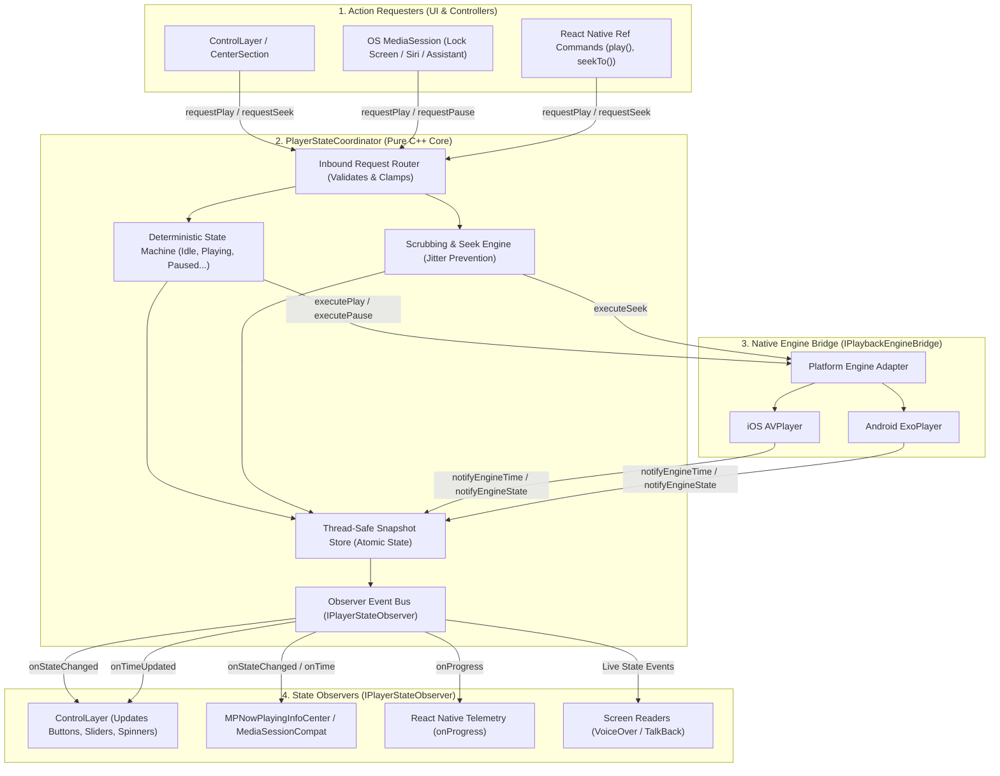
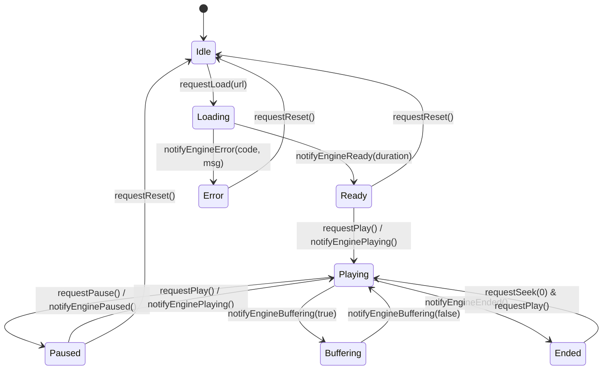
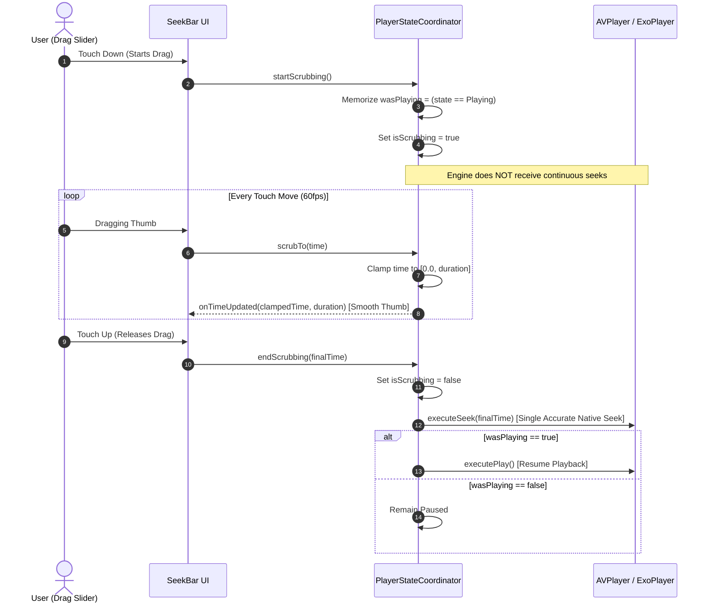
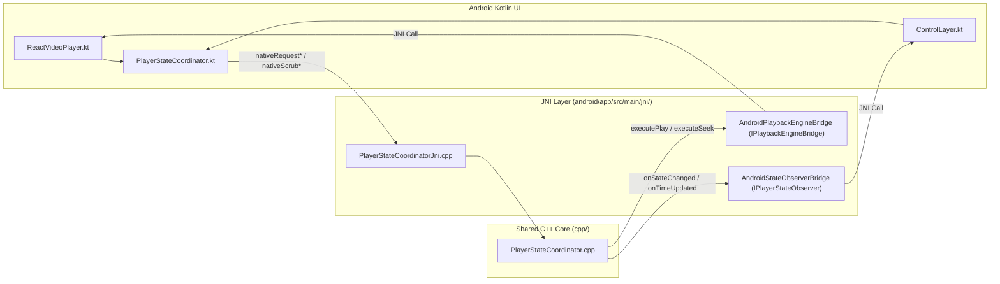

# Headless State Manager Architecture Specification (`state_manager_arch.md`)

## 1. Overview & Pure Headless Philosophy

The **`PlayerStateCoordinator`** is the cross-platform, headless brain of the video player. It is written in **pure standard C++ (C++17)** with **zero UI dependencies** (no UIKit, no Android View, no graphics, no layout logic).

### Core Architectural Separation:
- **No UI Knowledge**: It does not know what a button, slider, frame, or screen is.
- **Single Source of Truth**: Eliminates state desynchronization between native engines (`AVPlayer` / `ExoPlayer`), native UI controls, OS media widgets, and React Native.
- **Symmetrical Gateway**: Acts as a two-way coordinator:
  1. Translates user requests (play, pause, scrub) into verified engine actions.
  2. Ingests raw engine events (KVO / `Player.Listener`) and dispatches clean, thread-safe updates to observers.

---

## 2. High-Level Architecture Diagram



---

## 3. Core Data Types & Snapshot Store

All player state is captured in immutable, thread-safe snapshots:

```cpp
enum class PlaybackState {
    Idle,       // Initialized / Reset, no media active
    Loading,    // Media manifest / buffer requested
    Ready,      // Metadata loaded, duration known, ready to play
    Playing,    // Audio/video clock active, frames rendering
    Paused,     // Playback paused at current timestamp
    Buffering,  // Clock paused waiting for network buffer
    Ended,      // Playback reached duration
    Error       // Unrecoverable playback failure
};

struct PlayerSnapshot {
    PlaybackState state = PlaybackState::Idle;
    double currentTime = 0.0;
    double duration = 0.0;
    double bufferedTime = 0.0;
    float playbackRate = 1.0f;
    float volume = 1.0f;
    bool isMuted = false;
    bool isScrubbing = false;
    int errorCode = 0;
    std::string errorMessage = "";
};
```

---

## 4. Deterministic State Machine Rules

The state machine validates every transition to prevent impossible states (e.g. going from `Idle` to `Playing` without loading):



---

## 5. Scrubbing Engine & Jitter Prevention

Scrubbing video on touch devices frequently suffers from race conditions when touch events and native player time updates clash. The coordinator solves this with a **three-phase scrubbing lifecycle**:



---

## 6. Symmetrical Interfaces

### A. Inbound User Requests (`ICoordinatorCommands`)
Called by `ControlLayer`, React Native commands, and OS Media Sessions:

```cpp
class ICoordinatorCommands {
public:
    virtual ~ICoordinatorCommands() = default;

    virtual void requestPlay() = 0;
    virtual void requestPause() = 0;
    virtual void requestTogglePlayPause() = 0;
    virtual void requestSeek(double seconds) = 0;
    virtual void requestStepSeek(double deltaSeconds) = 0; // e.g. +15s, -15s

    virtual void startScrubbing() = 0;
    virtual void scrubTo(double seconds) = 0;
    virtual void endScrubbing(double finalSeconds) = 0;

    virtual void requestPlaybackRate(float rate) = 0;
    virtual void requestVolume(float volume) = 0;
    virtual void requestMute(bool muted) = 0;
    virtual void requestReset() = 0;
};
```

### B. Inbound Engine Notifications (`IEngineEventListener`)
Called by `AVPlayerAdapter` (iOS) and `ExoPlayerAdapter` (Android):

```cpp
class IEngineEventListener {
public:
    virtual ~IEngineEventListener() = default;

    virtual void notifyEngineState(PlaybackState state) = 0;
    virtual void notifyEngineTime(double currentTime) = 0;
    virtual void notifyEngineDuration(double duration) = 0;
    virtual void notifyEngineBuffer(double bufferedTime) = 0;
    virtual void notifyEngineError(int errorCode, const std::string& message) = 0;
};
```

### C. Outbound Engine Bridge (`IPlaybackEngineBridge`)
Implemented by platform native layers to execute real player actions:

```cpp
class IPlaybackEngineBridge {
public:
    virtual ~IPlaybackEngineBridge() = default;

    virtual void executePlay() = 0;
    virtual void executePause() = 0;
    virtual void executeSeek(double seconds) = 0;
    virtual void executePlaybackRate(float rate) = 0;
    virtual void executeVolume(float volume) = 0;
    virtual void executeMute(bool muted) = 0;
};
```

### D. Outbound Observer Interface (`IPlayerStateObserver`)
Implemented by UI controls, OS Media Sessions, and React Native event emitters:

```cpp
class IPlayerStateObserver {
public:
    virtual ~IPlayerStateObserver() = default;

    virtual void onStateChanged(PlaybackState newState, PlaybackState oldState) = 0;
    virtual void onTimeUpdated(double currentTime, double duration) = 0;
    virtual void onBufferUpdated(double bufferedTime, double percentage) = 0;
    virtual void onMuteChanged(bool isMuted, float volume) = 0;
    virtual void onPlaybackRateChanged(float rate) = 0;
    virtual void onError(int errorCode, const std::string& message) = 0;
};
```

#### Memory Safety: Weak Pointer Observer Subscription
To prevent dangling pointers and `EXC_BAD_ACCESS` crashes when views unmount or remount dynamically in React Native:
- `PlayerStateCoordinator` maintains observers as `std::vector<std::weak_ptr<IPlayerStateObserver>>`.
- Subscribing views (`RCTPlayPauseButton`, `ControlLayer`, etc.) retain their observer via `std::shared_ptr`.
- During state and timing dispatch, the coordinator promotes each `weak_ptr` to `shared_ptr` via `.lock()`. If a view has been deallocated, `lock()` safely yields `nullptr`, and the dead reference is pruned automatically with **zero risk of bad memory access**.

---


## 7. Project File Structure (`cpp/`)

The pure C++ state coordinator files reside in the cross-platform **`cpp/`** root directory:

```
Player/
  ├── cpp/
  │    ├── PlayerTypes.hpp              // Enums (PlaybackState) and PlayerSnapshot struct
  │    ├── IPlayerStateObserver.hpp     // Observer interface for UI and OS services
  │    ├── IPlaybackEngineBridge.hpp    // Bridge interface to AVPlayer & ExoPlayer
  │    ├── PlayerStateCoordinator.hpp   // Coordinator class declaration
  │    ├── PlayerStateCoordinator.cpp   // Coordinator implementation (thread-safe, mutex)
  │    └── PlayerRegistry.hpp           // Thread-safe singleton registry mapping playerId -> coordinator
```

- **iOS / tvOS**: Included directly into Objective-C++ (`.mm`) files.
- **Android / Android TV**: Compiled via CMake / NDK (`src/main/jni/CMakeLists.txt`) and linked via JNI (`PlayerStateCoordinatorJni.cpp`).

### Registry Role in Headless Coordination:
The `PlayerRegistry` singleton allows independent UI primitives (such as `<VideoPlayer.PlayPauseButton>` or `<VideoPlayer.SeekBar>`) to look up their assigned `PlayerStateCoordinator*` via `playerId` in constant time `O(1)` with thread-safe mutex locking, completely bypassing JavaScript bridge round-trips.

---

## 8. Android C++ Parity Architecture (JNI Bridge)

To achieve 100% logic and state parity with iOS, Android connects directly to `PlayerStateCoordinator.cpp`:



1. **JNI Layer (`PlayerStateCoordinatorJni.cpp`)**:
   - `AndroidPlaybackEngineBridge`: Implements `IPlaybackEngineBridge` and invokes ExoPlayer methods on the Android Main Looper.
   - `AndroidStateObserverBridge`: Implements `IPlayerStateObserver` and dispatches state updates (`PlaybackState`) and 60fps scrub timecode directly to `ControlLayer.kt`.
2. **CMake Build Target (`src/main/jni/CMakeLists.txt`)**:
   - Compiles `cpp/PlayerStateCoordinator.cpp` and `PlayerStateCoordinatorJni.cpp` directly into React Native's `appmodules` native library target.
3. **Kotlin Facade (`com.player.core.PlayerStateCoordinator.kt`)**:
   - Exposes clean Kotlin APIs for `requestPlay()`, `requestPause()`, `startScrubbing()`, `scrubTo()`, and `endScrubbing()`.

